# Before You Merge: Catch Breaking API Changes with Amazon Bedrock, AgentCore, Amazon Q Developer, and a Serverless AWS Release Gate

*By Ajay Uppu*

*Everything marked "observed" below was run in my own AWS account in `us-east-1` on November 14, 2026. Account IDs, API IDs, bucket suffixes and review nonces are blurred in every screenshot, and the account ID is written as `<ACCOUNT_ID>` (or `0444XXXXXXXX`) in text. Where something was only written and unit-tested, or only proposed, I say so in the same paragraph.*

*Code: https://github.com/Ajayuppu/before-you-merge-api-release-gate (the guide was checked against commit `37567ae`, which has 72 tests; the AgentCore validation in Section 9 ran at `fc35e03`, and the two later commits, `9e702c8` for cleanup and `37567ae` for tracing, are described in Sections 12, 14 and 15).*

---

## 1. The problem: a small diff that breaks every old client

A pull request can change an API in a way that still looks reasonable in review. Two lines of an OpenAPI document move, the diff is small, the reviewer approves, and old clients fail in production afterwards.

The example I use through this whole guide is deliberately boring, because boring is what actually ships:

- `GET /orders` returns `{"orders":[{"id":"ord-1","amount":19.95}],"next_cursor":null}`.
- In the **broken** candidate, `amount` changes from a JSON number to a string (`"19.95"`), and the required `next_cursor` property disappears from the page.
- In the **corrected** candidate, `amount` stays a number, `next_cursor` is back, and one optional field, `currency`, is added.

An old client that reads `next_cursor` to page through orders, or does arithmetic on `amount`, breaks on the first candidate and keeps working on the second. A human reading a two-line OpenAPI diff can miss that. A deterministic check can't.

This guide builds a release gate for that exact moment, on AWS, and then shows what it did when I ran it:

1. A developer submits the old OpenAPI document, the candidate document, and a small **declarative JSON fixture** (data, never code) that describes what an old client expects.
2. A serverless workflow runs a deterministic diff and a fixed, repository-owned old-client harness against a versioned mock API. Those two things, and only those two, decide `BLOCKED` or `PASS`.
3. If the verdict is `BLOCKED`, the job never reaches a human approval step. If it is `PASS`, the job waits for a **separately authenticated reviewer** to approve the exact sealed evidence.
4. Amazon Bedrock can explain the findings in plain language and propose declarative fixes. That text is advisory and non-authoritative: it is stored next to the evidence, never inside the verdict.
5. Amazon Bedrock AgentCore provides a Gateway with Cedar policy (an allow-list of three read tools and no approve tool) and a Code Interpreter that runs a fixed checker.
6. Amazon Q Developer is not a runtime dependency. I used its console chat for two design-review questions (Section 11); it did not write this code.

Approval here records a review decision. It does **not** merge and it does **not** deploy anything.

### What this guide will and will not claim

I kept three buckets strictly apart, and the guide labels each one as it goes:

- **Observed live in AWS** (screenshots and captured output): the CloudFormation deploy, the broken job being `BLOCKED`, the corrected job waiting for review and then `APPROVED`, the replay and blocked-job rejections, the developer being denied the reviewer route, two Bedrock model-comparison runs, the end-to-end Bedrock advisory on a real job, the AgentCore enable and validate runs with their console views, the 72-test suite in CloudShell, console views of the deployed services, the tracing configuration and CloudWatch Transaction Search, and two answers from Amazon Q Developer in the console.
- **Tested locally** (72 pytest tests, plus a local demo): the diff rules, the harness, evidence sealing, idempotency, crash and replay handling, DLQ separation, the AgentCore helper logic and many fail-closed edge cases. These use in-memory fakes and make no AWS calls.
- **Proposed or not done**: an AgentCore *Runtime* hosting an advisory agent, the workflow running the Code Interpreter inside it (`SPEC_CHECK_MODE=agentcore`; the live workflow uses `in-process`), an X-Ray Trace Map that lists the services (it stayed empty), and the cleanup run. These are described but are not claimed as results.

None of the numbers below are estimates: they are copied from output I captured.

---

## 2. Solution overview

The gate is a standard asynchronous serverless pipeline with a hard stop in the middle:

- A developer calls an IAM-authenticated **Amazon API Gateway** REST API. The **submit Lambda** validates and stores the three documents in **Amazon S3** and writes the job, an idempotency record and an outbox record to **Amazon DynamoDB** in a single transaction.
- A DynamoDB stream feeds a **publisher Lambda** that puts a `JobSubmitted` event on **Amazon EventBridge**. A rule sends it to an **Amazon SQS** work queue, which buffers bursts. A **dispatcher Lambda** reads the queue and starts an **AWS Step Functions** Standard execution with a deterministic, job-derived name.
- The state machine runs: `Validate → Diff → Analyze → SpecCheck → Harness → Seal → Gate`. The `Analyze` step is where Bedrock is called (when enabled). The `Harness` step calls a versioned mock API with SigV4 and runs fixed assertions.
- `Gate` is a Step Functions `Choice`. Only `PASS` continues to `WaitForReview`, a `waitForTaskToken` task. Everything else ends in `MarkBlocked`.
- A reviewer calls `GET /jobs/{jobId}/review-context` and `POST /reviews` with a different IAM role. The review Lambda checks the reviewer role, the job state, the evidence hash, a one-time nonce and expiry, then sends the Step Functions callback. `Finalize` re-checks the sealed evidence before it writes `APPROVED`.
- **Amazon CloudWatch** holds Lambda logs; Lambda functions use **AWS X-Ray** active tracing and the OpenTelemetry layer, which exports spans to the X-Ray OTLP endpoint (Section 12).
- **Amazon Bedrock AgentCore** (Gateway, Policy, Code Interpreter) is enabled by a separate, optional script and is validated separately; the section on AgentCore says exactly how it relates to the main workflow.

---

## 3. Architecture

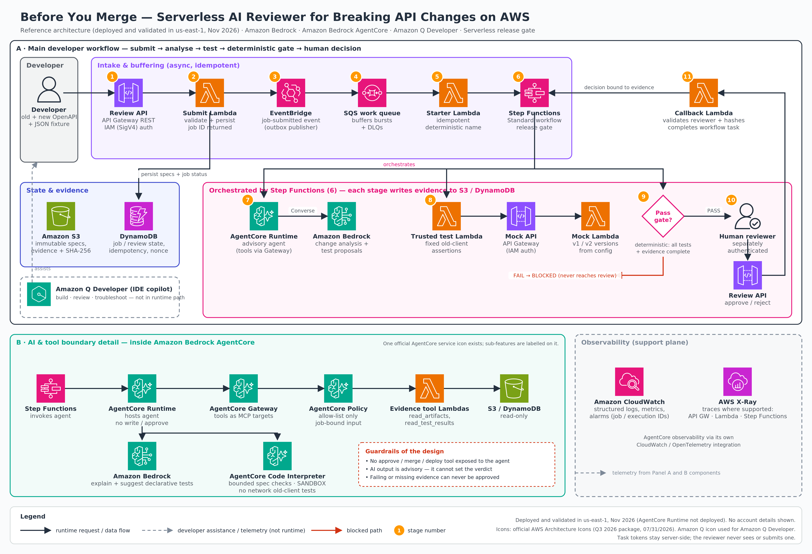

*Figure 1. The reference architecture drawn with official AWS Architecture Icons (4800×3280 PNG). Panel A is the developer workflow: Review API, Submit Lambda, EventBridge, SQS work queue, the starter (dispatcher) Lambda and Step Functions, with S3 and DynamoDB as the evidence store, a deterministic pass gate, and a separately authenticated human reviewer on the PASS branch; Panel B shows the AgentCore tool boundary and the CloudWatch and X-Ray support plane. Its AgentCore Runtime box is part of the design that I did not deploy (see Section 9); every other component was deployed and validated in us-east-1. No account details appear in it.*

### Trust boundaries

These are the boundaries the code enforces, and they are the reason the pipeline looks the way it does.

- **Developer API.** May submit specs and a fixture, and read that caller's own job. It cannot name a reviewer and never receives a task token.
- **Reviewer API.** May approve or reject the *current* sealed hash, nonce and job. It cannot approve a failing, missing, stale, expired or replayed result.
- **Deterministic diff and harness.** The only things that set the verdict. They accept data, never uploaded code or a caller-supplied URL.
- **Amazon Bedrock Converse.** Explains findings and proposes declarative edits when explicitly enabled. It cannot set the verdict or authenticate anyone.
- **AgentCore Gateway and Cedar policy.** Permit three read-style tools (`read_artifacts`, `request_spec_check`, `read_test_results`). There is no permit for approve, merge or deploy.
- **AgentCore Code Interpreter.** Runs a fixed checker text. Its result is corroboration, not the verdict. A `SANDBOX` interpreter can still reach some AWS services, so I do not call it an air gap.
- **Step Functions.** Orders the steps and holds the callback. A task token is not an approval.
- **Amazon Q Developer.** Answered two design questions for me in the console. It does not appear in the runtime path.

---

## 4. Services used, and what each one does here

- **Amazon API Gateway (REST, `AWS_IAM`).** Two REST APIs. The review API exposes `POST /jobs`, `GET /jobs/{jobId}`, `GET /jobs/{jobId}/report`, `GET /jobs/{jobId}/review-context` and `POST /reviews`. A second, mock API serves `GET /orders-v1/orders`, `GET /orders-v2-broken/orders` and `GET /orders-v2-corrected/orders`. No method is unauthenticated, including the mock routes.
- **AWS Lambda.** 15 functions in the stack: submit, status, review, review-context, publisher, dispatcher, validate, diff, analyze, spec-check, harness, seal, register-wait, finalize and expire. Runtime Python 3.12.
- **AWS Step Functions (Standard).** The release gate state machine in `cloud/statemachine.asl.json`.
- **Amazon EventBridge.** A custom event bus (logical id `ReviewBus`, deployed under the name `api-review`) and a rule, `api-review-submitted`, that matches `JobSubmitted` from `api.review` and targets the work queue. The rule has its own delivery dead-letter queue.
- **Amazon SQS.** A work queue (redrive after 5 receives, visibility timeout 182 seconds), a separate worker DLQ for failed processing, and a separate EventBridge delivery DLQ.
- **Amazon S3.** A versioned, encrypted, public-access-blocked artifact bucket holding content-addressed specs and evidence, and a second small code bucket used by the deploy script.
- **Amazon DynamoDB.** One table (`api-review-jobs`) with job, idempotency and outbox records, and a stream that feeds the publisher.
- **Amazon Bedrock (Converse API).** The optional advisory step. Default model for the stack is Amazon Nova 2 Lite; I deployed it with Anthropic Claude Haiku 4.5 for the live end-to-end advisory, and compared five models.
- **Amazon Bedrock AgentCore.** *Gateway* (MCP, IAM inbound auth), *Policy* (a policy engine in enforce mode with three Cedar permits), and *Code Interpreter* (`SANDBOX`). The *Runtime* is part of the design, not part of the validated result.
- **Amazon Q Developer.** Not in the runtime path. I asked its console chat two design questions; the questions, short excerpts of its answers and how they compare with this design are in Section 11.
- **Amazon CloudWatch and AWS X-Ray.** Each function has an explicit log group, `TracingConfig` set to `Active`, and the AWS OpenTelemetry layer, configured to export spans to the X-Ray OTLP endpoint (Section 12). The code does not import the maintenance-mode `aws-xray-sdk`. With the trace segment destination set to CloudWatch Logs, spans are stored in CloudWatch Transaction Search.
- **AWS IAM.** Two caller roles (`ApiReviewDeveloper`, `ApiReviewReviewer`) and a scripted operator user, plus per-function execution roles and two AgentCore service roles.

---

## 5. Prerequisites

- An AWS account and a region where API Gateway, Lambda, Step Functions, EventBridge, SQS, S3, DynamoDB, Bedrock and AgentCore are available. I used `us-east-1`.
- AWS CloudShell in that region (it already has the AWS CLI and Python). Everything in this guide ran there.
- Python 3.11 or newer for the local tests (the repository declares `requires-python >= 3.11`). The local run in this guide used Python 3.13.5 and pytest 9.2.
- The current regional **AWS Distro for OpenTelemetry Lambda layer** ARN for Python. I used the public layer `arn:aws:lambda:us-east-1:615299751070:layer:AWSOpenTelemetryDistroPython:33`. The 12-digit number inside that ARN is the layer publisher's account, not mine. Look the ARN up again for your region and architecture before you deploy.
- Permission to create the stack, IAM roles and users, Bedrock model access for any model you want to try, and AgentCore resources. I ran as the account root user in CloudShell, which matters for one troubleshooting item below (root is not an accepted API caller, so the stack uses dedicated roles).
- `pytest` for the tests: `pip install pytest`.

Every script that creates or deletes resources refuses to run unless you set an explicit confirmation variable, so a stray paste cannot create anything:

- `CONFIRM_DEPLOY=yes` for `scripts/deploy_cloudshell.sh`
- `CONFIRM_IDENTITIES=yes` for `scripts/setup_demo_identities.sh`
- `CONFIRM_AGENTCORE=yes` for `scripts/enable_agentcore.sh`
- `CONFIRM_VALIDATE=yes` for `scripts/validate_agentcore.sh`
- `CONFIRM_CLEANUP=yes` for `scripts/cleanup_cloudshell.sh`

---

## 6. Step-by-step walkthrough

### Step 1. Clone the repository and run the tests

In CloudShell:

```bash
rm -rf ~/api-review && git clone https://github.com/Ajayuppu/before-you-merge-api-release-gate ~/api-review && cd ~/api-review && git log --oneline -n 3 && ls
pip install pytest
cd ~/api-review && python3 -m pytest -q 2>&1 | tail -n 15
```

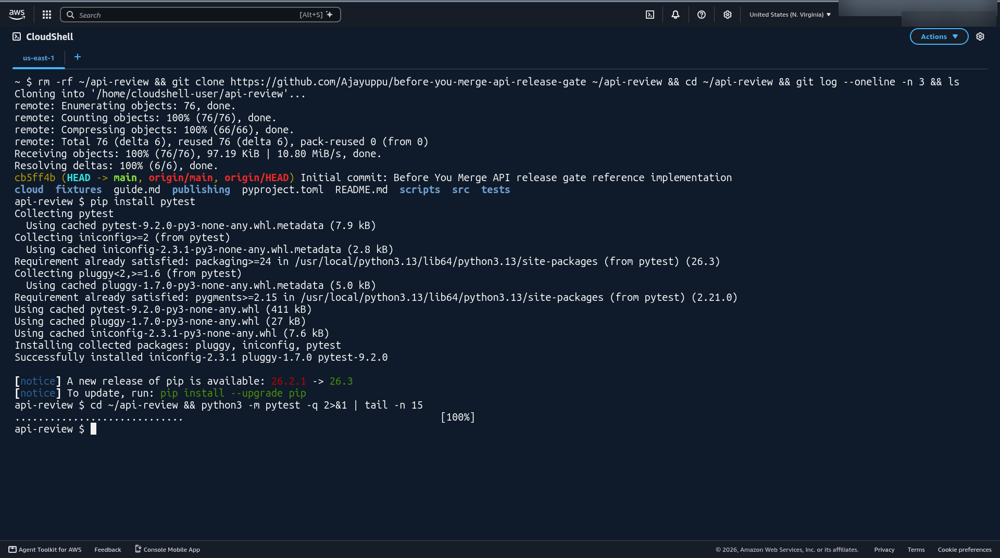

*Figure 2. CloudShell in `us-east-1` right after cloning the repository into `~/api-review`. The log shows the checkout at the initial commit (`cb5ff4b`), the file listing (`cloud`, `fixtures`, `guide.md`, `publishing`, `pyproject.toml`, `README.md`, `scripts`, `src`, `tests`), `pytest` installing, and the suite finishing at 100% with only passing dots. This was the first checkout, before the later fixes in this guide, so it is the original suite, not the final 72 (see the next figure). The account menu in the top-right corner is blurred.*

The final repository (commit `37567ae`) has 72 tests. I re-ran them locally for this guide (Python 3.13.5, pytest 9.2) and got `72 passed in 1.64s`. In CloudShell, in a virtual environment with pytest installed, the suite at commit `9e702c8` ("Empty versioned buckets on cleanup and record the live validation") printed `72 passed in 0.91s`:

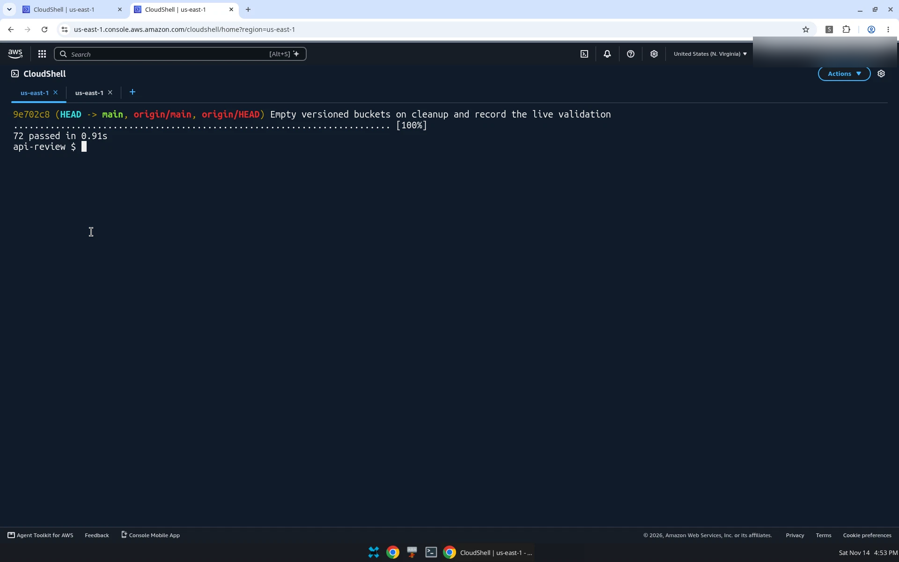

*Figure 3. CloudShell in `us-east-1` with the one-line `git log` entry for commit `9e702c8` (`HEAD -> main, origin/main, origin/HEAD`, "Empty versioned buckets on cleanup and record the live validation"), a progress line of dots ending at 100%, and `72 passed in 0.91s`. It proves the final suite passes in the same environment I deployed from, as opposed to the earlier checkout in the previous figure. The account menu is blurred.*

Per file, the 72 tests break down as: `test_local_reference.py` 26, `test_agentcore_setup.py` 13, `test_runtime_clients.py` 11, `test_advisory_parse.py` 4, `test_aws_demo_cli.py` 4, `test_cleanup_versions.py` 4, `test_advisory_report.py` 3, `test_cloud_handlers.py` 2, `test_compare_bedrock_models.py` 2, `test_dynamo_numbers.py` 2 and `test_template.py` 1.

These tests call no AWS API. They cover the diff rules (including the request-versus-response direction), the harness, evidence sealing, idempotency, a crash after `StartExecution`, a crash before and after the review callback, the two DLQs being distinct, the policy mirror that denies authority and cross-job arguments, the Bedrock parser and report shaping, the AgentCore helper logic, the versioned-bucket cleanup helpers, and the CloudFormation template contract (including the tracing variables). They are evidence about the *logic*. The live steps below are what show it working in AWS.

You can also run the local demo, which walks three orders journeys in memory:

```bash
bash scripts/run_local_tests.sh
bash scripts/run_local_demo.sh
```

The demo output from my run (the local identity is an explicit simulation, never production auth, and the banner says so):

```text
apireview 1.0.0 local demo
SIMULATION: this process is not production authentication and is not AWS IAM. Identity is taken from an explicit local principal, never from a reviewer field in the request body.

== healthy ==
status: WAITING_REVIEW
verdict: PASS
harnessPassed: True
breakingFindingCount: 0
checker.authoritative: False
checker.ok: True
checker.mode: in-process
advisory.includedInVerdict: False
review: APPROVED

== broken ==
status: BLOCKED
verdict: BLOCKED
harnessPassed: False
breakingFindingCount: 2
breaking response.property.removed.required: Removed response property next_cursor. It was required, so old clients that read it will break.
breaking response.type.changed: Response type changed from number to string. Old clients that decode the previous JSON type will break.
assertion failed amount: amount is str '19.95'; old clients require a JSON number and booleans are rejected
assertion failed next_cursor: next_cursor is missing; old clients require the field
checker.authoritative: False
checker.ok: False
checker.mode: in-process
advisory.includedInVerdict: False
review rejected: fail_closed: job is not waiting for review (BLOCKED)

== corrected ==
status: WAITING_REVIEW
verdict: PASS
harnessPassed: True
breakingFindingCount: 0
checker.authoritative: False
checker.ok: True
checker.mode: in-process
advisory.includedInVerdict: False
review: APPROVED

executions started: 3
```

(The demo also prints an evidence hash per scenario; those change on every run because each job gets a random id, so I left them out.) This is the same story the cloud run tells later: healthy passes, broken is blocked and cannot be approved, corrected passes and can be approved once.

### Step 2. Understand the three inputs

The repository ships three OpenAPI 3.0 documents under `fixtures/`, one declarative client fixture, and one mock response body per version. The fixture describes what an old client sends and expects. It is JSON and nothing else:

```json
{
  "fixtureVersion": "1",
  "name": "orders-old-client",
  "cases": [
    {
      "id": "list-orders",
      "method": "GET",
      "path": "/orders",
      "query": {},
      "expect": {
        "status": 200,
        "body": {
          "orders": [ { "id": "ord-1", "amount": 19.95 } ],
          "next_cursor": null
        },
        "requiredPaths": ["orders", "orders[0].id", "orders[0].amount", "next_cursor"]
      }
    }
  ]
}
```

The only difference between `orders-v1.openapi.json` and the **broken** candidate is three edits: `info.version` goes `1.0.0 → 2.0.0`, `amount.type` goes `number → string`, and `next_cursor` is removed from both `required` and `properties`. The **corrected** candidate differs from v1 by only `info.version` (`1.0.0 → 1.1.0`) and one added optional `currency` string. The mock API returns, for the broken version, a body with `"amount": "19.95"` and no `next_cursor`; for the corrected version, a numeric `19.95`, `next_cursor: null`, and `currency: "USD"`.

The fixture is validated before use. Keys such as `code`, `script`, `url`, `callback`, `principal`, `reviewer`, `role` and `taskToken` are forbidden, and strings that look like `http://`, `https://`, `s3://` or `file://` are rejected (`limits.py`). Specs are limited to a documented OpenAPI 3.0 subset with local `#/components/schemas` references; external references are refused. JSON booleans are not treated as numbers (Python's `bool` is a subclass of `int`, and the code handles that), and money values are parsed as `Decimal`, so `19.95` never passes through binary floating point.

### Step 3. The deterministic diff

The diff is the first of the two components that can set a verdict. The central idea is that **compatibility has a direction**. Removing a required *response* property breaks old clients. Adding a required *request* property breaks callers. Adding an optional response property breaks no one. The code keeps those rules separate:

```python
def _diff_object(old: Schema, new: Schema, path: str, direction: str, findings: list[dict[str, str]]) -> None:
    for name in sorted(set(old.properties) - set(new.properties)):
        required = name in old.required
        if direction == "response":
            rule = "response.property.removed.required" if required else "response.property.removed.optional"
            _add(
                findings,
                severity="breaking",
                rule=rule,
                path=f"{path}/properties/{name}",
                message=(
                    f"Removed response property {name}. "
                    + (
                        "It was required, so old clients that read it will break."
                        if required
                        else "It was optional, and old clients that read it can still break."
                    )
                ),
            )
        else:
            _add(findings, severity="info", rule="request.property.removed",
                 path=f"{path}/properties/{name}",
                 message=f"Removed request property {name}. The server accepts a smaller caller payload.")
    for name in sorted(set(new.properties) - set(old.properties)):
        required = name in new.required
        if direction == "response":
            rule = "response.property.added.required" if required else "response.property.added.optional"
            ...  # severity "info": old clients ignore a new response field
        elif required:
            _add(findings, severity="breaking", rule="request.property.added.required", ...)
```

A type change on a response schema produces `response.type.changed` with severity `breaking`. The test `test_request_and_response_required_directions_differ` locks the direction rules in.

### Step 4. The trusted harness

The second verdict-setting component is the old-client harness. It runs fixed assertions that live in the repository. The fixture only supplies expected values; it is never executed. The cloud transport can call only the configured mock host and an allow-listed route for the selected version enum, with redirects disabled, a 3-second timeout and a 64 KiB response cap:

```python
def build_plan(mock_version: str, *, host: str, stage: str) -> HarnessPlan:
    if mock_version not in MOCK_VERSIONS:
        raise ValidationFailed("mockVersion is not on the allowlist")
    if not host or "://" in host or "/" in host or " " in host:
        raise ValidationFailed("mock host must be a configured hostname, not a URL")
    ...
    path = CLOUD_MOCK_ROUTES[mock_version]
    url = f"https://{host}/{stage}{path}"
    parts = urlsplit(url)
    if parts.scheme != "https" or parts.hostname != host or parts.query or parts.fragment:
        raise ValidationFailed("mock URL failed the allowlist check")
    ...
    return HarnessPlan(mock_version=mock_version, target=MockTarget(..., allow_redirects=False))
```

The two assertions that matter for our example are `amount` and `next_cursor`:

```python
amount = order.get("amount")
if isinstance(amount, bool) or not is_json_number(amount):
    kind = type(amount).__name__
    assertions.append(_assertion("amount", False,
        f"amount is {kind} {amount!r}; old clients require a JSON number and booleans are rejected"))
...
present = "next_cursor" in body
if not present:
    assertions.append(_assertion("next_cursor", False,
        "next_cursor is missing; old clients require the field"))
```

A truncated or incomplete harness result also fails closed: `complete` must be true, there must be at least one case, and every case must pass.

### Step 5. Evidence sealing and the verdict function

After the harness runs, the `Seal` step builds an evidence bundle and hashes the canonical bytes of the whole thing: job id, both spec hashes, fixture hash, mock version, findings, harness result, checker summary, the advisory *hashes*, the agent trace and the verdict. Change any byte afterwards and the hash no longer matches.

The verdict function is short enough to read in one screen, and the thing to notice is what is *not* a parameter:

```python
def authoritative_verdict(findings: list[dict[str, Any]], harness: dict[str, Any] | None) -> str:
    """AI output is intentionally not a parameter."""
    if not harness or not harness.get("complete") or not harness.get("passed"):
        return "BLOCKED"
    if not harness.get("cases"):
        return "BLOCKED"
    if breaking_findings(findings):
        return "BLOCKED"
    return "PASS"
```

No model text, no checker result and no agent output can reach this function. The test `test_model_output_cannot_change_the_verdict` checks exactly that.

### Step 6. The workflow definition

The state machine is a Step Functions Standard workflow. Each step retries transient Lambda errors with backoff and catches everything else into `FailClosed`. The part that implements the hard gate is small:

```json
"Gate": {
  "Type": "Choice",
  "Choices": [ { "Variable": "$.verdict", "StringEquals": "PASS", "Next": "WaitForReview" } ],
  "Default": "MarkBlocked"
},
"MarkBlocked": { "Type": "Succeed" },
"WaitForReview": {
  "Type": "Task",
  "Resource": "arn:aws:states:::lambda:invoke.waitForTaskToken",
  "TimeoutSeconds": 3600,
  "Parameters": {
    "FunctionName": "${RegisterWaitFunctionArn}",
    "Payload": {
      "evidenceHash.$": "$.evidenceHash",
      "jobId.$": "$.jobId",
      "taskToken.$": "$$.Task.Token"
    }
  },
  "ResultPath": "$.review",
  "Catch": [
    { "ErrorEquals": ["States.Timeout"], "ResultPath": "$.error", "Next": "Expire" },
    { "ErrorEquals": ["States.ALL"], "ResultPath": "$.error", "Next": "FailClosed" }
  ],
  "Next": "Finalize"
}
```

`MarkBlocked` is a `Succeed` state on purpose: recording a block is a *completed* workflow, not an approval. Anything that is not exactly `PASS` takes the default branch. The task token is handed to a Lambda that stores it server-side; it is never returned to a caller. After the reviewer's callback, `Finalize` re-checks the evidence and only then writes `APPROVED`.

### Step 7. Intake, idempotency and the outbox

The submit Lambda makes one DynamoDB transaction that writes the job, an idempotency record keyed by caller and `Idempotency-Key`, and an outbox record. This closes the gap between "wrote the job" and "published the event":

```python
table.put_new(
    [
        (_job_pk(job_id), job),
        (_idem_pk(principal.subject, idempotency_key),
         {"jobId": job_id, "payloadHash": loaded.payload_hash, "status": "IDEMPOTENCY", "subject": principal.subject}),
        (_outbox_pk(event_id), {"eventId": event_id, "jobId": job_id, "status": "PENDING"}),
    ]
)
```

Submitting the same key with the same payload returns the same job; the same key with a different payload returns a conflict. The caller identity comes from `requestContext.identity.userArn`, set by API Gateway's IAM authorization, and a body that tries to carry authority fields is rejected.

The EventBridge rule and queue wiring in the generated template:

```json
"SubmitRule": {
  "Type": "AWS::Events::Rule",
  "Properties": {
    "EventBusName": { "Ref": "ReviewBus" },
    "EventPattern": { "detail-type": ["JobSubmitted"], "source": ["api.review"] },
    "Targets": [ { "Arn": { "Fn::GetAtt": ["WorkQueue", "Arn"] },
                   "DeadLetterConfig": { "Arn": { "Fn::GetAtt": ["EventBridgeDlq", "Arn"] } },
                   "Id": "WorkQueue" } ]
  }
},
"WorkQueue": {
  "Type": "AWS::SQS::Queue",
  "Properties": {
    "RedrivePolicy": { "deadLetterTargetArn": { "Fn::GetAtt": ["WorkerDlq", "Arn"] }, "maxReceiveCount": 5 },
    "VisibilityTimeout": 182
  }
}
```

The visibility timeout, 182 seconds, is `6 × 30 + 2`: six times the dispatcher's 30-second timeout plus its 2-second batch window, which is the documented rule for SQS-triggered Lambda. A test (`test_visibility_timeout_matches_the_documented_formula`) keeps the numbers in step. The EventBridge delivery DLQ and the worker redrive DLQ are different queues on purpose: one covers failed delivery into SQS, the other covers repeated failures in the dispatcher. EventBridge does not start the workflow; only the dispatcher does, after a conditional claim and with a deterministic execution name (`review-<jobId>`), so a replayed event cannot start a second logical run.

### Step 8. Deploy the stack

This is the deploy command I used in CloudShell. The first attempt (below) piped to `tee ~/deploy.log`; for later redeploys I redirected to a numbered log, `> ~/deployN.log 2>&1`, so I could grep it afterwards:

```bash
cd ~/api-review && CONFIRM_DEPLOY=yes REGION=us-east-1 \
  OTEL_LAYER_ARN='arn:aws:lambda:us-east-1:615299751070:layer:AWSOpenTelemetryDistroPython:33' \
  bash scripts/deploy_cloudshell.sh 2>&1 | tee ~/deploy.log
```

The script packages the Lambda code (`build/lambda.zip`, 37 entries), regenerates `cloud/template.deploy.json`, creates a code bucket named `api-review-code-<ACCOUNT_ID>-us-east-1` if it is missing, uploads the zip under a content-addressed key, and runs `aws cloudformation deploy` with `CAPABILITY_IAM` and `--s3-bucket`:

```bash
CODE_KEY="api-review/lambda-$(sha256sum "$ROOT/build/lambda.zip" | cut -c1-16).zip"
...
aws cloudformation deploy \
  --region "$REGION" --stack-name "$STACK" \
  --template-file "$ROOT/cloud/template.deploy.json" \
  --capabilities CAPABILITY_IAM --s3-bucket "${BUCKET}" --s3-prefix api-review/templates \
  --parameter-overrides \
    "LambdaCodeBucket=${BUCKET}" "LambdaCodeKey=${CODE_KEY}" "OtelLayerArn=${OTEL_LAYER_ARN}" \
    "ProjectName=${PROJECT_NAME:-api-review}" \
    "BedrockAdvisory=${BEDROCK_ADVISORY:-disabled}" \
    "BedrockModelId=${BEDROCK_MODEL_ID:-us.amazon.nova-2-lite-v1:0}" \
    "DeploymentNonce=${DEPLOYMENT_NONCE:-$(date +%s)}"
```

My first attempt failed, and that is worth showing because it is the first thing you will hit too:

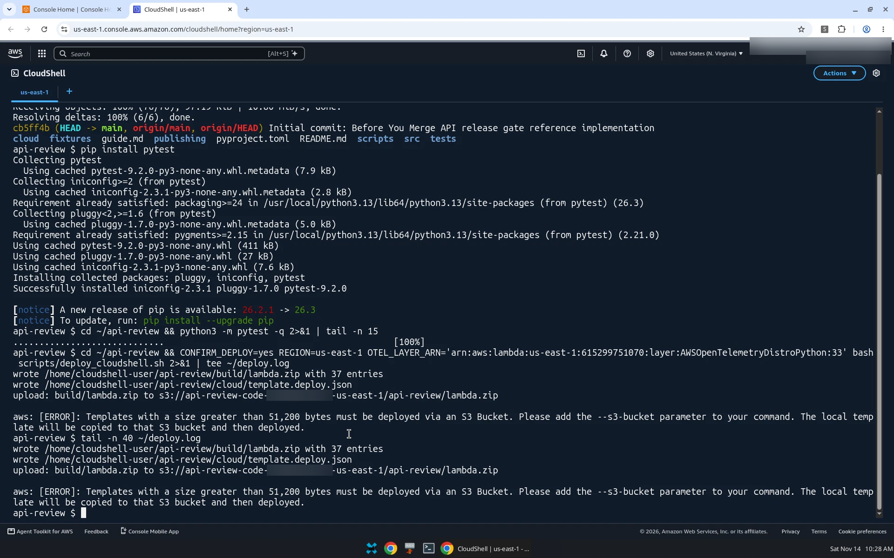

*Figure 4. The first deploy attempt. The script packaged `build/lambda.zip` (37 entries), wrote `cloud/template.deploy.json`, uploaded the zip to the code bucket (the bucket suffix after `api-review-code-` is blurred), and then `aws cloudformation deploy` stopped with: "Templates with a size greater than 51,200 bytes must be deployed via an S3 Bucket. Please add the --s3-bucket parameter to your command." The command line above it shows the `CONFIRM_DEPLOY=yes` guard and the layer ARN. This is a real failure, not a staged one, and the account menu is blurred.*

The fix (commit `955fb9e`) is the `--s3-bucket` / `--s3-prefix` pair you see in the script above; the template upload in the successful run is 94,421 bytes.

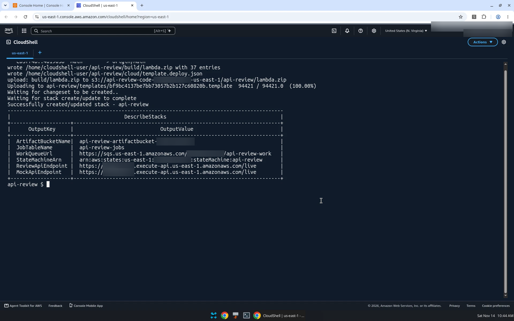

*Figure 5. A successful deploy. The log shows the template uploaded to `api-review/templates/...` (94421 / 94421.0, 100.00%), "Waiting for changeset to be created", "Waiting for stack create/update to complete" and "Successfully created/updated stack - api-review". The `DescribeStacks` table lists the six outputs: `ArtifactBucketName`, `JobTableName` (`api-review-jobs`), `WorkQueueUrl`, `StateMachineArn`, `ReviewApiEndpoint` and `MockApiEndpoint`; the two API endpoints end in the `live` stage. Account IDs, the artifact bucket suffix and both API IDs are blurred.*

I redeployed several times while fixing the issues in the troubleshooting section (deploy logs `deploy7`, `deploy8` and `deploy9` all ended with `Successfully created/updated stack`). The check I used each time was:

```bash
grep 'Successfully created/updated stack' ~/deployN.log
```

### Step 9. Create the caller identities (and why you need them)

CloudShell runs as the account root user, and the API's IAM-based caller check rejects root: `POST /jobs` answered `authorization_failed` with "unsupported caller ARN shape" (see the troubleshooting section). So the repo includes a script that creates an operator IAM user and two roles, and writes CLI profiles for them:

```bash
CONFIRM_IDENTITIES=yes REGION=us-east-1 bash scripts/setup_demo_identities.sh
```

The roles are the whole point of role separation. The developer role may call `POST /jobs` and `GET /jobs/*`, and has an **explicit deny** on the two reviewer routes. The reviewer role may call only the reviewer routes:

```python
developer = {
    "Version": "2012-10-17",
    "Statement": [
        {"Effect": "Allow", "Action": "execute-api:Invoke",
         "Resource": [f"{base}/live/POST/jobs", f"{base}/live/GET/jobs/*"]},
        {"Effect": "Deny", "Action": "execute-api:Invoke",
         "Resource": [f"{base}/live/GET/jobs/*/review-context", f"{base}/live/POST/reviews"]},
    ],
}
reviewer = {
    "Version": "2012-10-17",
    "Statement": [
        {"Effect": "Allow", "Action": "execute-api:Invoke",
         "Resource": [f"{base}/live/GET/jobs/*/review-context", f"{base}/live/POST/reviews"]},
    ],
}
```

The operator user can do exactly one thing: `sts:AssumeRole` on those two roles. The script writes three CLI profiles: `api-review-operator`, `api-review-developer` (session name `dev-ada`) and `api-review-reviewer` (session name `rev-ben`). Those session names show up in the ARNs in the screenshots below.

On the Lambda side, the caller identity is read from the API Gateway request context only:

```python
context = event.get("requestContext")
...
user_arn = identity.get("userArn")
...
role_name = _role_name(user_arn)
if not _role_allowed(role_name, expected_role_name):
    raise AuthorizationFailed("caller IAM role is not allowed for this method")
```

and the review handler additionally refuses a reviewer who is the job's owner (`submitter cannot review their own job`).

### Step 10. A failing (breaking) case: the broken candidate is BLOCKED

Submit the old document, the broken candidate and the fixture as the developer. The client script signs the request with SigV4 using the developer profile and saves the returned job id to `~/.api-review-last-job`:

```bash
python3 scripts/aws_demo.py --region us-east-1 --profile api-review-developer submit \
  --old fixtures/orders-v1.openapi.json \
  --new fixtures/orders-v2-broken.openapi.json \
  --fixture fixtures/orders-client.fixture.json \
  --mock-version orders-v2-broken \
  --idempotency-key cloud-broken-0003
python3 scripts/aws_demo.py --region us-east-1 --profile api-review-developer status --job-id last
python3 scripts/aws_demo.py --region us-east-1 --profile api-review-developer report --job-id last
```

The idempotency key I used for the job below was `cloud-broken-0003`. You will see the line `profile cannot read stack outputs; the lookup used ambient credentials` in several screenshots. That is the script working as designed: it looks up the API endpoint from the stack outputs, the developer and reviewer roles deliberately cannot read CloudFormation, so that one lookup falls back to the ambient CloudShell credentials, while the request itself is still signed with the profile.

**Result (job `job_d91438ad6d97f70467bd`):** status `BLOCKED`, verdict `BLOCKED`, evidence hash `2ed375106473bd023752e7147bc01bb1d03a1ada2c9208188f5e6fada07ee75e`, with these findings:

- `060d1de06bb5e2b6`, `info.version.changed`, severity `info`, `/info/version`: `1.0.0 → 2.0.0`.
- `83ff6f7d10e433e2`, `response.property.removed.required`, severity `breaking`, `GET /orders`, property `next_cursor`: "Removed response property next_cursor. It was required, so old clients that read it will break."
- `19f9694cfa9fe6d7`, `response.type.changed`, severity `breaking`, `GET /orders`, `orders[].amount`: `number → string`: "Old clients that decode the previous JSON type will break."

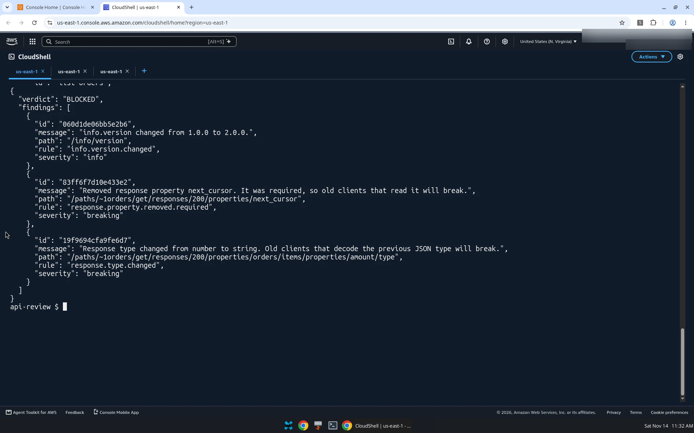

*Figure 6. The report for the broken candidate, read from the deployed API in CloudShell. The JSON shows `"verdict": "BLOCKED"` and three findings with their ids, rules and JSON-pointer paths: the informational version bump, the removed required `next_cursor`, and the `amount` type change from number to string, both marked `breaking`. This proves the deterministic diff catches both breaks in AWS and that the job is blocked. The account menu at the top is blurred; the job's owner ARN is not in view.*

A blocked job never enters the human-review wait, so there is nothing for a reviewer to approve. I tested that directly in Step 13.

### Step 11. The corrected candidate passes and waits for review

Same command shape, with the corrected document, the matching mock version and a new key (`cloud-corrected-0001`):

```bash
python3 scripts/aws_demo.py --region us-east-1 --profile api-review-developer submit \
  --old fixtures/orders-v1.openapi.json \
  --new fixtures/orders-v2-corrected.openapi.json \
  --fixture fixtures/orders-client.fixture.json \
  --mock-version orders-v2-corrected \
  --idempotency-key cloud-corrected-0001
```

**Result (job `job_834a7b9a23c87ce25a83`):** status `WAITING_REVIEW`, verdict `PASS`, evidence hash `c9075e51704fa7889e906dc0539ed2f588822f47a455417fe39368d74acbe551`. Its findings are the benign `info.version.changed` (`1.0.0 → 1.1.0`) and `875b695fc116389a`, `response.property.added.optional` for `currency`: "An optional additive response field is compatible with old clients."

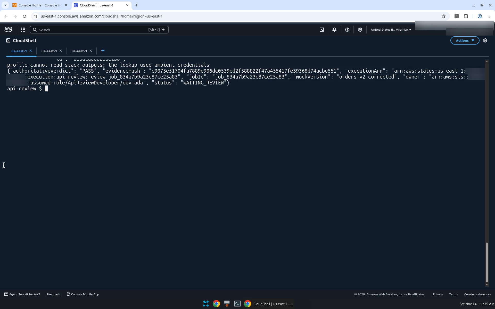

*Figure 7. The status response for the corrected candidate: `"authoritativeVerdict": "PASS"`, the evidence hash starting `c9075e51…`, `"mockVersion": "orders-v2-corrected"`, `"status": "WAITING_REVIEW"`, and an execution ARN named `review-job_834a7b9a23c87ce25a83`. The owner is `…assumed-role/ApiReviewDeveloper/dev-ada`. This shows a passing job stops at the human gate instead of auto-approving. The account ID inside the execution and owner ARNs is blurred.*

### Step 12. Review context and approval, by a different identity

The reviewer, under the reviewer profile, fetches the review context. This is the only call that returns the one-time nonce and expiry, and the submitter cannot see it. I saved the response to a file (note the `clear;` prefix I used on every CloudShell command, explained in troubleshooting):

```bash
clear; python3 scripts/aws_demo.py --region us-east-1 --profile api-review-reviewer \
  review-context --job-id job_834a7b9a23c87ce25a83 | tee ~/review-context.json
```

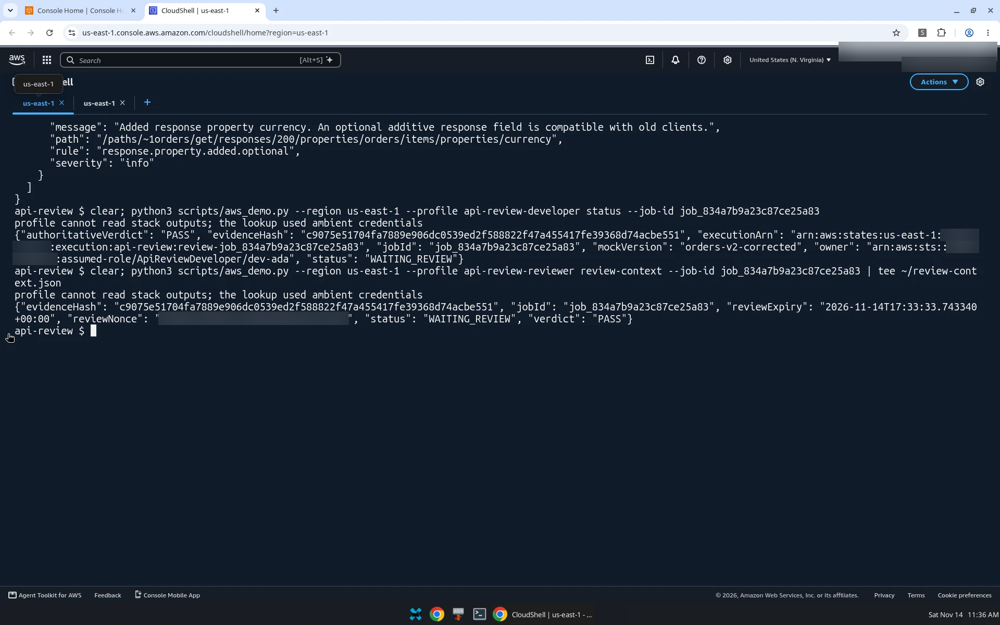

*Figure 8. Two calls back to back: `status` as `api-review-developer` returns the `WAITING_REVIEW` job owned by `…assumed-role/ApiReviewDeveloper/dev-ada`, then `review-context` as `api-review-reviewer`, saved with `tee ~/review-context.json`, returns the evidence hash, `"status": "WAITING_REVIEW"`, `"verdict": "PASS"` and a `reviewExpiry` of `2026-11-14T17:33:33.743340+00:00` (12:33 PM ET). It proves the nonce is only handed to the reviewer role, bound to this job and this evidence. The `reviewNonce` and the account ID are blurred; the last finding of the report (the optional `currency` field) is visible above.*

The approval call binds the decision to the job, the exact evidence hash and the nonce:

```bash
python3 scripts/aws_demo.py --region us-east-1 --profile api-review-reviewer review \
  --job-id job_834a7b9a23c87ce25a83 \
  --evidence-hash "$EVIDENCE_HASH" \
  --nonce "$NONCE" \
  --decision approve \
  --comment "sealed evidence matches"
```

`EVIDENCE_HASH` and `NONCE` come from the saved review-context file. The server-side review handler does the following, in order:

```python
principal = principal_from_api_gateway(event, expected_role_name=REVIEWER_ROLE_NAME, ...)
...
if principal.subject == job["owner"]:
    raise AuthorizationFailed("submitter cannot review their own job")
...
if job["status"] not in {"WAITING_REVIEW", "REVIEW_CALLBACK_PENDING"}:
    raise FailClosed(f"job is not waiting for review ({job['status']})")
if job.get("evidenceHash") != body.get("evidenceHash"):
    raise FailClosed("evidence hash does not match the sealed bundle")
if job.get("reviewNonce") != body.get("nonce"):
    raise FailClosed("review nonce does not match this job")
_recheck(job, blobs)          # rebuilds the seal from stored bytes and compares hashes
...
job = table.update(_job_pk(job["jobId"]),
    equals={"status": "WAITING_REVIEW", "evidenceHash": job["evidenceHash"], "reviewNonce": job["reviewNonce"]},
    changes={"decision": decision, "reviewer": principal.subject, "status": "REVIEW_CALLBACK_PENDING", ...})
sfn.send_task_success(taskToken=job["taskToken"], output=canonical_dumps(output))
```

The conditional update is the one-time transition. `Finalize` then checks again that the callback payload still matches the job and the seal before writing `APPROVED`.

**Observed result:** the approve call returned `{"callback":"sent","status":"REVIEW_CALLBACK_PENDING"}`, and the final job status became `APPROVED` with verdict `PASS`. The `202` response is deliberately *not* "approved": the status stays `REVIEW_CALLBACK_PENDING` until `Finalize` has re-verified the evidence.

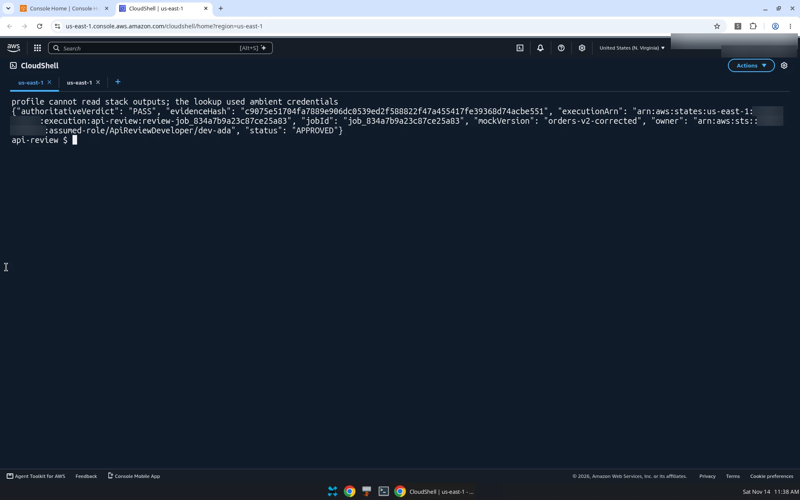

*Figure 9. The status of the corrected job after the reviewer's callback: `"authoritativeVerdict": "PASS"`, the same evidence hash (`c9075e51…`), the same execution ARN and `"status": "APPROVED"`. This shows approval landed only after the workflow finished, bound to the exact evidence that was sealed. Account IDs in the ARNs are blurred.*

### Step 13. Replay, blocked-job and role-separation checks (all fail closed)

**Replay.** Sending the same approval a second time must not approve anything again:

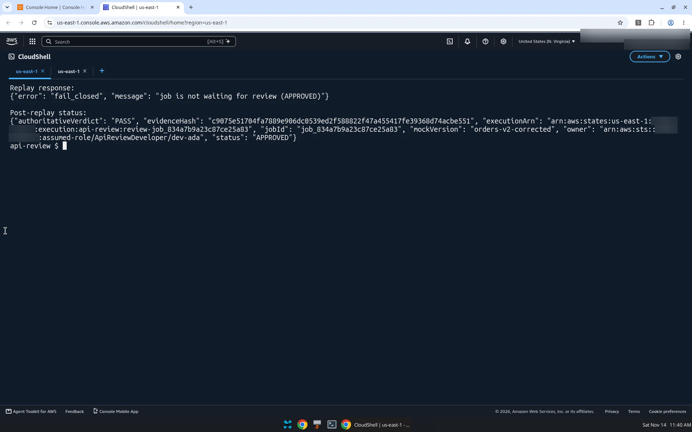

*Figure 10. The replayed approval returns `{"error": "fail_closed", "message": "job is not waiting for review (APPROVED)"}`. The "Post-replay status" below it still reads `"status": "APPROVED"` with the unchanged evidence hash and the same execution, so nothing was approved twice and nothing moved. The account ID inside the ARNs is blurred.*

**A blocked job cannot be approved.** I called both reviewer endpoints for the *broken* job:

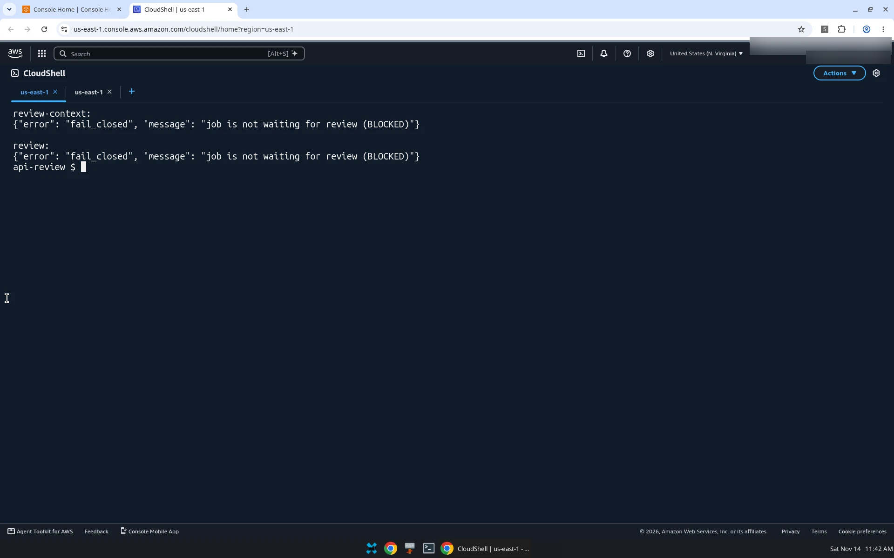

*Figure 11. For the blocked job, both `review-context` and `review` answer `{"error": "fail_closed", "message": "job is not waiting for review (BLOCKED)"}`. A failing result has no review step to approve, which is the central promise of the gate. No account details are visible in this view.*

**The developer cannot use the reviewer route.** The developer role has an explicit deny, and the call fails at API Gateway before any Lambda runs:

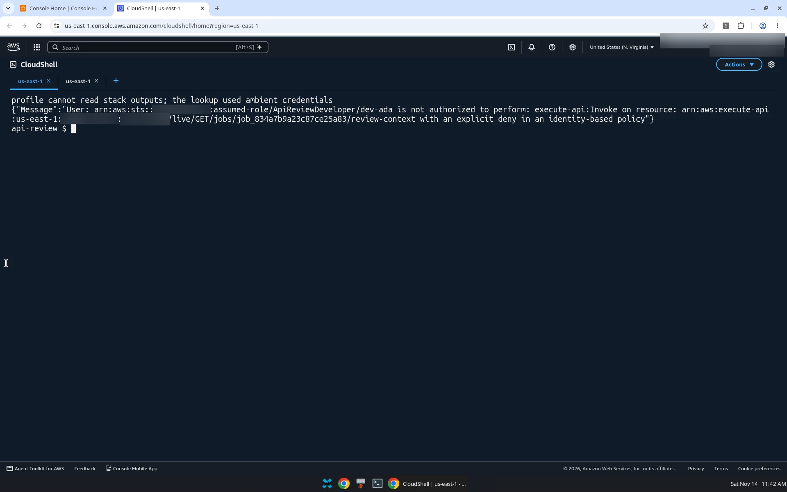

*Figure 12. Calling `review-context` as `…assumed-role/ApiReviewDeveloper/dev-ada` returns API Gateway's message that the user "is not authorized to perform: execute-api:Invoke on resource: …/live/GET/jobs/job_834a7b9a23c87ce25a83/review-context with an explicit deny in an identity-based policy". That is the identity policy from Step 9 doing its job, not application code. The account ID and API ID in the message are blurred.*

At the end of these checks, Step Functions showed both executions as `SUCCEEDED` (the broken one ended in `MarkBlocked`, the corrected one in the approval path). A `list-rules` query on the *default* event bus for rules matching `api-review` returned none, which is consistent with the rule living on the custom `ReviewBus` in the template; I did not capture a `list-rules` for that bus, so I am not presenting it as evidence. What I can say is that the jobs moved from `RECEIVED` to terminal states, which requires the outbox, publisher, EventBridge, SQS, dispatcher and Step Functions path to have worked.

**The local tests cover the cases I did not repeat live**: wrong role and submitter-as-reviewer (`test_submitter_and_wrong_role_cannot_review`), a stale hash, a cross-job nonce and an expired review (`test_stale_hash_cross_job_nonce_and_expiry`), tampered findings (`test_tampered_findings_fail_closed`), same key with the same or a different payload (`test_idempotency_same_payload_and_conflict`), duplicate events starting one execution, a crash after `StartExecution`, a crash before and after the review callback, and the two DLQs being separate. Those are tested locally, not re-run in AWS.

---

## 7. The Amazon Bedrock advisory step, and why it is not authoritative

### What it does

The `Analyze` step always produces a **deterministic advisory** (plain explanations and declarative proposals built from the findings by repository code). When the stack parameter `BedrockAdvisory` is `enabled`, the same step also calls the Amazon Bedrock **Converse** API with the breaking findings and asks a model to explain them and propose fixes. The reply is parsed strictly, stored beside the deterministic advisory, and shown on the job report.

The request the analyze function builds:

```python
def build_converse_request(model_id: str, findings: list[dict[str, str]]) -> dict[str, Any]:
    """Bedrock Converse request. Reasoning stays off so maxTokens remains valid."""
    prompt = canonical_dumps({
        "task": "explain-breaking-changes",
        "findings": [item for item in findings if item["severity"] == "breaking"],
    })
    return {
        "modelId": model_id,
        "system": [{"text": _SYSTEM}],
        "messages": [{"role": "user", "content": [{"text": prompt}]}],
        "inferenceConfig": {"maxTokens": 1024, "temperature": 0.0},
        "outputConfig": {"textFormat": {"type": "json_schema", "structure": {"jsonSchema": {
            "name": "advisory",
            "description": "Explanations and proposals. Not a verdict.",
            "schema": _ADVISORY_SCHEMA}}}},
    }
```

The system prompt tells the model to return one JSON object with two arrays, `explanations` (objects with a string `explanation`) and `proposals` (objects with a string `description`), and to leave out any verdict, approve, decision, principal, job id or code. Models that reject the structured-output field get the request again without it, and models that reject a system prompt get it folded into the user message (`_send_converse`). A transport or service error does not fail the job: it becomes a recorded `modelStatus: error` with the reason, and the deterministic advisory stays.

### Why it can never decide

Four independent reasons, each one visible in code or output:

1. **The verdict function has no parameter for it.** `authoritative_verdict(findings, harness)` (Step 5) only sees findings and the harness result.
2. **The sealed evidence marks it non-authoritative.** The bundle's `advisory` block contains `"authoritative": False` and `"includedInVerdict": False`, plus only the *hashes* of the deterministic and model advisories.
3. **The parser refuses authority-shaped content.** Any key such as `code`, `script`, `command`, `verdict`, `approve`, `decision`, `principal` or `jobid`, and any string containing `http://`, `https://` or `s3://`, causes the whole reply to be rejected:

```python
def _safe_tree(value: Any) -> bool:
    if isinstance(value, dict):
        for key, child in value.items():
            if not isinstance(key, str):
                return False
            lowered = key.lower()
            if lowered in {"code", "script", "command", "verdict", "approve", "decision", "principal", "jobid"}:
                return False
            if not _safe_tree(child):
                return False
        return True
    ...
```

4. **It is tested.** `test_model_output_cannot_change_the_verdict`, `test_forbidden_content_is_rejected_and_error_matches_rejection` and `test_rejected_model_report_keeps_the_reason_and_the_block` all run in the suite.

A suggestion from a model also never becomes executable: proposals are descriptions of a change to an OpenAPI document, not code.

### Turning it on

I enabled the advisory by redeploying with two extra variables. This is the command I used for the end-to-end run (Anthropic Claude Haiku 4.5 through its US inference profile):

```bash
cd ~/api-review && CONFIRM_DEPLOY=yes REGION=us-east-1 \
  OTEL_LAYER_ARN='arn:aws:lambda:us-east-1:615299751070:layer:AWSOpenTelemetryDistroPython:33' \
  BEDROCK_ADVISORY=enabled BEDROCK_MODEL_ID='us.anthropic.claude-haiku-4-5-20251001-v1:0' \
  bash scripts/deploy_cloudshell.sh > ~/deployN.log 2>&1
grep 'Successfully created/updated stack' ~/deployN.log
```

Then confirm the Lambda's environment without changing anything:

```bash
aws lambda get-function-configuration --function-name api-review-analyze --query Environment.Variables
```

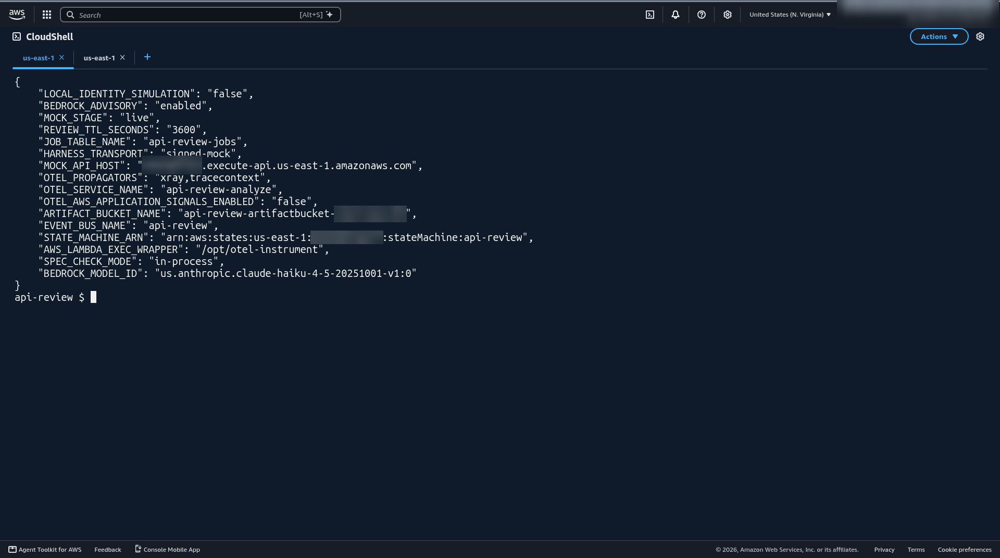

*Figure 13. The environment of `api-review-analyze` after the advisory-enabled redeploy: `"BEDROCK_ADVISORY": "enabled"` and `"BEDROCK_MODEL_ID": "us.anthropic.claude-haiku-4-5-20251001-v1:0"`. It also shows `"SPEC_CHECK_MODE": "in-process"`, `"LOCAL_IDENTITY_SIMULATION": "false"`, `"MOCK_STAGE": "live"`, `"REVIEW_TTL_SECONDS": "3600"`, `"JOB_TABLE_NAME": "api-review-jobs"`, `"OTEL_SERVICE_NAME": "api-review-analyze"`, `"AWS_LAMBDA_EXEC_WRAPPER": "/opt/otel-instrument"` and the OpenTelemetry propagators `xray,tracecontext`. The mock API host, the artifact bucket suffix and the account ID inside the state machine ARN are blurred.*

Note `SPEC_CHECK_MODE: in-process`. The deployed workflow ran the fixed checker in the Lambda, not in AgentCore Code Interpreter. I come back to that in Section 9.

---

## 8. Comparing third-party models on the advisory step

The question I wanted answered was practical: which Bedrock models, including ones from other providers, actually return the JSON this step needs, and what happens when a model is not available to my account? I wrote `scripts/compare_bedrock_models.py` for it. It calls `bedrock-runtime` `converse` with the *same request* the analyze function builds, a number of times per model (default 3), and records wall-clock latency, token usage, the stop reason, whether the reply parsed, and any error. `AccessDeniedException`, `ValidationException` and `ResourceNotFoundException` are stored against that model instead of stopping the run. Model text is never a verdict here either.

```bash
cd ~/api-review && PYTHONPATH=src python3 scripts/compare_bedrock_models.py \
  --region us-east-1 --report ~/broken-report.json --runs 3 --print-raw
```

The script reads the findings from a saved JSON report of the broken job (default `~/broken-report.json`), and writes `build/model-comparison.json` plus a markdown summary. In my CloudShell the script needed `PYTHONPATH=src` to import the repository package. In the tables below, "ok" means the call returned without a service error, and "parse ok" means the reply was accepted by the repository's parser. Latency is the median wall-clock time per call. For a refused call, that figure is just the time to the refusal, not model speed.

### Run 1 (about 2:10 PM ET, commit `1097d92`, 3 runs per model)

- `us.anthropic.claude-sonnet-4-5-20250929-v1:0`: ok 0/3, median 168.764 ms, tokens n/a, parse ok 0/3.
- `us.anthropic.claude-haiku-4-5-20251001-v1:0`: ok 3/3, median 3197.794 ms, median input/output tokens 227/471, parse ok 0/3.
- `us.meta.llama3-3-70b-instruct-v1:0`: ok 0/3, median 126.378 ms, tokens n/a, parse ok 0/3.
- `us.mistral.pixtral-large-2502-v1:0`: ok 3/3, median 3139.316 ms, tokens 250/210, parse ok 2/3.
- `us.amazon.nova-2-lite-v1:0`: ok 3/3, median 1482.788 ms, tokens 238/206, parse ok 0/3.

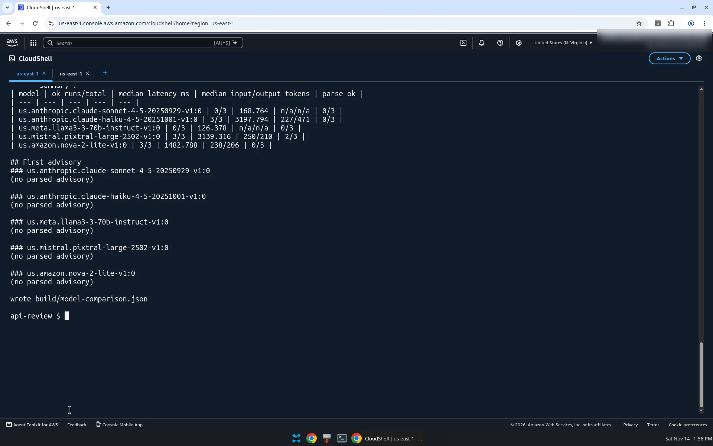

*Figure 14. The summary printed by the first comparison run, with the five models and their ok runs, median latency, median input/output tokens and parse results exactly as listed above, followed by "First advisory" sections that all read "(no parsed advisory)" and the line "wrote build/model-comparison.json". It shows that three models answered but none gave a usable parsed advisory in this first run, while two models were refused. No account details are in the terminal output; the account menu in the corner is blurred.*

**The two refusals were real, not a bug in the script.** Sonnet 4.5 and Llama 3.3 70B both failed with a `ResourceNotFoundException`:

```text
Access denied. This Model is marked by provider as Legacy and you have not been actively using the model in the last 30 days.
```

This is a Bedrock model-lifecycle rule: a model marked Legacy by its provider is refused to an account that has not used it in the last 30 days. Before building any workflow on a model, run a quick call from the account that will use it.

I also deployed the stack with Pixtral Large for the advisory (the only model with any parse success in run 1) and submitted the broken candidate. That deploy succeeded and the job (`job_61a4e2ed6087607bf6eb`) was `BLOCKED` as always, but the advisory was rejected:

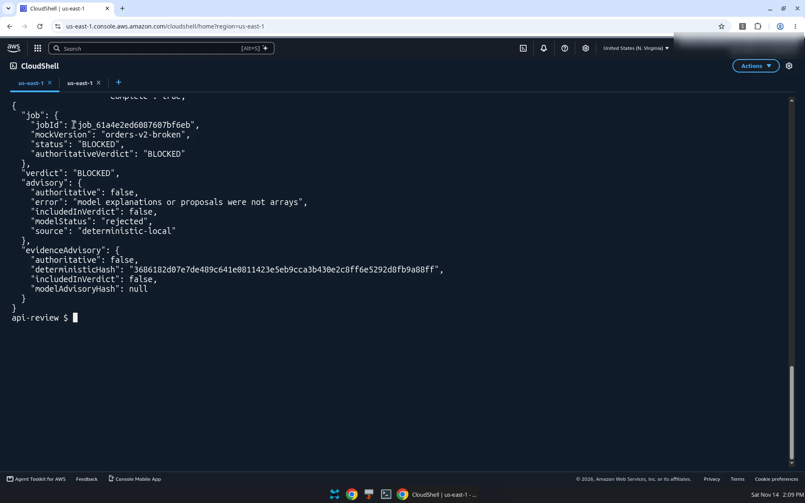

*Figure 15. The report of the Pixtral-backed job: the job is `BLOCKED` with `authoritativeVerdict` `BLOCKED`, and the `advisory` block says `"authoritative": false`, `"includedInVerdict": false`, `"modelStatus": "rejected"`, `"source": "deterministic-local"` and `"error": "model explanations or proposals were not arrays"`. The `evidenceAdvisory` block has a `deterministicHash` but `"modelAdvisoryHash": null`. It proves the pipeline records a rejected model reply, keeps the block, and falls back to the deterministic advisory instead of failing the job. The job id is visible; the account menu is blurred.*

That error pointed at the parser being too strict about the shape and wrapping of model output. I fixed the parser (commit `de60ed5`) so that it accepts a reply wrapped in a Markdown code fence, finds the first balanced JSON object if the model added prose, wraps a single object or string into a list, and renames a small set of known aliases (`summary`, `fix`, `suggestedFix` and similar) onto the two allowed fields. Unknown keys are dropped rather than failing the reply, but forbidden content inside the two arrays is still rejected:

```python
def parse_converse_response(response: dict[str, Any]) -> dict[str, Any]:
    try:
        blocks = response["output"]["message"]["content"]
        texts = [block["text"] for block in blocks if isinstance(block, dict) and "text" in block]
        text = _strip_fences("".join(texts).strip())
        parsed = _load_first_object(text)
    except (KeyError, TypeError, json.JSONDecodeError, ValueError):
        return _invalid("model output was not a JSON object")
    ...
    normalized = _normalize_keys(parsed)
    explanations = _as_list(normalized.get("explanations", []))
    proposals = _as_list(normalized.get("proposals", []))
    if not isinstance(explanations, list) or not isinstance(proposals, list):
        return _invalid("model explanations or proposals were not arrays")
    if not _safe_tree(explanations) or not _safe_tree(proposals):
        return _invalid("model output contained forbidden content")
```

I also tightened the system prompt and added the structured-output field to the request in the same commit, and replaced the two Legacy comparison models with Sonnet 4.6 and Llama 4 Maverick.

### Run 2 (about 2:20 to 2:25 PM ET, commit `de60ed5`, 3 runs per model)

- `us.anthropic.claude-sonnet-4-6`: ok 0/3, median 115.354 ms, tokens n/a, parse ok 0/3.
- `us.anthropic.claude-haiku-4-5-20251001-v1:0`: ok 3/3, median 1361.927 ms, tokens 576/149, parse ok 3/3.
- `us.meta.llama4-maverick-17b-instruct-v1:0`: ok 0/3, median 146.086 ms, tokens n/a, parse ok 0/3.
- `us.mistral.pixtral-large-2502-v1:0`: ok 3/3, median 1966.831 ms, tokens 304/137, parse ok 3/3.
- `us.amazon.nova-2-lite-v1:0`: ok 3/3, median 1354.776 ms, tokens 283/197, parse ok 3/3.

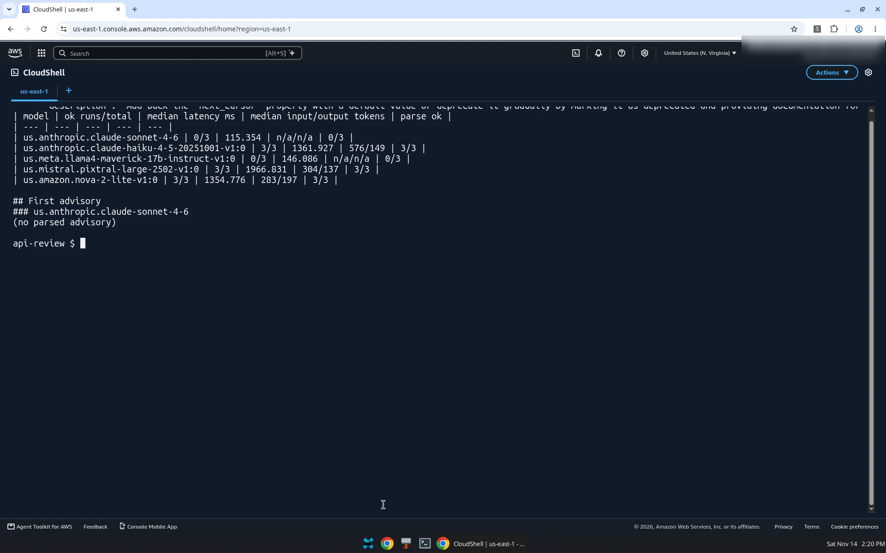

*Figure 16. The summary of the second run: Haiku 4.5, Pixtral Large and Nova 2 Lite each answered 3 of 3 runs and parsed 3 of 3, while Sonnet 4.6 and Llama 4 Maverick show 0/3 with `n/a` tokens, and the "First advisory" section begins with Sonnet 4.6 reading "(no parsed advisory)". It proves the refusals were recorded per model instead of stopping the run. The top line is cut-off scrollback, no account details are visible, and the account menu is blurred.*

**The refusals in run 2 were also real results, and they are worth recording as results:**

- **Sonnet 4.6** was refused with: `Model access is denied due to INVALID_PAYMENT_INSTRUMENT: A valid payment instrument must be provided.. Your AWS Marketplace subscription for this model cannot be completed at this time.` That is an account-level setup refusal for that model on my account, not a model-quality outcome.
- **Llama 4 Maverick** was refused with the same Legacy access message as Llama 3.3 above.

With `--print-raw`, the script also prints each model's reply. This is what the three models that answered said about the broken candidate (transcribed from the output):

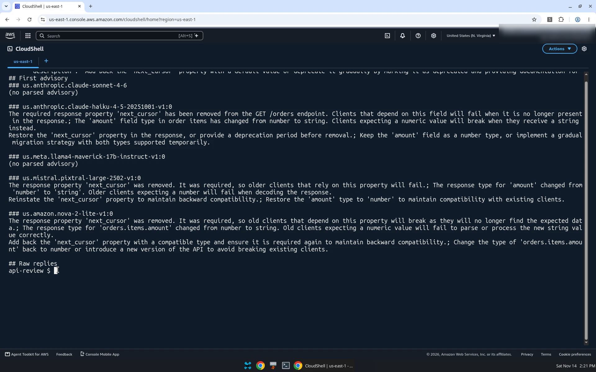

*Figure 17. The "First advisory" section of the second run. Haiku 4.5, Pixtral Large and Nova 2 Lite each flag both breaks (the removed `next_cursor` and the `amount` change from number to string) in their own wording and propose restoring them, while Sonnet 4.6 and Llama 4 Maverick show "(no parsed advisory)". It proves the working models understood the findings, even though the verdict never depends on them. The last line, "## Raw replies", introduces the raw output; the account menu is blurred.*

- **Haiku 4.5:** explained that `next_cursor` had been removed from `GET /orders` and clients depending on it fail, and that `amount` changed from number to string and numeric clients break. Proposals: restore `next_cursor` or provide a deprecation period before removal; keep `amount` a number or run a gradual migration supporting both types.
- **Pixtral Large:** explained that `next_cursor` was required and was removed, so older clients that rely on it fail, and that the type of `amount` changed from `number` to `string`, so older clients decoding it fail. Proposals: reinstate `next_cursor`; restore `amount` to `number`.
- **Nova 2 Lite:** explained the same two breaks, referring to `orders.items.amount`. Proposals: add `next_cursor` back as a required property of a compatible type; change the `amount` type back to number, or introduce a new API version.

All three correctly identified *both* breaking changes and proposed a restoration. The deterministic findings, not these paragraphs, are what blocked the job.

One raw reply is also instructive, because it explains why the strict parser failed in run 1:

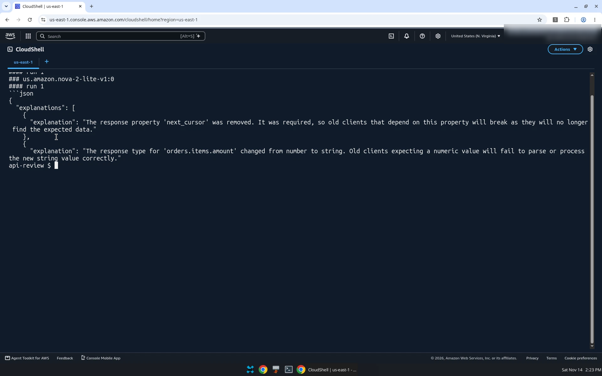

*Figure 18. A raw Nova 2 Lite reply, run 1 of the second comparison. The reply begins with a Markdown code fence labeled json, then an object whose `explanations` array contains one object per break (`next_cursor` was removed and old clients will break; the type of `orders.items.amount` changed from number to string). It proves the model returned valid JSON wrapped in a code fence, which the original strict parser would not accept and the fixed parser does. Nothing sensitive is visible; the account menu is blurred.*

### How to read the two runs

- **The refusals are the lesson.** Out of the five models in each run, two were never usable from my account: in run 1 two Legacy models, in run 2 one Legacy model and one payment-instrument refusal. A comparison script that records the refusal per model is more useful than one that dies on the first error.
- **Three working models, three parseable JSON answers.** In run 2, Haiku 4.5, Pixtral Large and Nova 2 Lite all parsed 3 of 3 times. In run 1 the same models parsed 0/3, 2/3 and 0/3 against the original strict parser. The request had also changed between runs (new system prompt and structured-output field), so the two runs are not a like-for-like latency benchmark. For example, Haiku's median output was 471 tokens in run 1 and 149 in run 2; I did not isolate the cause.
- **One oddity I did not explain.** In run 1, Pixtral Large reported "parse ok 2/3", yet its "First advisory" section still printed "(no parsed advisory)". I have not traced why, and the parser has changed since.
- **Do not generalize these numbers.** Three runs of one prompt on one input is a smoke test of "does it return usable JSON", not a quality benchmark.

### Closing the loop: the advisory on a real job

After the comparison I submitted the broken candidate again with Haiku 4.5 enabled. Two further problems appeared, both visible in the screenshots.

The first was a **report that dropped the model text.** The job showed `modelStatus: parsed` yet no explanations:

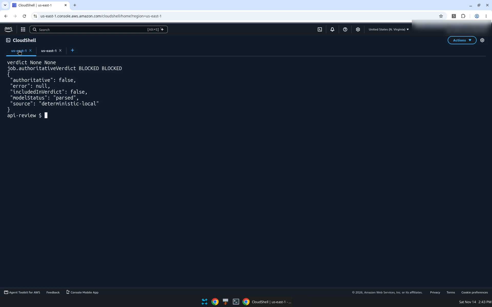

*Figure 19. An advisory block that says `"modelStatus": "parsed"`, `"authoritative": false`, `"includedInVerdict": false` and `"error": null`, but `"source": "deterministic-local"` and no explanation or proposal text, even though a model reply had been parsed; the job-level `authoritativeVerdict` printed above it is `BLOCKED BLOCKED`. It proves the model text was being dropped when the report was built, not rejected. The first line, `verdict None None`, is part of a quick inspection printout and not a report field, and nothing sensitive is in view.*

The cause (commit `f0e6102`) was that the report shaping copied only `source`, `modelStatus` and `error` and dropped the parsed text, which the merge step had stored under `modelExplanations` and `modelProposals`. The fix is in `report_advisory`:

```python
if status == "parsed":
    return {
        "authoritative": False,
        "error": None,
        "explanations": advisory.get("modelExplanations", []),
        "includedInVerdict": False,
        "modelAdvisoryHash": advisory.get("modelAdvisoryHash"),
        "modelId": advisory.get("modelId") or model_id,
        "modelStatus": "parsed",
        "proposals": advisory.get("modelProposals", []),
        "source": advisory.get("modelSource") or "bedrock-converse",
    }
```

The second was a **mistyped job id** (a CloudShell typing problem, covered in troubleshooting): a job I submitted for this run answered `not_found` on `status` and `report` because the id I typed was not the id that had been returned (`job_63b4574b6378286872e1` is the real one; the mistyped one began `job_63b5474b`). I fixed my workflow by never typing job ids again: `scripts/aws_demo.py` now saves the last submitted id to `~/.api-review-last-job` and accepts `--job-id last`.

**End-to-end result** (deploy `deploy8`, commit `f0e6102`, about 2:52 PM ET). Job `job_79fc043cf2b109f42aea` (idempotency key `cloud-broken-advisory-0004`) came back `BLOCKED` with `authoritativeVerdict` `BLOCKED`, and an advisory with source `bedrock-converse`, model `us.anthropic.claude-haiku-4-5-20251001-v1:0`, `modelStatus` `parsed`, `authoritative` false, `includedInVerdict` false and `modelAdvisoryHash` `abc9415047ad0838ddc40cd98a52dbd755db6e55c46ced3fee574dfb6f962f52`.

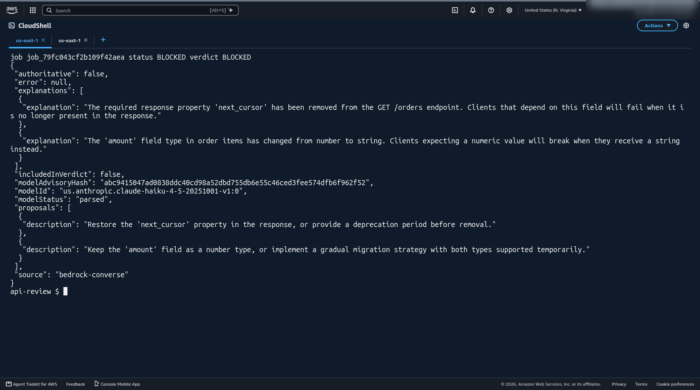

*Figure 20. The final advisory on job `job_79fc043cf2b109f42aea`: status `BLOCKED`, verdict `BLOCKED`, two explanations (the required `next_cursor` removed from `GET /orders`; `amount` changed from number to string), two proposals (restore `next_cursor` or deprecate it first; keep `amount` numeric or migrate gradually), `"authoritative": false`, `"includedInVerdict": false`, `"modelStatus": "parsed"`, `"modelId": "us.anthropic.claude-haiku-4-5-20251001-v1:0"`, `"source": "bedrock-converse"` and the `modelAdvisoryHash`. It proves the model text reaches the report while the verdict stays the deterministic `BLOCKED`. No account details are visible and the account menu is blurred.*

---

## 9. Amazon Bedrock AgentCore: Gateway, Policy and Code Interpreter

### How this relates to the main workflow (read this first)

AgentCore is **optional** in this project and is enabled and validated by its own scripts. In the live run:

- The AgentCore **Gateway** (MCP), the **Policy** engine with three Cedar permits, and the **Code Interpreter** were created and validated against the deployed review API.
- The deployed state machine still had `SPEC_CHECK_MODE=in-process` (Figure 13). The workflow's own `SpecCheck` step ran the fixed checker inside the Lambda. The Code Interpreter was exercised by the validation script, not by the workflow.
- The `Analyze` step's "bounded agent" is the in-process tool gateway in `src/apireview/agent_boundary.py`, a **local policy mirror** that permits the same three tools. It is not the Cedar evaluator.
- An AgentCore **Runtime** hosting an advisory agent is part of the architecture's design and is **not deployed** in this run. The enable script ends by printing "Set the runtime to call only read_artifacts, request_spec_check, and read_test_results. Do not add an approve, merge, or deploy tool."

So what I can show as evidence is that the three AgentCore building blocks deploy, are policy-enforced, and behave correctly under the allow and deny cases below. What I cannot show is a Runtime-hosted agent driving the workflow.

### The three tools, and the one that is there to be denied

The gateway target `ReviewTools` is an API Gateway target pointing at the review API's `live` stage, and it maps three read-style tools to routes:

- `read_artifacts` → `GET /jobs/{jobId}`
- `read_test_results` → `GET /jobs/{jobId}/report`
- `request_spec_check` → `POST /jobs`

```python
"toolOverrides": [
  {"name": "read_artifacts",     "path": "/jobs/{jobId}",        "method": "GET",  "description": "Read one job. Not a verdict."},
  {"name": "read_test_results",  "path": "/jobs/{jobId}/report", "method": "GET",  "description": "Read the sealed report and harness results. Not a verdict."},
  {"name": "request_spec_check", "path": "/jobs",                "method": "POST", "description": "Submit a job for the fixed checker. Not a verdict."},
  {"name": "approve",            "path": "/reviews",             "method": "POST", "description": "Review callback. Cedar default deny must block this tool."},
],
```

The fourth tool, `approve`, is registered **only so that validation can prove it is denied**. No permit exists for it, so Cedar's default deny blocks it, and under enforcement it does not even show up in `tools/list`. Two more layers sit behind that: the gateway's IAM role has an explicit IAM `Deny` on the review-context and reviews routes, and the review Lambda separately demands the reviewer role. The runtime is meant to be told to use the three read tools only.

Tool and action ids use the gateway's naming convention `<target>___<tool>` (three underscores), for example `ReviewTools___read_artifacts`.

### Step 14. Enable AgentCore

```bash
cd ~/api-review && CONFIRM_AGENTCORE=yes REGION=us-east-1 bash scripts/enable_agentcore.sh 2>&1 | tee ~/agentcore-enable.log
```

`enable` does the following, in this order (from `agentcore_setup.py`):

1. Checks that the installed boto3 (1.43.83 in CloudShell) supports the AgentCore control and data planes.
2. Creates or updates two IAM roles: `ApiReviewCodeInterpreter` and `ApiReviewGateway`. Both trust the `bedrock-agentcore.amazonaws.com` service principal with `aws:SourceAccount` and an `aws:SourceArn` of `arn:aws:bedrock-agentcore:<region>:<ACCOUNT_ID>:*`.
3. Creates (or finds) the Code Interpreter `ApiReviewChecker` with `networkMode: SANDBOX`.
4. Creates (or finds) the policy engine `ApiReviewPolicy` ("Read-only tools for the API review gateway.").
5. Creates (or reuses) the gateway `ApiReviewTools` with `authorizerType=AWS_IAM`, `protocolType=MCP` and the policy engine attached in `ENFORCE` mode.
6. Creates or updates the target `ReviewTools` and waits until it is ready.
7. Grants `bedrock-agentcore:InvokeGateway` on that gateway to `ApiReviewDeveloper` and `ApiReviewReviewer`.
8. Creates three Cedar permits, one per allowed tool, and waits for each to be `ACTIVE`.
9. Writes the ids to `build/agentcore-ids.json` (used by validate and teardown).

The service-role trust policy, and the gateway role's permission policy, as written in the script:

```python
def trust_policy(account, region, source_arn):
    return {"Version": "2012-10-17", "Statement": [{
        "Sid": "AllowBedrockAgentCoreAssumeRole", "Effect": "Allow",
        "Principal": {"Service": "bedrock-agentcore.amazonaws.com"}, "Action": "sts:AssumeRole",
        "Condition": {"StringEquals": {"aws:SourceAccount": account},
                      "ArnLike": {"aws:SourceArn": source_arn}}}]}

# gateway role: GetPolicyEngine; AuthorizeAction + PartiallyAuthorizeActions;
# execute-api:Invoke on GET /jobs, GET /jobs/*, POST /jobs;
# explicit Deny on GET /jobs/*/review-context and POST /reviews
```

And the Cedar permit that the script renders for each tool. One role, one action, one gateway:

```python
def permit_statement(gateway_arn: str, action: str, principal_id: str) -> str:
    return (
        "permit (\n"
        "  principal is AgentCore::IamEntity,\n"
        f'  action == AgentCore::Action::"{action}",\n'
        f'  resource == AgentCore::Gateway::"{gateway_arn}"\n'
        ")\n"
        "when {\n"
        f'  principal.id like "{principal_id}*"\n'
        "};\n"
    )
```

with `principal_id` set to `arn:aws:sts::<ACCOUNT_ID>:assumed-role/ApiReviewDeveloper` (Cedar evaluates the role without the session name, and the trailing `*` also matches a session suffix). Policies are created with `validationMode="FAIL_ON_ANY_FINDINGS"`, so a permit that Cedar validation flags does not become active.

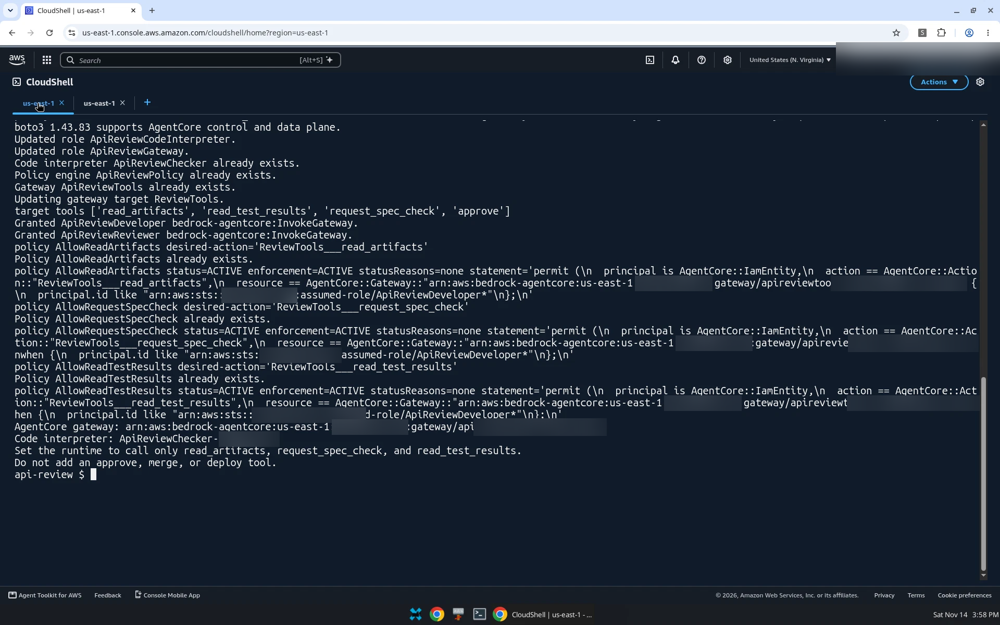

*Figure 21. A completed run of `enable_agentcore.sh` (the idempotent re-run that produced the final state). It reports the boto3 version check, roles `ApiReviewCodeInterpreter` and `ApiReviewGateway` updated, Code Interpreter `ApiReviewChecker`, policy engine `ApiReviewPolicy` and gateway `ApiReviewTools` already existing, and the target `ReviewTools` updated with the tools `read_artifacts`, `read_test_results`, `request_spec_check` and `approve`. It then shows `bedrock-agentcore:InvokeGateway` granted to `ApiReviewDeveloper` and `ApiReviewReviewer`, and the three permits `AllowReadArtifacts`, `AllowRequestSpecCheck` and `AllowReadTestResults` each at `status=ACTIVE enforcement=ACTIVE statusReasons=none`, with statements that use `principal is AgentCore::IamEntity` and a `when` clause matching `…assumed-role/ApiReviewDeveloper*`. It ends with the reminder to limit the runtime to the three read tools and "Do not add an approve, merge, or deploy tool." The account ID, the gateway and code-interpreter id suffixes, and the username in the ARNs are blurred.*

### Step 15. Validate: allow, deny, wrong identity, Code Interpreter

```bash
cd ~/api-review && CONFIRM_VALIDATE=yes REGION=us-east-1 bash scripts/validate_agentcore.sh 2>&1 | tee ~/agentcore-validate.log
```

Validate checks four things, each printed as `PASS` or `FAIL`:

- **`gateway-read`**: as the `api-review-developer` profile (role `ApiReviewDeveloper`, session `dev-ada`), call `tools/call` on `ReviewTools___read_artifacts` for the last job id (read from `~/.api-review-last-job`). It passes only on a real, non-error result.
- **`policy-deny`**: with the same developer identity, call `ReviewTools___approve`. It passes only when the response is a policy denial.
- **`other-identity`**: as the **reviewer** profile (`ApiReviewReviewer`, session `rev-ben`), call `read_artifacts`. It passes only when that call is **denied**: the Cedar permits are scoped to the developer role, so the reviewer is refused even though it has `InvokeGateway`.
- **`code-interpreter diff`**: start a Code Interpreter session on `ApiReviewChecker`, run the fixed checker source against the *broken* spec, read the output stream, and stop the session in a `finally`. It passes only if the checker returned `ok: false` and flagged both `checker.amount.type` and `checker.next_cursor.required`. In other words, `PASS` means the interpreter correctly caught the broken candidate.

The log from the validation run (account masked as `0444XXXXXXXX`):

```text
boto3 1.43.83 supports AgentCore control and data plane.
ambient caller arn:aws:iam::0444XXXXXXXX:root
gateway caller profile api-review-developer role ApiReviewDeveloper
Gateway target ReviewTools is READY.
policy AllowReadArtifacts status=ACTIVE enforcement=ACTIVE statusReasons=none
policy AllowRequestSpecCheck status=ACTIVE enforcement=ACTIVE statusReasons=none
policy AllowReadTestResults status=ACTIVE enforcement=ACTIVE statusReasons=none
job id from /home/cloudshell-user/.api-review-last-job job_79fc043cf2b109f42aea
gateway caller arn:aws:sts::0444XXXXXXXX:assumed-role/ApiReviewDeveloper/dev-ada
tools/list -> ReviewTools___read_artifacts, ReviewTools___read_test_results, ReviewTools___request_spec_check
PASS gateway-read ReviewTools___read_artifacts
PASS policy-deny ReviewTools___approve
other caller arn:aws:sts::0444XXXXXXXX:assumed-role/ApiReviewReviewer/rev-ben
PASS other-identity ReviewTools___read_artifacts
PASS code-interpreter diff
PASS agentcore-validation
```

Two details matter here. First, `tools/list` returns only the three read tools: with the policy engine in enforcement, the gateway lists only tools that an ACTIVE permit allows, so `approve` is hidden from the listing as well as denied when called. Second, the "ambient caller" is the root user of CloudShell, which is *not* the gateway caller: all gateway calls are made through the developer and reviewer profiles.

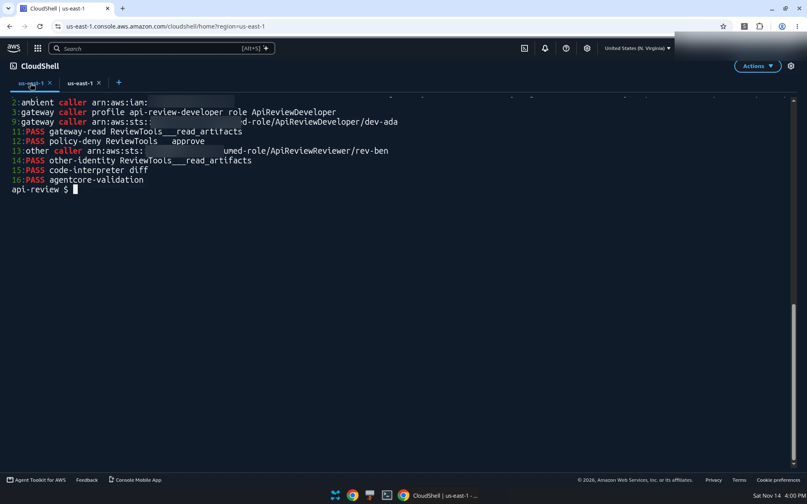

*Figure 22. The compact view of the validate result: the ambient root caller, the developer profile, `PASS gateway-read ReviewTools___read_artifacts` as `dev-ada`, `PASS policy-deny ReviewTools___approve`, the other caller `…assumed-role/ApiReviewReviewer/rev-ben` with `PASS other-identity ReviewTools___read_artifacts`, `PASS code-interpreter diff` and `PASS agentcore-validation`. It proves the allow, the policy denial, the wrong-identity denial and the interpreter check in one screen. The account ID portions of the ARNs are blurred.*

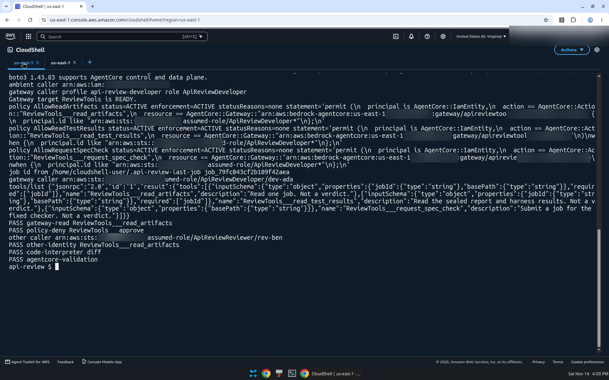

*Figure 23. The full validate log: the boto3 probe, target `ReviewTools` READY, the three ACTIVE permits with their Cedar statements, job id `job_79fc043cf2b109f42aea` read from `~/.api-review-last-job`, the `tools/list` response listing only `read_artifacts`, `read_test_results` and `request_spec_check` (each with the description "…Not a verdict."), and then all PASS lines through `PASS agentcore-validation`. It shows the entire chain, from policy state to the final result, in a single capture. Account IDs and the gateway id suffix in the Cedar resource strings are blurred.*

### The AgentCore console, for the same resources

The same state, from the AgentCore console:

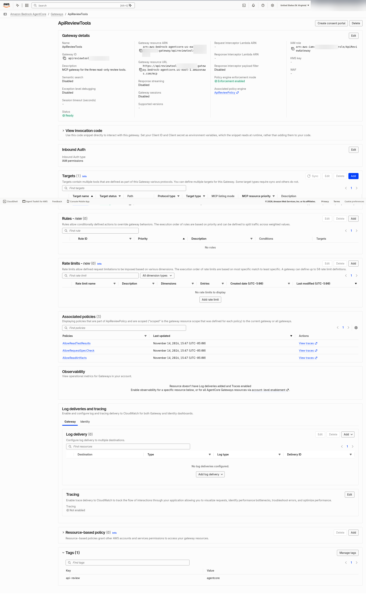

*Figure 24. The Amazon Bedrock AgentCore console page for gateway `ApiReviewTools`: status Ready, description "MCP gateway for the three read-only review tools", inbound auth type IAM permissions, policy engine enforcement mode Enforced with the associated policy engine `ApiReviewPolicy`, and the IAM role `ApiReviewGateway`. The Associated policies section lists `AllowReadTestResults`, `AllowRequestSpecCheck` and `AllowReadArtifacts`, last updated November 14, 2026 at 15:47 (UTC-05:00, which is ET). It proves the gateway is IAM-authenticated and policy-enforced in the console, not just in my script's output. The account ID, the gateway id and URL suffixes and the role ARN prefix are blurred.*

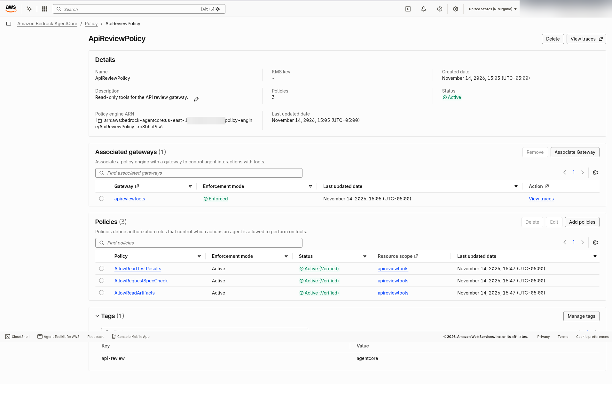

*Figure 25. The policy engine `ApiReviewPolicy`: description "Read-only tools for the API review gateway.", status Active, 3 policies, and the associated gateway `apireviewtools` with enforcement mode Enforced. The Policies table shows `AllowReadTestResults`, `AllowRequestSpecCheck` and `AllowReadArtifacts`, each "Active" with the status "Active (Verified)", scoped to `apireviewtools`. It shows the permits passed validation and are in force, and that there are exactly three. The account ID inside the policy engine ARN is blurred.*

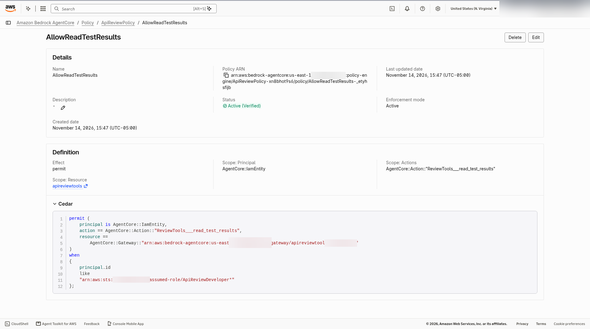

*Figure 26. The definition of `AllowReadTestResults` in the console: effect `permit`, principal scope `AgentCore::IamEntity`, action `AgentCore::Action::"ReviewTools___read_test_results"`, resource the `apireviewtools` gateway. The Cedar tab shows the full statement, including `when { principal.id like "arn:aws:sts::<ACCOUNT_ID>:assumed-role/ApiReviewDeveloper*" }`. It proves the permit is scoped to the developer role and not to every IAM caller. The account ID and the gateway id suffix are blurred.*

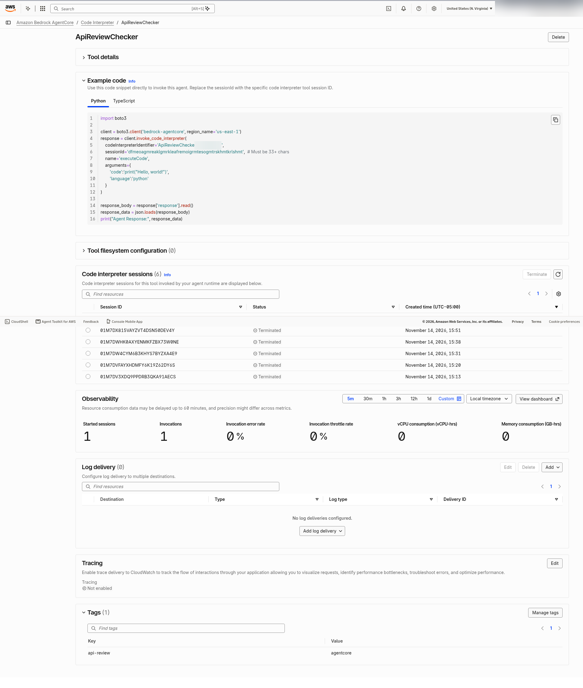

*Figure 27. The code interpreter `ApiReviewChecker` in the console: the example `invoke_code_interpreter` snippet for the resource, the "Code interpreter sessions (6)" list, with the visible sessions shown as Terminated and created on November 14, 2026 between 15:13 and 15:51 (ET), and the observability panel for the selected window reading 1 started session, 1 invocation and 0% invocation error rate. The session count is consistent with the repeated validate runs while I was fixing the issues in the troubleshooting section, and every session was stopped. The account ID and the interpreter id suffix are blurred.*

### What is tested, what is not (AgentCore)

- **Observed live:** gateway, target, policy engine and three ACTIVE permits created; the developer read allowed; `approve` denied by policy; the reviewer identity denied; the Code Interpreter flagged both breaks in the broken spec; console views of each resource.
- **Tested locally:** the helper logic in `agentcore_setup.py` (13 tests): name patterns, trust shape, MCP protocol negotiation, Cedar statement generation and matching, checker-stream parsing, tool/route mapping and denial classification.
- **Not shown:** an AgentCore Runtime, a workflow run that uses `SPEC_CHECK_MODE=agentcore`, and the Code Interpreter's observability beyond the one console view above.

---

## 10. A console tour of the deployed stack

Everything in this section was captured from the AWS console in `us-east-1` on November 14, 2026, between about 4:32 PM and 5:04 PM ET, after the stack had been deployed and used for the runs above. The account menu, account IDs inside URLs and ARNs, API ids and random resource suffixes are blurred. Each view maps to something the CloudShell walkthrough already created, so this is the same stack seen from the other side.

### Step Functions: one named execution per job

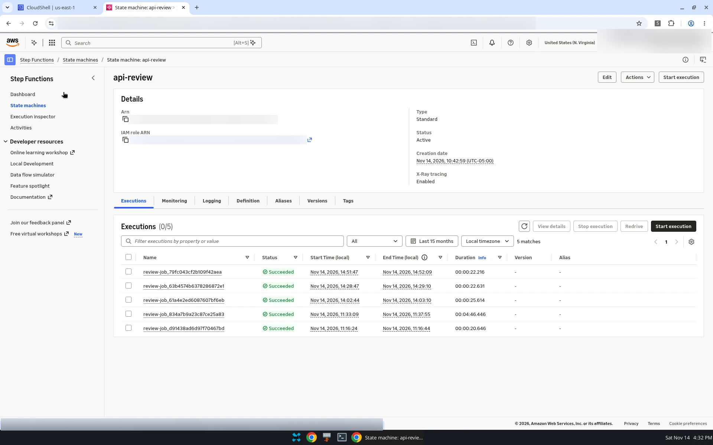

*Figure 28. The Step Functions console page for the state machine `api-review`: type Standard, status Active, created November 14, 2026 at 10:42:59 (UTC-05:00, which is ET), and X-Ray tracing Enabled. The Executions tab lists five executions named `review-job_<jobId>`, all Succeeded, from `review-job_d91438ad6d97f70467bd` (11:16 AM ET, 20.6 seconds) to `review-job_79fc043cf2b109f42aea` (2:51 PM ET, 22.2 seconds). The corrected job's execution, `review-job_834a7b9a23c87ce25a83`, ran for 4 minutes 46 seconds because it waited for the review, and "Succeeded" for a broken job only means the workflow reached its `MarkBlocked` end state, not that the candidate passed. This list was captured at 4:32 PM ET, so it does not include the later tracing test jobs. The ARNs and the browser address are blurred.*

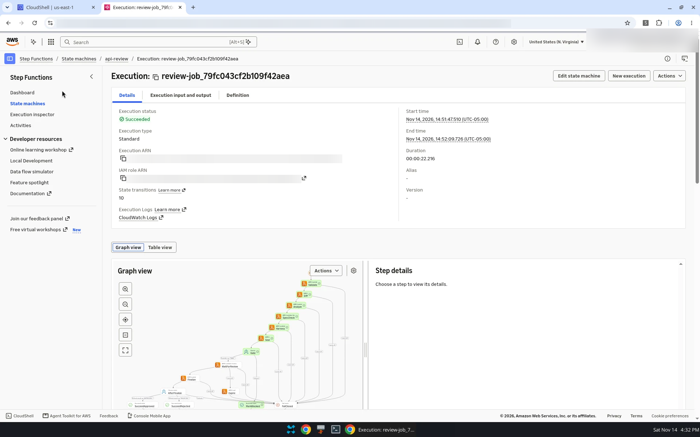

*Figure 29. The detail page for `review-job_79fc043cf2b109f42aea`, the broken candidate that ran with the Bedrock advisory enabled: status Succeeded, type Standard, started 14:51:47.510 and ended 14:52:09.726 (UTC-05:00), duration 00:00:22.216, 10 state transitions. The graph view under the details draws the state machine with the states that ran in green; the page is cut off at the fold, so the individual states are not readable in this capture. It shows that every job gets its own named execution that you can open and replay state by state. The execution ARN, the role ARN and the browser address are blurred.*

### DynamoDB: the job, idempotency and outbox records

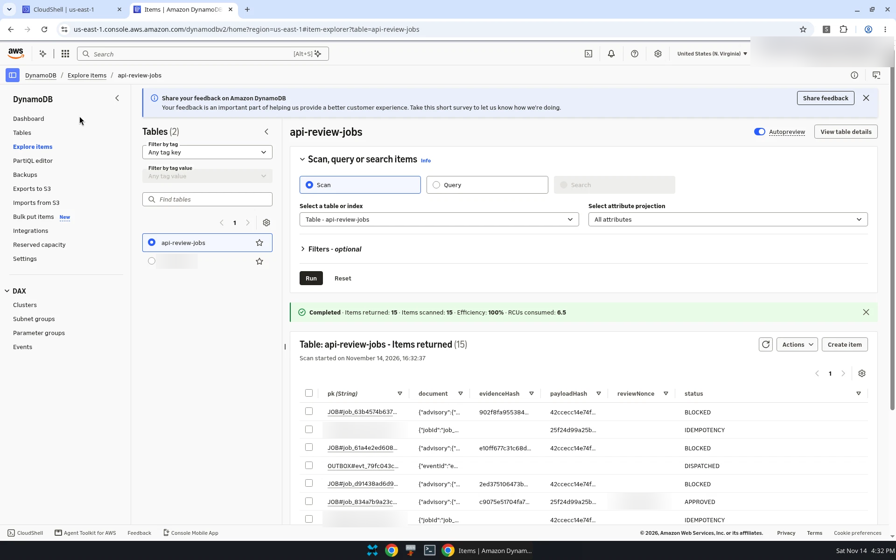

*Figure 30. The DynamoDB console's Explore items view for the table `api-review-jobs`: a scan that completed with 15 items returned and 15 scanned. The visible partition keys are of three kinds, `JOB#job_…`, `IDEM#…` and `OUTBOX#evt_…`, with the statuses BLOCKED, IDEMPOTENCY, DISPATCHED and APPROVED, which is the single-table layout from Step 7 in the real table. The `reviewNonce` value, the idempotency keys (they embed the caller's ARN), the name of an unrelated table in the same account and the account menu are blurred.*

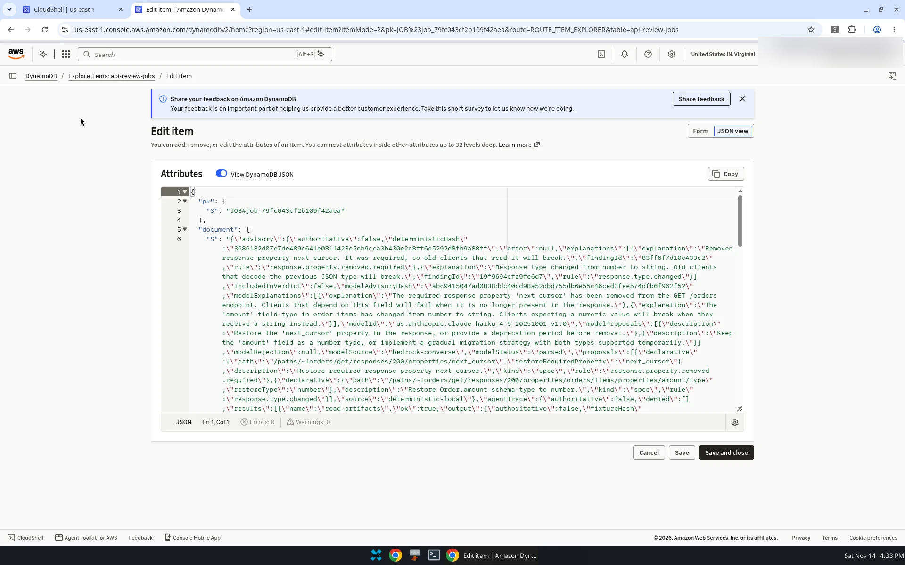

*Figure 31. The item `JOB#job_79fc043cf2b109f42aea` opened in JSON view. The visible part of its `document` attribute is the advisory block: `authoritative: false`, a `deterministicHash`, explanations for the removed `next_cursor` and the `amount` type change, `modelId` `us.anthropic.claude-haiku-4-5-20251001-v1:0`, `modelStatus: parsed`, `includedInVerdict: false` and a `modelAdvisoryHash`; the rest of the document scrolls out of view. This is the same advisory shown in the report earlier (Figure 20), read straight from the table, and it confirms the model text is stored beside the evidence and flagged as non-authoritative. The account menu is blurred.*

### Amazon S3: the artifact bucket

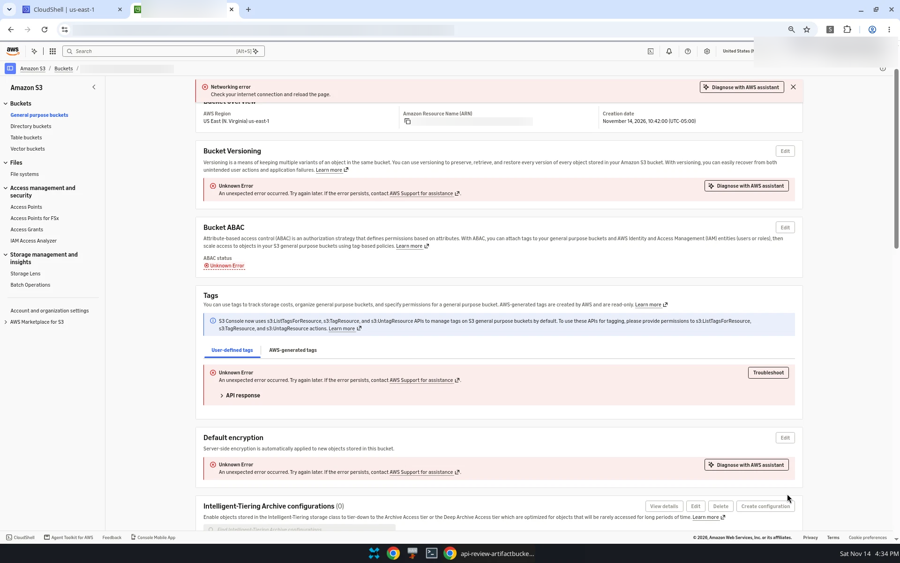

*Figure 32. The S3 console, Properties tab of the artifact bucket. The bucket overview shows the region US East (N. Virginia) us-east-1 and the creation date November 14, 2026, 10:42:00 (UTC-05:00), but the Bucket Versioning, Bucket ABAC, Tags and Default encryption panels all show "Unknown Error", under a "Networking error" banner. So this capture does **not** show the versioning or encryption settings; those come from the template, which declares versioning Enabled, AES256 default encryption and all four public-access blocks. The bucket name, ARN and browser address are blurred.*

The console's Objects tab for the same bucket returned the same "Unknown Error". I noted that the bucket has no bucket policy and did not establish whether that is related, so I read the bucket from CloudShell instead. The commands are not visible in the two captures below; they are `aws s3 ls` listings of this form:

```bash
aws s3 ls "s3://<ArtifactBucketName>/"
aws s3 ls "s3://<ArtifactBucketName>/" --recursive
```

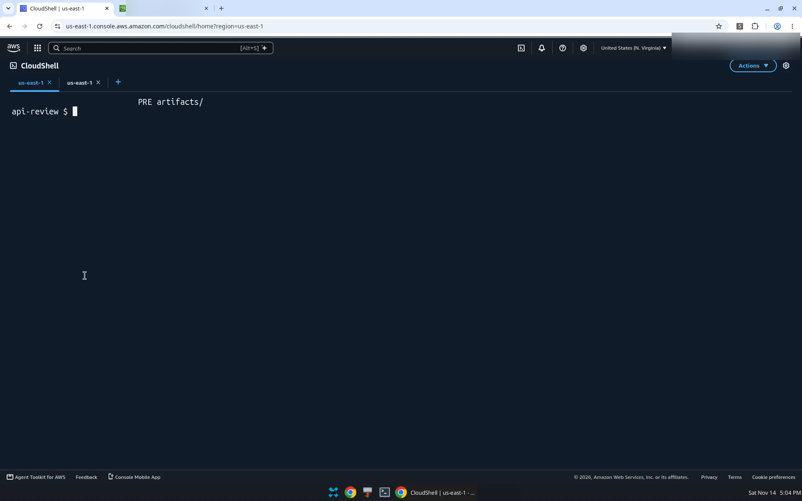

*Figure 33. CloudShell at 5:04 PM ET: the root of the artifact bucket contains one prefix, `PRE artifacts/`. Nothing else is stored at the top level, which matches the code, which writes each object under the key `artifacts/<digest>.json`. The account menu and the second browser tab's bucket name are blurred.*

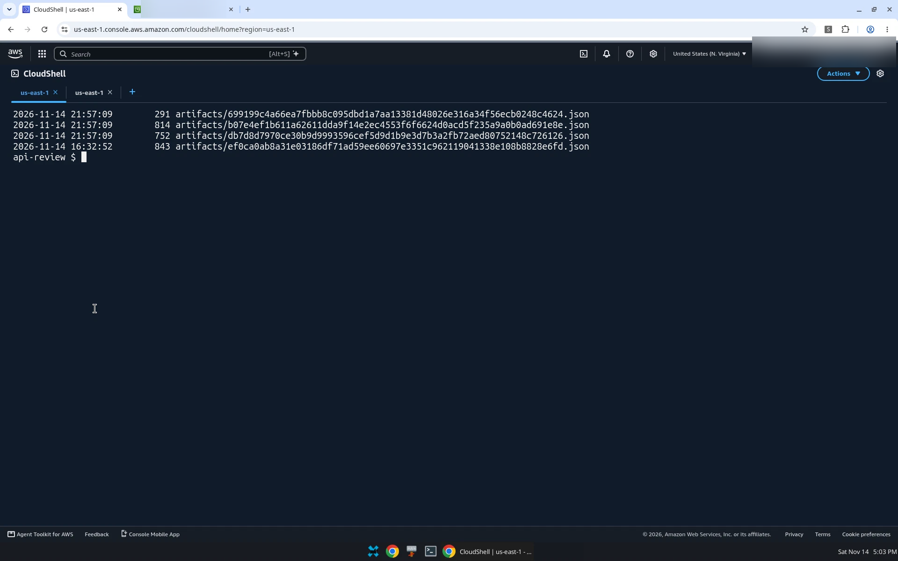

*Figure 34. The recursive listing under `artifacts/`: four JSON objects with 64-character hexadecimal names of 291, 814, 752 and 843 bytes. `aws s3 ls` prints UTC, so three objects were last written at 21:57:09 UTC (4:57 PM ET) and one at 16:32:52 UTC (11:32 AM ET). Only four objects after many jobs is consistent with the content-addressed keys (identical bytes are written under the same key); I did not list object versions here. The account menu and the bucket name in the browser tab are blurred.*

### SQS and EventBridge: the buffer and the bus

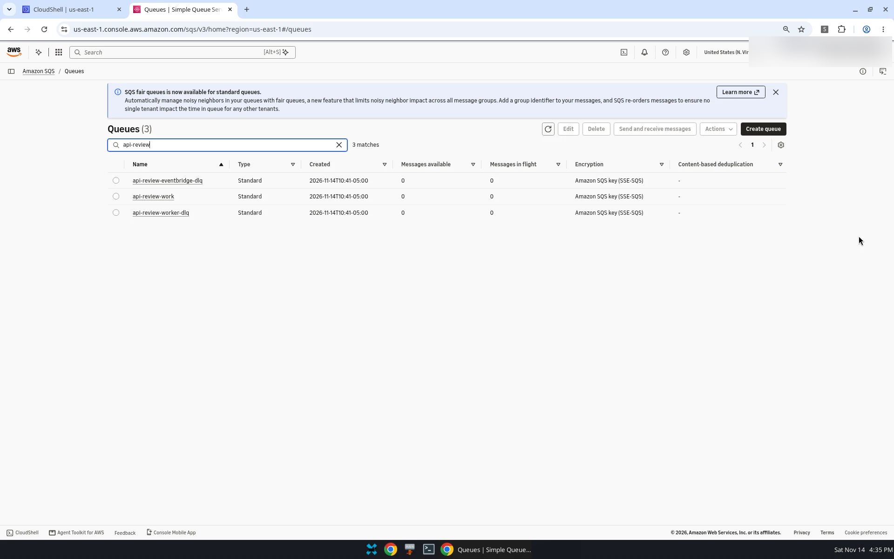

*Figure 35. The Amazon SQS console filtered on `api-review`: three Standard queues, `api-review-eventbridge-dlq`, `api-review-work` and `api-review-worker-dlq`, all created 2026-11-14T10:41 (-05:00) and encrypted with SSE-SQS. Every queue shows 0 messages available and 0 in flight at 4:35 PM ET, so the two separate dead-letter queues from Section 4 were empty after all of the jobs above. The account menu is blurred.*

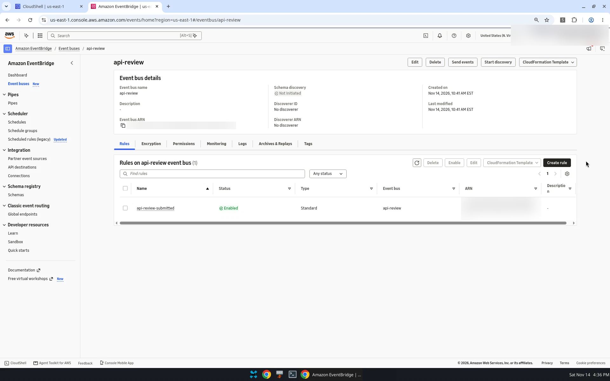

*Figure 36. The EventBridge console page for the event bus `api-review` (the template's logical id for it is `ReviewBus`): created November 14, 2026 at 10:41 AM EST, schema discovery not initiated, and exactly one rule, `api-review-submitted`, type Standard and Enabled. That rule is the `JobSubmitted` pattern that routes events to the work queue. The event bus ARN, the rule ARN and the account menu are blurred.*

### Lambda and CloudWatch Logs: 15 functions, 16 log groups

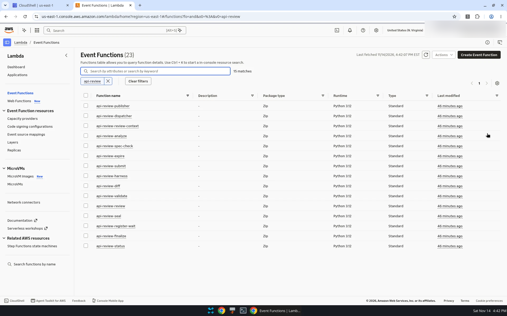

*Figure 37. The Lambda console's function list filtered on `api-review`: 15 matches out of 23 functions in the account, all Zip packages on Python 3.12. The names are publisher, dispatcher, review-context, analyze, spec-check, expire, submit, harness, diff, validate, review, seal, register-wait, finalize and status, which is exactly the list in Section 4. All 15 show the same "46 minutes ago" modification age (the page says it was fetched at 4:42:07 PM EST), as you would expect after one stack update. The account menu is blurred.*

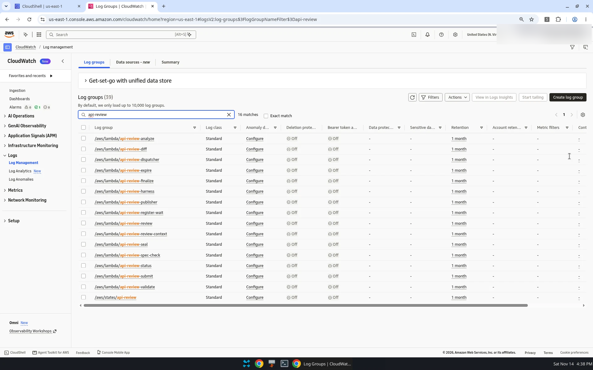

*Figure 38. CloudWatch Logs, Log management, filtered on `api-review`: 16 matches, one `/aws/lambda/api-review-<function>` group for each of the 15 functions plus `/aws/states/api-review` for the state machine. All are Standard class with retention "1 month", which is the 30-day retention the template sets on each explicit log group. They exist because the template creates them, not because a first invocation did, and they are removed with the stack. The account has 39 log groups in total; the account menu is blurred.*

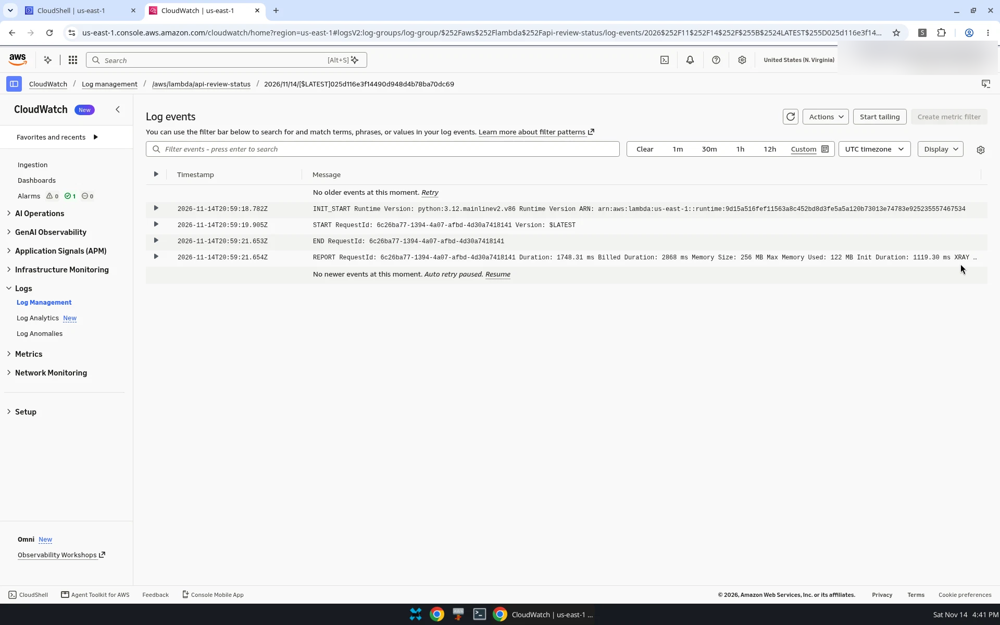

*Figure 39. One log stream of `/aws/lambda/api-review-status`, with the timezone set to UTC: an `INIT_START` line for the Python 3.12 runtime, then `START`, `END` and `REPORT` for one request at 2026-11-14T20:59 UTC (3:59 PM ET). The REPORT line shows Duration 1748.31 ms, Memory Size 256 MB, Max Memory Used 122 MB and Init Duration 1119.30 ms, and continues with an `XRAY` field that is cut off in this view. It shows the function logging to its own group and the cold-start initialization time of the OpenTelemetry-wrapped runtime. The account menu is blurred.*

---

## 11. Amazon Q Developer: two design-review questions

Amazon Q Developer was never in the runtime path, and it did not write this repository's code: the code already existed when I asked these questions. On November 14, 2026 (about 4:44 to 4:46 PM ET) I used the Amazon Q Developer chat panel in the AWS console as a planning and design-review assist. I asked two general questions, with no repository attached, and compared its answers with what I had already built. The full, verbatim answers are saved in `results/q_developer_answers.md`; below I quote only short excerpts.

### Question 1: detecting breaking changes between two OpenAPI specs

I asked: "What are best practices for detecting breaking changes between two OpenAPI specs, such as a removed response field or a field type changed from number to string?"

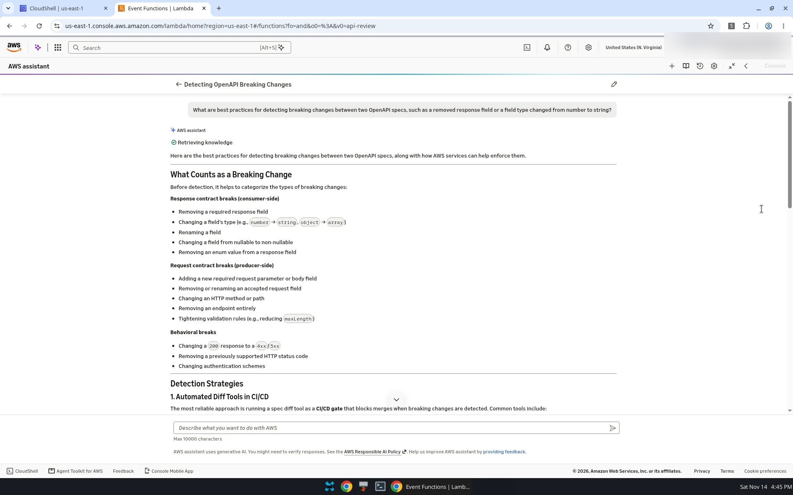

*Figure 40. The Amazon Q Developer chat panel in the Lambda console, with the first question at the top and the start of the answer after "Retrieving knowledge". The answer opens with "What Counts as a Breaking Change", listing response breaks such as "Removing a required response field" and "Changing a field's type (e.g., number → string, object → array)", request breaks, and behavioral breaks. Those two response examples are exactly the two breaks in this guide's orders example. The account menu in the console header is blurred.*

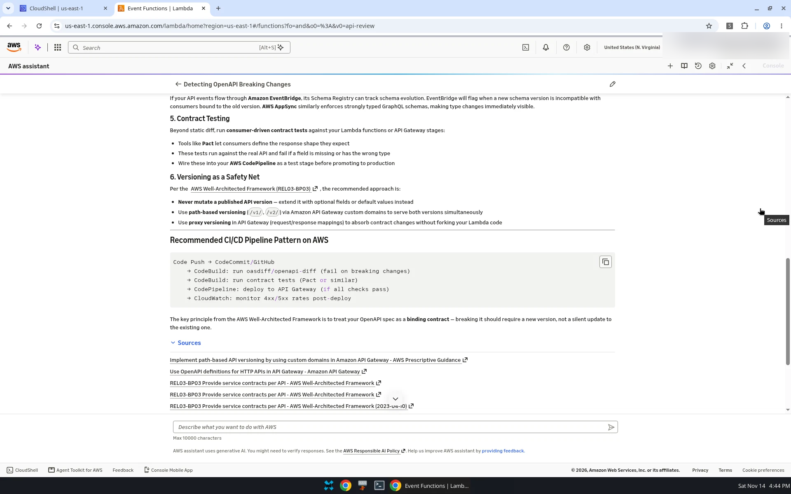

*Figure 41. Further down the same answer: "Contract Testing" (consumer-driven tests, with Pact named as an example), "Versioning as a Safety Net" citing the Well-Architected Framework item REL03-BP03, and a "Recommended CI/CD Pipeline Pattern on AWS" box that runs `oasdiff/openapi-diff` and fails on breaking changes before deploying. It closes with "treat your OpenAPI spec as a binding contract" and a list of sources. The account menu is blurred.*

What I took from it, using short quotes:

- It frames the control as a gate in the pipeline: "The most reliable approach is running a spec diff tool as a CI/CD gate that blocks merges when breaking changes are detected." That is the shape of this project, which implements its own diff (`src/apireview/diff.py`) and adds an old-client harness instead of adopting an off-the-shelf tool. I did not run oasdiff or Pact for this guide.
- It says API Gateway's own import check "only catches malformed specs — it does not detect semantic breaking changes like a removed field." That matches why the gate compares the old and the new document itself.
- Its "contract tests" suggestion resembles, in intent, the declarative client fixture and harness in Steps 2 and 4: a check that fails when a field is missing or has the wrong type.

### Question 2: keeping an LLM advisory step from changing a verdict

I asked: "How should an AWS Step Functions workflow keep an LLM advisory step from changing a deterministic release verdict?"

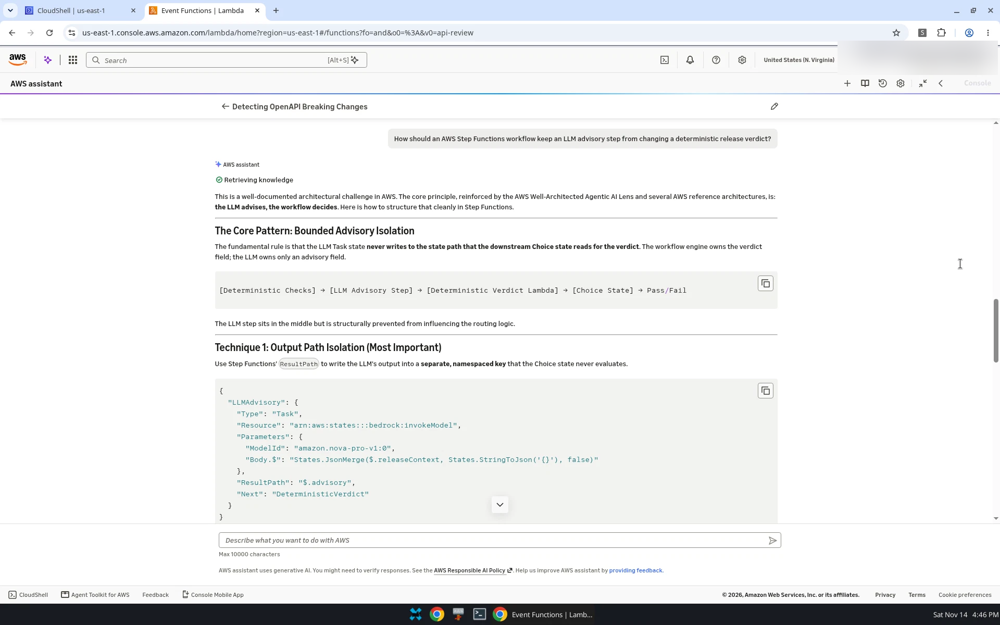

*Figure 42. The second question and the start of its answer: "the LLM advises, the workflow decides", "The Core Pattern: Bounded Advisory Isolation" with a one-line flow (deterministic checks, LLM advisory step, deterministic verdict Lambda, Choice state, pass or fail), and the start of "Technique 1: Output Path Isolation", a Task state that writes to `ResultPath` `$.advisory`. The example uses a direct `bedrock:invokeModel` Task with the model id `amazon.nova-pro-v1:0`. The account menu is blurred.*

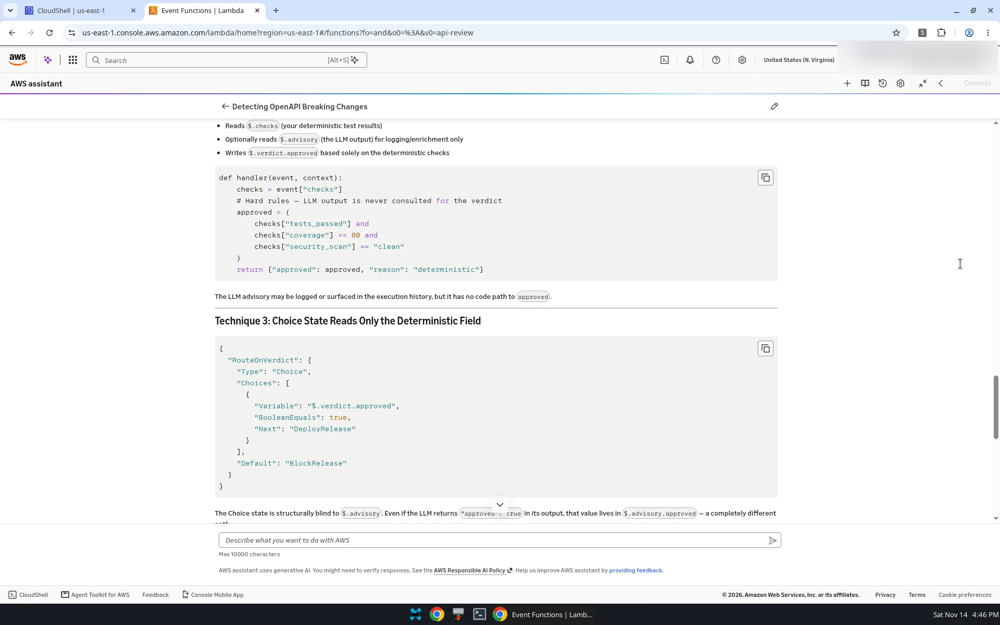

*Figure 43. The middle of the answer: a verdict handler that computes `approved` only from deterministic check results ("LLM output is never consulted for the verdict"), and "Technique 3: Choice State Reads Only the Deterministic Field", a Choice state that tests `$.verdict.approved`. The answer notes the Choice state is "structurally blind" to `$.advisory`. The account menu is blurred.*

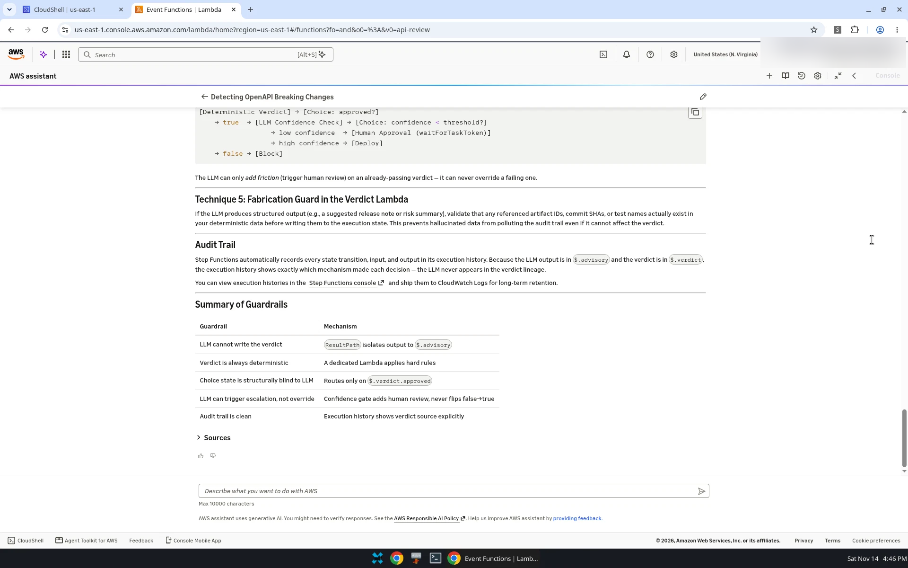

*Figure 44. The end of the answer: a confidence gate ("The LLM can only add friction (trigger human review) on an already-passing verdict — it can never override a failing one"), "Technique 5: Fabrication Guard in the Verdict Lambda", an audit-trail note about Step Functions execution history, and a "Summary of Guardrails" with five rows. The account menu is blurred.*

How this compares with what I built, stated carefully:

- **The principle matches.** In this workflow the `Gate` Choice state tests `$.verdict` for the string `PASS`, and that value is produced by the `Seal` step from the deterministic findings and the harness result only. The advisory is stored with `authoritative: false` and `includedInVerdict: false` and is hashed separately.
- **The mechanism is different.** Q's example isolates the model output with `ResultPath` on a direct `bedrock:invokeModel` Task. My state machine does not do that: every Task state returns `$`, and the model is called through Converse from the `analyze` Lambda. The isolation comes from the Lambda code and the verdict function, not from `ResultPath`. I did not change the workflow because of this answer.
- **One suggestion is not implemented.** Q's confidence gate (low confidence leads to human approval) does not exist here; a human review step happens on every `PASS` regardless of any model output.

Treat a Q answer as a prompt for a person to check against the code and the 72 tests, not as evidence. It does not replace the tests, and I did not use it as a code review.

---

## 12. Observability: logs, tracing, and what the X-Ray Trace Map did and did not show

### What each function is configured to do

Each Lambda in the stack has an explicit CloudWatch log group, `TracingConfig` `Active`, and the AWS OpenTelemetry layer. The API Gateway `live` stage and the Step Functions state machine have tracing turned on as well. The application code uses a small span helper (`tracing.py`) that records structured start and end events with the job id and optionally forwards to OpenTelemetry when it is installed. It never imports the maintenance-mode `aws-xray-sdk`, and a test (`test_repo_does_not_import_the_xray_sdk`) enforces that. The span helper strips `taskToken` and `reviewNonce` from attributes, and a test (`test_task_token_is_not_logged_or_returned`) checks the task token is not logged.

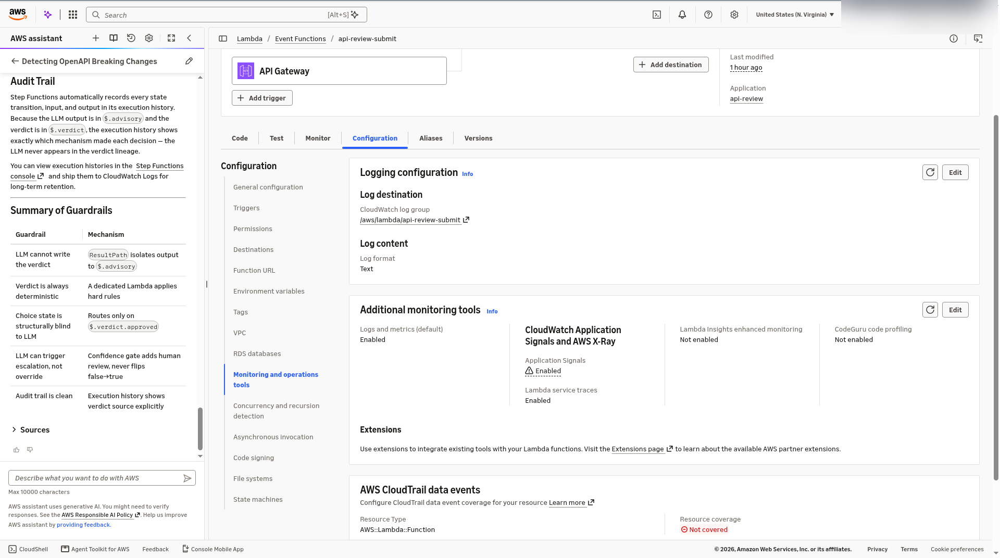

*Figure 45. The Lambda console for `api-review-submit`, Configuration tab, "Monitoring and operations tools". Logging configuration points at the log group `/aws/lambda/api-review-submit` with text log format, and under "Additional monitoring tools" the section "CloudWatch Application Signals and AWS X-Ray" shows "Lambda service traces" Enabled. The side panel on the left is the console's Amazon Q Developer chat panel, still showing the answer from Section 11. The account menu is blurred.*

### The first attempt: tracing was "on" and the Trace Map was empty

After the first deploy, every function had `TracingConfig` `Active`, the layer attached and these variables: `AWS_LAMBDA_EXEC_WRAPPER=/opt/otel-instrument`, `OTEL_PROPAGATORS=xray,tracecontext`, `OTEL_AWS_APPLICATION_SIGNALS_ENABLED=false` and an `OTEL_SERVICE_NAME` per function. I submitted a broken candidate (`job_d286cd77bde4a219e0f5`, idempotency key `cloud-broken-trace-0005`), which was `BLOCKED` as expected. In the X-Ray Trace Map the result was "No services", and there were 0 traces. I did not keep a screenshot of that first empty map; the Trace Map capture further down was taken after the fix and looks the same.

The cause was in the environment. `OTEL_AWS_APPLICATION_SIGNALS_ENABLED=false` made the layer skip the AWS distro, so the spans went to the default exporter address, `localhost:4318`, and were dropped inside the function. The fix, in commit `37567ae`, sets the distro, the configurator and the exporter explicitly, and points the exporter at the X-Ray OTLP endpoint. This is the real block from `scripts/assemble_template.py`, with the repository's own comment:

```python
# The layer only selects aws_distro when Application Signals is true.
# With it false, spans default to localhost:4318 and the Trace Map stays empty.
# Export directly to the X-Ray OTLP endpoint, which Transaction Search stores in aws/spans.
"OTEL_AWS_APPLICATION_SIGNALS_ENABLED": "false",
"OTEL_EXPORTER_OTLP_PROTOCOL": "http/protobuf",
"OTEL_EXPORTER_OTLP_TRACES_ENDPOINT": {"Fn::Sub": "https://xray.${AWS::Region}.amazonaws.com/v1/traces"},
"OTEL_LOGS_EXPORTER": "none",
"OTEL_METRICS_EXPORTER": "none",
"OTEL_PROPAGATORS": "xray,tracecontext",
"OTEL_PYTHON_CONFIGURATOR": "aws_configurator",
"OTEL_PYTHON_DISTRO": "aws_distro",
"OTEL_SERVICE_NAME": {"Fn::Sub": f"${{ProjectName}}-{suffix}"},
"OTEL_TRACES_EXPORTER": "otlp",
"OTEL_TRACES_SAMPLER": "parentbased_always_on",
```

The template test (`test_template_contracts`) now asserts these values, the `Active` tracing mode, tracing on the API stage and the state machine, and the two X-Ray write actions in the submit role.

### After the fix: redeploy, a job, and a read-only check

I redeployed from `37567ae` (the log ended with `Successfully created/updated stack - api-review`) and submitted another broken candidate, `job_e02c5e57722dec400590` (key `cloud-broken-trace-0006`), which was `BLOCKED` again.

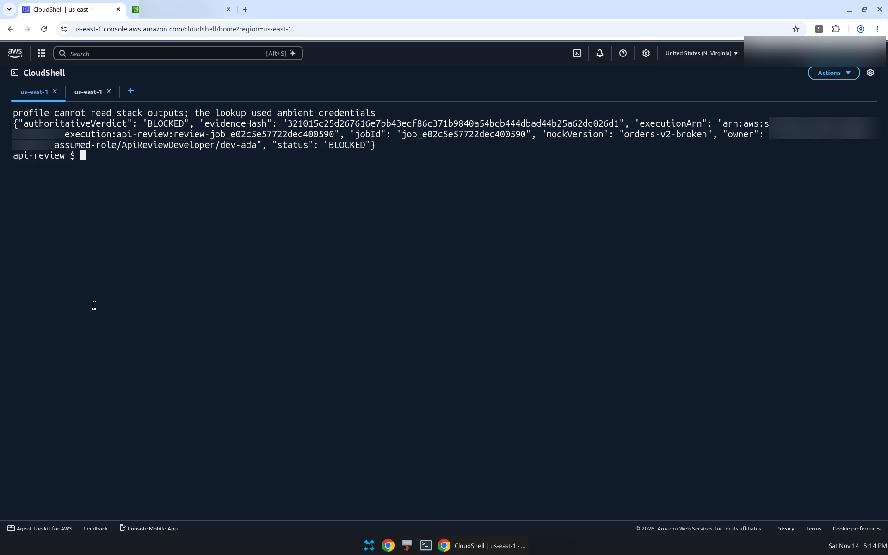

*Figure 46. The submit output for the second tracing test job: `authoritativeVerdict` and `status` both `BLOCKED`, `mockVersion` `orders-v2-broken`, the job id `job_e02c5e57722dec400590`, an `evidenceHash`, and an owner of `…assumed-role/ApiReviewDeveloper/dev-ada`. The first line is a warning the script printed to stderr: "profile cannot read stack outputs; the lookup used ambient credentials". It is not a failure: the developer profile was denied access to the stack outputs, so `aws_demo.py` read the endpoint from the stack with CloudShell's own credentials and still signed the API call itself as the developer role. The account ID inside the ARNs, including the part that wrapped onto the next lines, and the account menu are blurred.*

To look at the configuration without changing anything, I wrote `scripts/check_tracing.sh`. It does not submit a job. It lists each function's tracing mode and the OpenTelemetry variables, reads the API stages and the state machine, asks X-Ray for trace summaries from the last 30 minutes, and prints the X-Ray indexing rules and the trace segment destination:

```bash
aws xray get-trace-summaries --region "$REGION" --start-time "$START" --end-time "$END" --output json
aws xray get-indexing-rules --region "$REGION" --output json
aws xray get-trace-segment-destination --region "$REGION" --output json
```

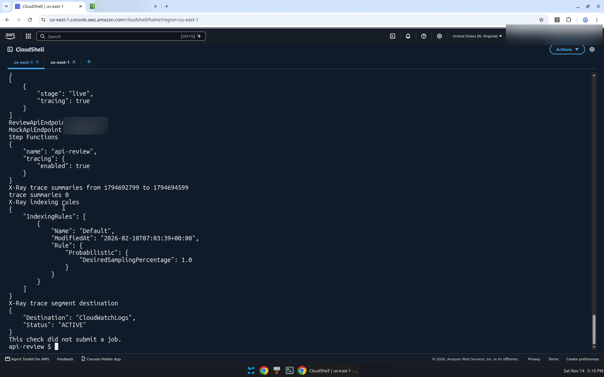

*Figure 47. The tail of `scripts/check_tracing.sh` at 5:16 PM ET. The `live` stage reports `"tracing": true` for the review API (the API ids are blurred), Step Functions reports `"name": "api-review"` with `"enabled": true`, and the X-Ray trace summaries over the last 30 minutes number 0. The indexing rules show a single rule named `Default` that is `Probabilistic` with `DesiredSamplingPercentage` 1.0, and the trace segment destination is `CloudWatchLogs` with status `ACTIVE`. The last line confirms "This check did not submit a job." The account menu and the second tab's bucket name are blurred.*

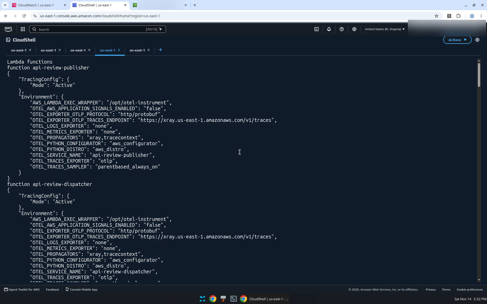

*Figure 48. The start of the same check, captured at 5:32 PM ET, for the `api-review-publisher` and `api-review-dispatcher` functions: `TracingConfig` mode `Active`, `AWS_LAMBDA_EXEC_WRAPPER` `/opt/otel-instrument`, `OTEL_PYTHON_DISTRO` `aws_distro`, `OTEL_PYTHON_CONFIGURATOR` `aws_configurator`, `OTEL_TRACES_EXPORTER` `otlp`, the traces endpoint `https://xray.us-east-1.amazonaws.com/v1/traces`, and `OTEL_SERVICE_NAME` per function. The check printed the same block for every function; the capture shows these two, and I did not capture the rest of the list. The account menu is blurred.*

### What CloudWatch Transaction Search showed

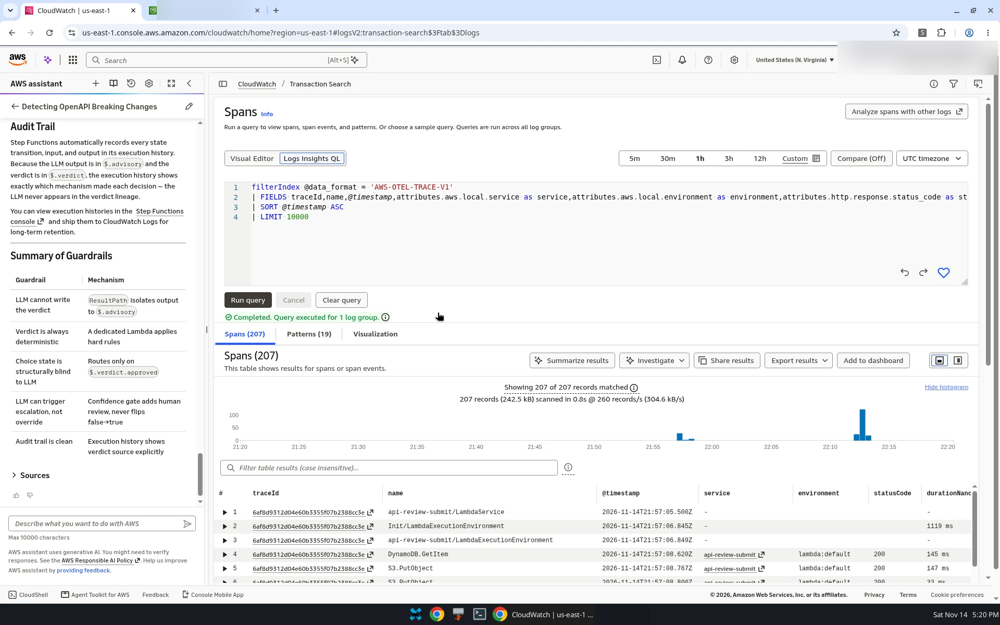

*Figure 49. CloudWatch Transaction Search, Spans tab, with the timezone set to UTC and a one-hour window. The query (`filterIndex @data_format = 'AWS-OTEL-TRACE-V1'`, sorted by timestamp) completed against one log group and returned 207 spans (207 records, 242.5 kB, scanned in 0.8 seconds). The histogram has a small cluster at about 21:57 UTC (4:57 PM ET) and a larger one at about 22:12 to 22:13 UTC (5:12 to 5:13 PM ET); the visible rows are spans such as `api-review-submit/LambdaService`, `DynamoDB.GetItem` and `S3.PutObject`. The commit for the tracing fix was made at 5:09 PM ET, and I did not capture which job each span belongs to. The side panel is the Amazon Q Developer chat panel from Section 11, and the account menu is blurred.*

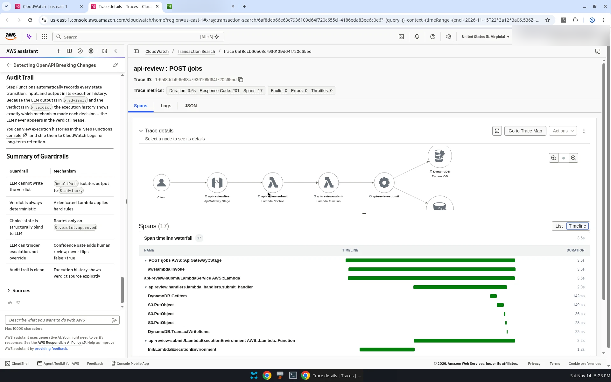

*Figure 50. The trace details page for "api-review : POST /jobs": duration 3.6 s, response code 201, 17 spans, 0 faults, 0 errors and 0 throttles. The service graph runs client, the API Gateway stage, the Lambda context for `api-review-submit`, the function, and on to DynamoDB, and the timeline lists `POST /jobs` (3.6 s), `awslambda.Invoke`, the handler span `apireview.handlers.lambda_handlers.submit_handler` (2.0 s), `DynamoDB.GetItem` (142 ms), three `S3.PutObject` calls (149 ms, 36 ms and 28 ms) and `DynamoDB.TransactWriteItems` (22 ms), then the Lambda execution environment with its init span. The leading hexadecimal digits of this trace's id are its start time in epoch seconds (`6af8dcb6`, which decodes to 22:12:06 UTC, 5:12 PM ET); that is derived from the id, not shown by the console, and it falls after the tracing commit. It shows an end-to-end request across API Gateway, Lambda, DynamoDB and S3 with no errors. The account menu is blurred.*

### What it did not show


*Figure 51. The CloudWatch Trace Map with a 15-minute window, captured at 5:19 PM ET (after the fix): "No services", "Try adjusting the time range", and "No node selected". This is the same view that was empty before the fix, so for the Trace Map the change made no visible difference in this capture. The side panel is the Amazon Q Developer chat panel from Section 11, and the account menu and a browser tab title are blurred.*


*Figure 52. CloudWatch Log groups (39 in total) filtered on `/aws/spans`: "0 matches" and "No log groups matched your filter". The filter was for `/aws/spans`, the name the repository's template comment gives for where Transaction Search stores spans, and it found nothing, while the spans in the previous figures were queryable in Transaction Search. I did not investigate further, so I make no claim about where those spans are stored or why the group is not listed. The side panel is the Amazon Q Developer chat panel from Section 11, and the account menu is blurred.*

Putting the observations together, without claiming more than I saw:

- Tracing configuration is correct and complete on every layer I checked: the functions, the API stage and the state machine.
- Spans from these functions are visible in CloudWatch Transaction Search (207 in the one-hour window), including a 17-span `POST /jobs` trace with no faults or errors.
- X-Ray trace summaries over the last 30 minutes were 0 and the Trace Map stayed on "No services".
- My reading, as an observation and not a guarantee: the trace segment destination is `CloudWatchLogs` (ACTIVE), so spans are stored in Transaction Search, and the indexing rule is `Default` probabilistic at 1.0%, so only about 1% of traces are indexed into X-Ray trace summaries and Trace Map entries. That would explain an empty map for a handful of test requests, but I did not test it (for example by raising the sampling percentage), so treat it as the explanation I find most likely, not as a verified one.
- The first-attempt failure (spans exported to `localhost:4318`) is a separate problem, and the commit fixed it. In my captures I did not isolate that fix from the Transaction Search setup: there are also spans at 21:57 UTC, before the commit, in the same table, and I did not investigate why.
- The two AgentCore console views (Figures 24 and 27) both show tracing as "Not enabled" for the gateway and the interpreter.

---

## 13. What was tested live, locally, and only proposed

**Observed live in AWS (us-east-1, November 14, 2026):**

- The CloudFormation stack `api-review`, including the first failed attempt and the working deploys; redeploys with the Bedrock advisory enabled, and the redeploy from `37567ae` for tracing.
- The broken candidate `BLOCKED` with one informational and two breaking findings; the corrected candidate `PASS`, `WAITING_REVIEW`, then `APPROVED`; two more broken candidates for the tracing check, both `BLOCKED`.
- A replayed approval rejected; a blocked job's review-context and review both rejected; the developer role denied the reviewer route by an explicit IAM deny.
- Two Bedrock comparison runs over five models each, including the Legacy and payment-instrument refusals; the live advisory on a real job from Claude Haiku 4.5.
- AgentCore Gateway, Policy (three Cedar permits) and Code Interpreter, with the allow, policy-deny, other-identity and interpreter checks, and four console views.
- The 72-test suite passing in CloudShell at `9e702c8`.
- The deployed services in the console: Step Functions executions, DynamoDB items, the S3 bucket through the CLI, SQS queues, the EventBridge bus and rule, Lambda functions and CloudWatch log groups (Section 10).
- Tracing configuration on every layer, spans and a 17-span trace in CloudWatch Transaction Search, and a Trace Map that stayed empty (Section 12).
- Two design questions answered by Amazon Q Developer in the console (Section 11), used as a planning assist only.

**Tested locally only (72 tests, no AWS calls):** the diff direction rules, the harness, sealing, idempotency conflicts, duplicate-event and crash/reconcile handling, DLQ separation, the policy mirror, DynamoDB Decimal handling, advisory parsing and report shaping, runtime-client wiring, the AgentCore helper logic, the template contract (including the tracing variables) and the cleanup helpers (batching, pagination, a missing bucket and the report format).

**Proposed or not demonstrated:**

- An AgentCore Runtime hosting an advisory agent that calls the gateway.
- The workflow running with `SPEC_CHECK_MODE=agentcore` (Code Interpreter inside the state machine). The live workflow uses `SPEC_CHECK_MODE=in-process`.
- An X-Ray Trace Map that lists the services. It showed "No services" in every capture; the spans are visible only in Transaction Search, and I did not test the sampling explanation.
- The S3 console's view of versioning and default encryption (the panels returned "Unknown Error"). The template declares both, and I did not confirm them in the console.
- Amazon Q Developer on this repository's code. The two answers were general design guidance.
- The cleanup run (Section 15), including the new version-aware bucket emptying and the final existence check. Both are covered by unit tests only.

---

## 14. Troubleshooting: the real fix chain

Every item below is something that actually went wrong in this build. Where I have the exact message from a run, I quote it. Where the only evidence is the code and the commit that fixed it, I describe the behavior the code now handles and do not invent an error string. Commit ids are in the public repository.

### Deploying the core stack

- **Template too large for a direct deploy** (`955fb9e`). *Symptom:* "Templates with a size greater than 51,200 bytes must be deployed via an S3 Bucket" (Figure 4). *Fix:* upload through the code bucket with `--s3-bucket` and `--s3-prefix`, which the script now does. The generated template is 94,421 bytes.
- **`Payload.$$` rejected** (`4019058`). *Cause:* the state machine definition is passed through `Fn::Sub`, which treats `$` specially, so the `$$.Task.Token` context reference did not survive. *Fix:* `scripts/assemble_template.py` doubles the `$` characters when it embeds the definition, so always regenerate the template with that script instead of pasting the JSON. The failed create left the stack in `ROLLBACK_COMPLETE`; that stack had to be deleted before I could redeploy.
- **HTTP 500 "AWS clients are not configured"** (`c484c18`). *Cause:* the handlers fail closed when no AWS clients are injected, and the Lambda runtime had none wired. *Fix:* `runtime_clients.py` builds and caches the SDK clients only inside the Lambda runtime, only when needed, and never at import time.
- **Redeploys did not update the code** (`d17ae91`). *Cause:* the zip was uploaded under one static S3 key, so CloudFormation saw no change. *Fix:* a content-addressed key, `api-review/lambda-<first 16 hex of the zip's sha256>.zip`.
- **`authorization_failed`: "unsupported caller ARN shape"** (`711708d`). *Cause:* I was calling as the CloudShell root user, and the handlers accept only the developer and reviewer roles. *Fix:* the scripted operator user and the two roles, and the three CLI profiles (Step 9).
- **`CreateRole` failed with `MalformedPolicyDocument`: "Invalid principal"** (`df151ea`). *Cause:* IAM eventual consistency: the role's trust policy named a user created seconds earlier. *Fix:* `setup_demo_identities.sh` retries up to 8 times with a 10-second wait on exactly that error.
- **Report returned HTTP 500: `Decimal` is not JSON serializable** (`afa8fdd`). *Cause:* DynamoDB returns numbers as `Decimal`, and the evidence contains money-style values. *Fix:* convert to native numbers on read, and a test (`test_report_serializes_decimal_evidence_and_hash_matches`) proves the evidence hash still matches after the conversion.

### The Bedrock advisory and the comparison

- **Models refused as Legacy** (Sonnet 4.5, Llama 3.3 70B, then Llama 4 Maverick). *Symptom:* `ResourceNotFoundException: Access denied. This Model is marked by provider as Legacy and you have not been actively using the model in the last 30 days.` *Fix:* none in code; replace the model, and let the comparison script record the refusal per model.
- **Sonnet 4.6 refused for a payment instrument.** *Symptom:* "Model access is denied due to INVALID_PAYMENT_INSTRUMENT: A valid payment instrument must be provided.. Your AWS Marketplace subscription for this model cannot be completed at this time." *Fix:* an account-level setup issue for that model, not something the code can resolve; I left it as a recorded result.
- **Strict parser rejected valid model output** (`de60ed5`). *Symptom:* run 1 parse results 0/3, 2/3 and 0/3 for Haiku, Pixtral and Nova; the live job's advisory said "model explanations or proposals were not arrays". *Cause:* the original parser accepted only a bare, exactly shaped JSON object, while a model can wrap it in a code fence or add prose. *Fix:* the parser changes described in Section 8.
- **The report dropped the model text** (`f0e6102`). *Symptom:* `modelStatus: parsed` but no explanations on the report (Figure 19). *Cause:* the report builder copied only `source`, `modelStatus` and `error`. *Fix:* `report_advisory` now returns the parsed explanations and proposals, with source `bedrock-converse`.
- **Mistyped job ids.** *Symptom:* `not_found` on `status` and `report` for a job that existed (the real id was `job_63b4574b6378286872e1`; I typed `job_63b5474b…`). *Fix:* never type a job id. `aws_demo.py submit` saves the id to `~/.api-review-last-job`, and every later command takes `--job-id last`. When you do need an id, take it from the output of a command, not from memory.

### CloudShell typing problems

- *Symptom:* the CloudShell terminal sometimes dropped or swapped characters in long commands and occasionally froze, so a command that looked right on screen was not what ran. *What worked:* reload the tab (F5) or reopen `https://us-east-1.console.aws.amazon.com/cloudshell/home?region=us-east-1`; your home directory, including `~/api-review`, persists. Prefix commands with `clear;` so you can read exactly what was typed, then check the line before pressing Enter. Do not hand-type ids: use `--job-id last` or a shell variable. Use short wrapper variables for long values, and check a deploy by grepping the log, `grep 'Successfully created/updated stack' ~/deployN.log`, rather than reading the scrollback. The repository's CloudShell checkout is `~/api-review`.

### The AgentCore chain, in the order it happened

1. **Roles by hand** (`39b1f6e`). The first version assumed two role ARNs were supplied. *Fix:* `enable` creates `ApiReviewCodeInterpreter` and `ApiReviewGateway` itself when they are not provided, and a `validate` command and teardown were added.
2. **Resource names that violate each API's name pattern** (`82d1a52`). The first names were hyphenated (`api-review-checker`, `api-review-tools`), which does not match the Code Interpreter pattern `[a-zA-Z][a-zA-Z0-9_]{0,47}`. *Fix:* `ApiReviewChecker`, `ApiReviewTools`, `ApiReviewPolicy`, `ReviewTools` and the three `Allow…` policy names, with a test (`test_resource_names_match_documented_patterns`) that matches each against the documented regex. The gateway and target names are the two that may contain hyphens; the policy engine, the policies and the Code Interpreter may not.
3. **MCP protocol version** (`2d80018`). The validation client sent the header `MCP-Protocol-Version: 2025-11-25`, but the gateway I created advertises only the older `2025-03-26` (the code comment says gateways created before the later protocol versions advertise only that one). The unit-test fixture for this case is a JSON-RPC error reading `Unsupported protocol version: 2025-11-25` with `supported: ["2025-03-26"]`. *Fix:* the client reads the gateway's supported versions, prefers `2025-03-26`, and renegotiates from the server's error (`negotiated_protocol`).
4. **Code Interpreter trust** (`2d80018`). A trust policy tied to one specific interpreter id does not match when the session starts. *Fix:* `aws:SourceArn` is `arn:aws:bedrock-agentcore:<region>:<ACCOUNT_ID>:*` with `aws:SourceAccount` set, which is the documented form. The code also retries session start while the role is "not assumable yet".
5. **Gateway trust** (`fe96ad7`). `CreateGateway` assumes the gateway role while validating the policy engine, and the source of that call is the *policy engine*, not the gateway, so a gateway-only `aws:SourceArn` is rejected. *Fix:* the same account-wide `…:*` source ARN for the gateway role (`test_gateway_trust_stays_account_wide`).
6. **Gateway reuse** (`fe96ad7`). A re-run of enable did not reuse the gateway that already existed. *Fix:* list gateways (the response key is `items`; the gateway's id is the lowercased name plus a suffix), reuse the match, and attach the policy engine if it is missing.
7. **Checker stream parse** (`fe96ad7`). The Code Interpreter returns an event stream, and the checker's result object contains nested objects, so taking the last `{` read the inside of `findings`. *Fix:* collect the text from the stream events, parse the first balanced top-level object, and require `ok: false` with both expected rule ids (`test_checker_output_parses_the_first_object_and_expected_findings`).
8. **Cedar principal** (`38eb412`). The first permits used an unconstrained `principal`. *Fix:* `principal is AgentCore::IamEntity`, so the permit matches the IAM caller type. Enable also refreshes stored policies that differ from the desired statement.
9. **FAILED policies were never replaced** (`9aacb84`). A policy that failed validation stayed in the engine under the same name, so a re-run kept a permit that permitted nothing. *Fix:* enable deletes any policy that is not already the desired statement in `ACTIVE`, waits until the name is gone, and creates all three again with `FAIL_ON_ANY_FINDINGS`; the action ids are built from the target's real tool names, and `statusReasons` is printed as the validation report.
10. **The "overly permissive" finding** (`5d5df23`). With `principal is AgentCore::IamEntity` alone, Cedar validation flagged each permit as overly permissive (any IAM caller). *Fix:* the `when { principal.id like "arn:aws:sts::<ACCOUNT_ID>:assumed-role/ApiReviewDeveloper*" }` clause you can see in Figure 26. That is also what makes the reviewer identity fail the `other-identity` check.
11. **Gateway 403 and swapped tool routes** (`fc35e03`). Two issues together. The gateway signs its call to the review API as `ApiReviewGateway`, not as the developer session, and the status Lambda answered 403 because the caller was not the job's owner; the gateway surfaced that as an internal error. Separately, the tool-to-route mapping had the read tools on the wrong routes. *Fix:* `caller_may_read_job` lets the gateway role read a job owned by `ApiReviewDeveloper` (any other caller must be the owner), the status Lambda was redeployed, and the mapping is now `read_artifacts` → `GET /jobs/{jobId}`, `read_test_results` → `GET /jobs/{jobId}/report`, `request_spec_check` → `POST /jobs` (`test_tool_routes_match_the_operation_names`). Validate now also prints the job id it used and the last five minutes of the relevant Lambda and gateway logs when a read fails.

After these, the validation in Step 15 passed on commit `fc35e03`.

### Tracing, console and cleanup

- **Tracing "on" but the Trace Map empty** (`37567ae`). *Symptom:* after a `BLOCKED` job (`job_d286cd77bde4a219e0f5`, key `cloud-broken-trace-0005`) the X-Ray Trace Map showed "No services" and there were 0 traces, although every function had `TracingConfig` `Active`. *Cause:* `OTEL_AWS_APPLICATION_SIGNALS_ENABLED=false` made the layer skip the AWS distro, so spans went to `localhost:4318` and were dropped. *Fix:* each function now sets `OTEL_PYTHON_DISTRO=aws_distro`, `OTEL_PYTHON_CONFIGURATOR=aws_configurator`, `OTEL_TRACES_EXPORTER=otlp` and `OTEL_EXPORTER_OTLP_TRACES_ENDPOINT=https://xray.us-east-1.amazonaws.com/v1/traces`; I redeployed (`Successfully created/updated stack - api-review`) and added `scripts/check_tracing.sh` to read the configuration back. *Still open:* the Trace Map stayed on "No services" afterwards, while Transaction Search showed spans (Section 12).
- **"profile cannot read stack outputs; the lookup used ambient credentials"** (a warning, not an error). The developer profile is denied access to the stack outputs, so `aws_demo.py` reads the endpoint from the stack with CloudShell's own credentials and prints this warning to stderr. The API call itself is still signed as the developer role, which the job's `owner` shows (Figure 46).
- **S3 console "Unknown Error"** on the Objects and Properties tabs (Figure 32). I did not establish the cause (I noted only that the bucket has no bucket policy). *What worked:* `aws s3 ls` from CloudShell (Figures 33 and 34).
- **Cleanup could be blocked by object versions** (`9e702c8`). This was a risk I found by reading the script, not a failure I hit in AWS. *Cause:* the artifact bucket is versioned, and `aws s3 rm --recursive` leaves older versions and delete markers behind, which stops CloudFormation from deleting the bucket. *Fix:* `scripts/empty_bucket_versions.py` deletes every version and delete marker before the stack is deleted, and `scripts/verify_cleanup.py` prints a final existence check (Section 15).

---

## 15. Cleanup (commands documented; run at the end)

**Status: I have not run the cleanup.** The stack and the AgentCore resources described above still exist in my account as I write this. These are the commands, what they do in order, and how to verify that everything is gone. Run them when you are done with the guide. Since commit `9e702c8` the script empties every object version and delete marker before it deletes the stack, and it ends with an existence check; both were added after I found the versioning risk by reading the script, and both are covered only by unit tests (no AWS calls), not by a live run.

### The command

```bash
cd ~/api-review && CONFIRM_CLEANUP=yes REGION=us-east-1 bash scripts/cleanup_cloudshell.sh
```

Without `CONFIRM_CLEANUP=yes` the script prints a refusal and exits with status 2 and deletes nothing. `REGION` is required.

### What it removes, in order

1. **AgentCore** (unless `CLEANUP_AGENTCORE=no`): runs `scripts/teardown_agentcore.sh`, which runs `agentcore_setup.py teardown`. That deletes the gateway targets and the gateway `ApiReviewTools`, then the policies and the policy engine `ApiReviewPolicy`, then the Code Interpreter `ApiReviewChecker`, then the roles `ApiReviewCodeInterpreter` and `ApiReviewGateway` (their inline policies first), and removes `build/agentcore-ids.json`. It looks resources up by those exact names (and the ids in the state file), so it does not touch other gateways, engines or interpreters.
2. **Both buckets are emptied, versions included.** `scripts/empty_bucket_versions.py` lists every object version and delete marker in the artifact bucket (its name is read from the stack output `ArtifactBucketName`) and in the code bucket (`api-review-code-<ACCOUNT_ID>-us-east-1`, or `$DEPLOY_BUCKET`), deletes them in batches of 1,000 and follows pagination. A bucket that does not exist deletes nothing. It prints `Removed N object versions and delete markers from <bucket>.` for each bucket.
3. **The stack is deleted** (`aws cloudformation delete-stack` for `api-review`, or `$STACK_NAME`) and the script waits for `stack-delete-complete`. That removes the REST APIs, Lambda functions and their log groups, the state machine, the queues, the EventBridge bus and rule, the DynamoDB table and the per-function IAM roles.
4. **The code bucket is removed.** If it still exists, the script empties it again and runs `aws s3 rb`.
5. **IAM demo identities** (unless `CLEANUP_IDENTITIES=no`): runs `scripts/teardown_demo_identities.sh`, which deletes the inline policies and then the roles `ApiReviewDeveloper` and `ApiReviewReviewer`, the access keys, inline policies and the IAM user `api-review-operator`, and strips the three profiles (`api-review-operator`, `api-review-developer`, `api-review-reviewer`) from `~/.aws/config` and `~/.aws/credentials`.
6. **A final existence check:** `scripts/verify_cleanup.py` prints one line per resource.

The core of the emptying step is small. This is the real code, trimmed to the two functions that matter:

```python
def version_delete_batches(pages, batch_size=1000):
    objects = []
    for page in pages:
        for key in ("Versions", "DeleteMarkers"):
            for item in page.get(key) or []:
                objects.append({"Key": item["Key"], "VersionId": item["VersionId"]})
    return [objects[start : start + batch_size] for start in range(0, len(objects), batch_size)]

# purge_bucket(client, bucket) pages through list_object_versions (KeyMarker and
# VersionIdMarker), calls delete_objects for each batch, and returns how many
# versions and delete markers it removed. A missing bucket returns 0.
```

The existence check reports `exists`, `absent` or `unknown` for each of these: the stack `api-review`, the artifact bucket, the code bucket, the table `api-review-jobs`, the roles `ApiReviewDeveloper`, `ApiReviewReviewer`, `ApiReviewCodeInterpreter` and `ApiReviewGateway`, the user `api-review-operator`, the gateway `ApiReviewTools`, the policy engine `ApiReviewPolicy` and the code interpreter `ApiReviewChecker`. After a clean run every line should read `absent`. `unknown` means the lookup failed for a reason other than "not found" (for example, missing permissions), so check that resource in the console; the script does not guess. The four tests in `tests/test_cleanup_versions.py` cover the batching at 1,000, pagination and a missing bucket, the report format and the AgentCore example JSON names. None of them calls AWS.

The two flags let you keep a layer:

```bash
# remove the stack but keep the AgentCore resources
CONFIRM_CLEANUP=yes REGION=us-east-1 CLEANUP_AGENTCORE=no bash scripts/cleanup_cloudshell.sh
# remove the stack but keep the operator user and caller roles
CONFIRM_CLEANUP=yes REGION=us-east-1 CLEANUP_IDENTITIES=no bash scripts/cleanup_cloudshell.sh
```

You can also run each teardown on its own: `CONFIRM_CLEANUP=yes REGION=us-east-1 bash scripts/teardown_agentcore.sh` and `CONFIRM_CLEANUP=yes bash scripts/teardown_demo_identities.sh`.

One thing to know before you run it: if you keep the identities (`CLEANUP_IDENTITIES=no`), the inline `api-review-invoke-gateway` policy that `enable_agentcore.sh` put on `ApiReviewDeveloper` and `ApiReviewReviewer` stays on those roles, because only the identity teardown removes the roles' inline policies.

### Verify that it is gone

The script's own existence check covers the stack, buckets, table, IAM entities and the three AgentCore resources. These commands cover what it does not check. Each should report that the resource does not exist or return nothing.

```bash
aws sqs list-queues --region us-east-1 --queue-name-prefix api-review                  # no queues
aws stepfunctions list-state-machines --region us-east-1 --query "stateMachines[?name=='api-review']"   # []
aws logs describe-log-groups --region us-east-1 --log-group-name-prefix /aws/lambda/api-review          # none
aws logs describe-log-groups --region us-east-1 --log-group-name-prefix /aws/states/api-review          # none (state machine log group)
aws events list-event-buses --region us-east-1 --name-prefix api-review                # no bus named api-review
grep -c 'api-review' ~/.aws/config ~/.aws/credentials                                  # 0 matches for the profiles
```

If you want to double-check the main pieces by hand as well:

```bash
aws cloudformation describe-stacks --region us-east-1 --stack-name api-review          # "does not exist"
aws s3api head-bucket --bucket "api-review-code-<ACCOUNT_ID>-us-east-1"                # 404 Not Found
aws s3api head-bucket --bucket "<ArtifactBucketName>"                                  # 404 Not Found
aws dynamodb describe-table --region us-east-1 --table-name api-review-jobs            # ResourceNotFoundException
```

### Manual console checks

- **CloudFormation:** the stack `api-review` is not listed (or shows `DELETE_COMPLETE` under Deleted stacks).
- **Amazon S3:** no bucket whose name starts with `api-review-code-` or `api-review-artifactbucket`.
- **DynamoDB:** no table `api-review-jobs`. **SQS:** no `api-review-work` or `api-review-…dlq` queues. **EventBridge:** no event bus named `api-review`. **Step Functions:** no state machine `api-review`. **CloudWatch:** no `/aws/lambda/api-review-*` or `/aws/states/api-review` log groups.
- **IAM:** no roles `ApiReviewDeveloper`, `ApiReviewReviewer`, `ApiReviewGateway`, `ApiReviewCodeInterpreter`, and no user `api-review-operator`.
- **Amazon Bedrock AgentCore console:** no gateway `ApiReviewTools` under Gateways, no `ApiReviewPolicy` under Policy, and no `ApiReviewChecker` under Code Interpreter. The AgentCore documentation describes a retention period for Code Interpreter session data, so I do not promise that every trace of past sessions disappears at once.
- **CloudShell home directory:** you may also delete the local files `~/api-review-*.log`, `~/deploy*.log`, `~/review-context.json`, `~/broken-report.json`, `~/.api-review-last-job` and `~/api-review/build/`. They hold no credentials.
- Bedrock model access needs no cleanup: the advisory calls create no resources.

---

## 16. Conclusion

A breaking API change is a small diff and a large outage, and the failure mode is that the person approving it is shown the wrong evidence. This gate puts the decision where it belongs: a deterministic diff and a fixed old-client harness decide, and nothing probabilistic can overrule them. In AWS, with real roles, the broken orders candidate was `BLOCKED` with the exact two breaks (the removed required `next_cursor` and the `amount` number-to-string change), the corrected candidate passed and waited, a *different* identity approved the sealed evidence once, a replay and a blocked-job approval both failed closed, and the developer role was denied the reviewer route by IAM itself.

Bedrock adds something genuinely useful on top: plain-language explanations and proposed fixes on the report, from a model of your choice, clearly labeled as advisory, hashed separately and excluded from the verdict. The comparison runs also showed something I would not have guessed from the documentation: a good share of the models I tried were simply unavailable to my account, for lifecycle or account-setup reasons, so a comparison that records refusals is part of the design. AgentCore adds a tool boundary you can read: a Gateway that exposes three read tools, a Cedar policy that permits only the developer role to call them, an `approve` tool that exists only to be denied, and a Code Interpreter that runs a fixed checker and found the same two breaks.

Two smaller lessons came from the console work. First, "tracing enabled" on a function does not mean spans arrive anywhere: the first attempt had every function on `Active` tracing and an empty Trace Map, because one environment variable made the layer export to `localhost:4318`. Second, even after the fix the Trace Map stayed on "No services" while CloudWatch Transaction Search showed the spans, so I would check the span view, not only the map, before concluding that tracing is broken. Amazon Q Developer played a small, honest role: I asked it two design questions, its principle ("the LLM advises, the workflow decides") matched what I had built, and its mechanism differed from mine.

What I would still do before calling this production-ready is on the "proposed" list above: host the advisory agent in an AgentCore Runtime, run the workflow with the Code Interpreter inside it, understand why the Trace Map stays empty (the indexing rule samples 1% of traces, which I did not test), and run and verify the cleanup. I would rather publish that gap than paper over it.

The code, the scripts and the 72 tests are in the repository: https://github.com/Ajayuppu/before-you-merge-api-release-gate.

---

## Appendix A. Repository map

- `src/apireview/diff.py`: response and request compatibility rules
- `src/apireview/harness.py`: fixed assertions and the mock URL allow-list
- `src/apireview/evidence.py`: sealing and the verdict function
- `src/apireview/advisory.py`: Converse request, parser, merge and report shaping
- `src/apireview/agent_boundary.py`: local policy mirror of the three allowed tools
- `src/apireview/checker.py`: the fixed spec checker (also run in Code Interpreter by `validate`)
- `src/apireview/identity.py`: caller identity from the API Gateway request context
- `src/apireview/handlers/lambda_handlers.py`: all 15 cloud handlers
- `cloud/statemachine.asl.json` and `cloud/template.deploy.json`: workflow and generated CloudFormation
- `cloud/agentcore/*.cedar` and `*.json`: reference Cedar and create requests, now using the live names (`ApiReviewChecker`, `ApiReviewTools`, `AllowReadArtifacts`). The Python script `scripts/agentcore_setup.py` remains the source of truth for names and statements
- `scripts/deploy_cloudshell.sh`, `setup_demo_identities.sh`, `enable_agentcore.sh`, `validate_agentcore.sh`, `compare_bedrock_models.py`, `aws_demo.py`, `cleanup_cloudshell.sh`, `empty_bucket_versions.py`, `verify_cleanup.py`, `check_tracing.sh`, `teardown_agentcore.sh`, `teardown_demo_identities.sh`
- `fixtures/`: the three orders documents, the client fixture and three mock bodies

## Appendix B. Commands in one place

```bash
# 1. clone and test
git clone https://github.com/Ajayuppu/before-you-merge-api-release-gate ~/api-review && cd ~/api-review
pip install pytest && python3 -m pytest -q

# 2. deploy (core stack)
CONFIRM_DEPLOY=yes REGION=us-east-1 OTEL_LAYER_ARN='<current regional ADOT Python layer ARN>' bash scripts/deploy_cloudshell.sh

# 3. caller identities
CONFIRM_IDENTITIES=yes REGION=us-east-1 bash scripts/setup_demo_identities.sh

# 4. broken, corrected, review (see Steps 10 to 13 for the full commands)
python3 scripts/aws_demo.py --region us-east-1 --profile api-review-developer submit ... --idempotency-key <new key>
python3 scripts/aws_demo.py --region us-east-1 --profile api-review-reviewer review-context --job-id last
python3 scripts/aws_demo.py --region us-east-1 --profile api-review-reviewer review --job-id last --evidence-hash "$EVIDENCE_HASH" --nonce "$NONCE" --decision approve

# 5. Bedrock advisory on, and model comparison
CONFIRM_DEPLOY=yes REGION=us-east-1 OTEL_LAYER_ARN='<arn>' BEDROCK_ADVISORY=enabled BEDROCK_MODEL_ID='us.anthropic.claude-haiku-4-5-20251001-v1:0' bash scripts/deploy_cloudshell.sh
PYTHONPATH=src python3 scripts/compare_bedrock_models.py --region us-east-1 --report ~/broken-report.json --runs 3 --print-raw

# 6. AgentCore
CONFIRM_AGENTCORE=yes REGION=us-east-1 bash scripts/enable_agentcore.sh
CONFIRM_VALIDATE=yes  REGION=us-east-1 bash scripts/validate_agentcore.sh

# 7. read-only tracing check (does not submit a job)
REGION=us-east-1 bash scripts/check_tracing.sh

# 8. cleanup (documented; run at the end)
CONFIRM_CLEANUP=yes REGION=us-east-1 bash scripts/cleanup_cloudshell.sh
```
