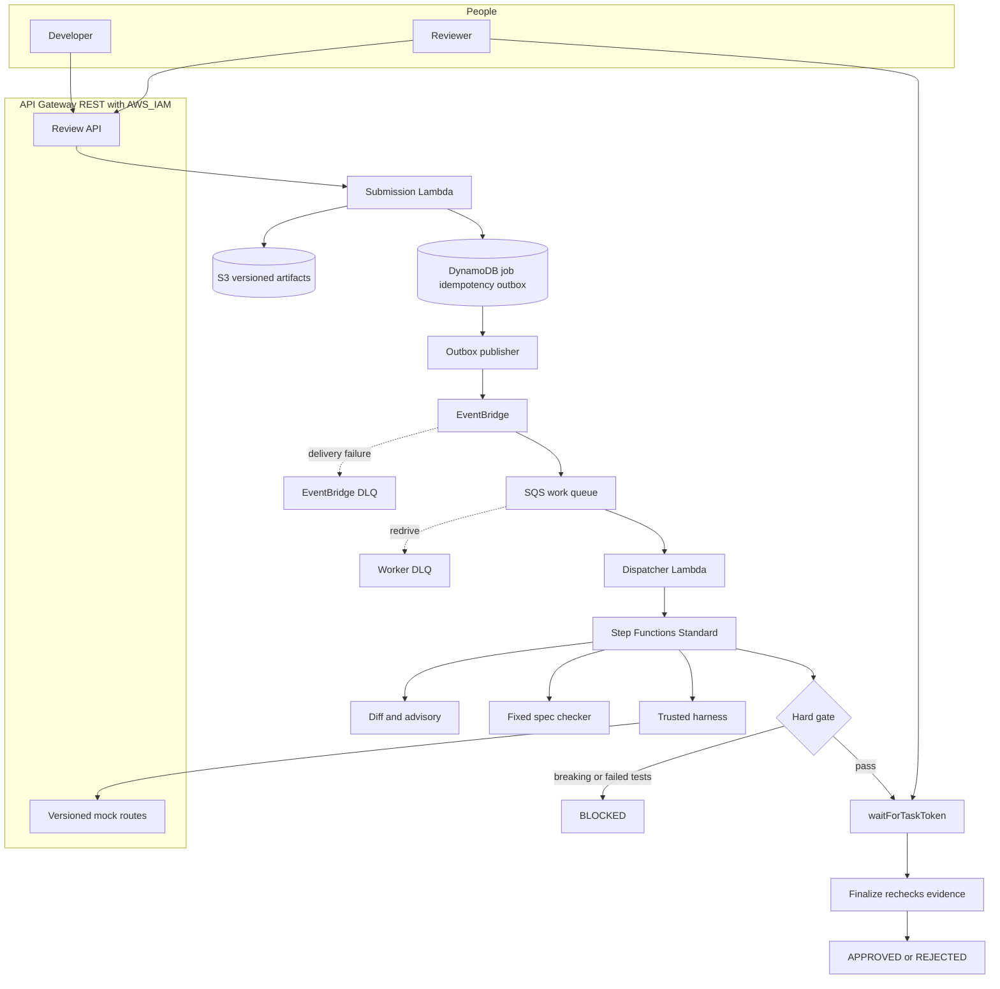

# Before You Merge: Catch Breaking API Changes with Amazon Bedrock, AgentCore, Amazon Q Developer, and a Serverless AWS Release Gate

This is the working tutorial and reference for a release gate that compares two OpenAPI documents, runs a fixed old-client check, and lets a different person approve only the sealed passing evidence.

Two copies of the words below are intentional. This file is the full guide. `publishing/MEDIUM_DRAFT.md` is an unpublished short draft for a later post. Neither file was published, and no Google Doc was created from this session.

An official-icon architecture diagram is being drawn separately. It is not in this repository. The diagram in this guide is Mermaid source. It is not a screenshot of a running account.

## What was actually run

On this machine, on 7 November 2026:

- `pytest` collected 29 tests. 29 passed. 0 failed.
- `python -m apireview.cli demo` ran the healthy, broken, and corrected orders journeys in memory.
- A local HTTP submit to `127.0.0.1:47831` returned `BLOCKED` for the broken orders candidate.
- `bash scripts/package_lambda.sh` wrote `build/lambda.zip` with 37 entries, including the handlers and the mock catalog.
- `python3 scripts/assemble_template.py` wrote `cloud/template.deploy.json`.
- `bash scripts/deploy_cloudshell.sh`, `bash scripts/enable_agentcore.sh`, and `bash scripts/cleanup_cloudshell.sh` were started without the confirmation variables. Each exited 2 before any AWS call.

No stack was deployed. Amazon Bedrock was not called. AgentCore was not called. No signed request was sent to API Gateway. Amazon Q Developer was not opened. There are no console screenshots in this delivery.

## The developer path

1. A developer submits the old OpenAPI document, the candidate OpenAPI document, and a declarative fixture. The fixture is data. It is not client code.
2. The gate returns a job id.
3. A deterministic diff and a fixed harness run against a versioned mock chosen from an allowlist: `orders-v1`, `orders-v2-broken`, or `orders-v2-corrected`.
4. The broken candidate changes `amount` from a JSON number to a string and removes required `next_cursor`. The diff reports both breaks. The harness fails both assertions. The job is `BLOCKED`.
5. The corrected candidate restores the number and `next_cursor`, and adds optional `currency`. The diff treats that addition as compatible. The harness passes. The job waits for review.
6. A different reviewer, authenticated as a reviewer rather than named in the body, can approve only that sealed evidence. A second approve is rejected. A blocked job cannot be approved.

Approval records a review decision. It does not merge and it does not deploy.

## Trust boundaries

| Boundary | What it may do | What it must not do |
| --- | --- | --- |
| Developer API | Submit specs and a fixture, then read that caller's job | Name the reviewer or carry a task token |
| Reviewer API | Approve or reject the current sealed hash, nonce, and job | Approve failing, missing, stale, expired, or replayed evidence |
| Deterministic diff and harness | Set the verdict | Accept uploaded code or a caller URL |
| Bedrock Converse | Explain findings and propose declarative edits when explicitly enabled | Set the verdict or authenticate the caller |
| AgentCore gateway policy | Permit `read_artifacts`, `request_spec_check`, and `read_test_results` | Expose approve, merge, or deploy |
| Code Interpreter | Run the fixed checker text | Act as an air gap, or replace the harness |
| Trusted harness Lambda | Call only the configured mock host, stage, and allowlisted path | Follow redirects or accept a caller-supplied URL |
| Step Functions | Order the steps and hold the callback | Treat task success as business approval |
| Amazon Q Developer | Help a person in the IDE | Appear as a runtime dependency |

The local process prints this banner on every demo: identity is a simulation, not AWS IAM. The cloud handlers read `requestContext.identity.userArn` and ignore any reviewer field in the body.

## Architecture



EventBridge does not start the state machine. Only the dispatcher does, and only after a conditional claim stored with the canonical execution input. A repeated event can start at most one execution name for that job.

## Building blocks

These are the pieces in the core template, `cloud/template.deploy.json`.

- **API Gateway REST, AWS_IAM.** `POST /jobs`, `GET /jobs/{jobId}`, `GET /jobs/{jobId}/report` for the developer role. `GET /jobs/{jobId}/review-context` and `POST /reviews` for the reviewer role. A second REST API serves `GET /orders-v1/orders`, `GET /orders-v2-broken/orders`, and `GET /orders-v2-corrected/orders` with mock integrations. There is no unauthenticated method.
- **Lambda.** Submit, status, review, publisher, dispatcher, and one function per workflow step. Handlers are `src/apireview/handlers/lambda_handlers.py`. They are complete. The local tests inject fake clients.
- **Step Functions Standard.** `cloud/statemachine.asl.json`. `WaitForReview` uses `arn:aws:states:::lambda:invoke.waitForTaskToken`, a 3600 second timeout, and a catch for `States.Timeout`. `SendTaskSuccess` carries the decision. `Finalize` writes `APPROVED` only after the evidence still matches. `MarkBlocked` is a Succeed state because recording a block is a completed workflow, not an approval.
- **DynamoDB.** One table, pk `JOB#`, `IDEM#`, and `OUTBOX#`. A stream on `NEW_IMAGE` feeds the publisher.
- **S3.** Versioning enabled, public access blocked, artifacts stored at `artifacts/{sha256}.json`.
- **EventBridge and SQS.** The rule target is the work queue. Its dead-letter queue is separate from the worker redrive queue. The work queue visibility timeout is 182 seconds, which is `6 * 30 + 2`: dispatcher timeout 30 seconds and batch window 2 seconds. Both mappings use `ReportBatchItemFailures`.
- **Bedrock.** The analyze function builds a Converse request for `us.amazon.nova-2-lite-v1:0` and does not set `reasoningConfig`, so `maxTokens` stays valid. `BEDROCK_ADVISORY` is `disabled` in the template. The permission is present and was not used.
- **AgentCore.** Not in the core stack. `scripts/enable_agentcore.sh` and `cloud/agentcore/` describe a SANDBOX code interpreter, an MCP gateway with `authorizerType` `AWS_IAM`, a policy engine in `ENFORCE`, and three Cedar `permit` statements. Cedar is the `definition.cedar` union member. The Dogwood `policy` member is a different feature and is not the gate. Gateway policy is not the job binding: the tool still checks the authenticated job id.
- **Code Interpreter.** The fixed checker runs in-process unless `SPEC_CHECK_MODE=agentcore`. SANDBOX mode can reach AWS services, including S3. That is not an air gap. `stop_code_interpreter_session` is in a `finally` block. Session timeout is the session lifetime, not the Lambda timeout. This code does not claim that stop deletes retained session data.
- **CloudWatch and X-Ray.** Each function uses `TracingConfig` Active and the OpenTelemetry wrapper `/opt/otel-instrument`, with `OTEL_AWS_APPLICATION_SIGNALS_ENABLED=false` and `OTEL_PROPAGATORS=xray,tracecontext`. The source does not import `aws-xray-sdk`. You must pass the current regional layer ARN. This repository does not embed one, because those ARNs contain an AWS account id and change.
- **Amazon Q Developer.** No SDK and no runtime call. Prompts for a person in the IDE are at the end of this guide. AWS documents that Q code reviews can filter out test files, so a Q review is not evidence that the harness passed.

## OpenAPI subset and compatibility direction

Supported documents are OpenAPI 3.0.x with local `#/components/schemas` refs only. External refs, `allOf`, servers, callbacks, and URL-shaped fixture strings are rejected. JSON booleans are not numbers, even though Python's `bool` is a subclass of `int`. Money values stay `Decimal`. `19.95` is not passed through binary floating point.

Removing a required response property breaks old clients. Adding a required request property, or making an optional request property required, breaks callers. Adding an optional response property does not. Adding a required response property is also compatible for old clients: they can ignore it, and the server is now promising to send it. Those two directions are different rules in `src/apireview/diff.py`.

## Prerequisites before any later deployment

- Python 3.11+ for the local demo.
- `pytest` if you want the test suite (`pip install pytest`).
- For CloudShell later: AWS CLI v2, permission to create the stack, and the current OpenTelemetry Lambda layer ARN for the region and architecture you choose. Confirm AgentCore, Bedrock Nova 2 Lite, and Step Functions are available in that region in the current AWS documentation before you start. This guide does not guess a region list.
- Caller identities for the API. `scripts/setup_demo_identities.sh` creates IAM user `api-review-operator` and roles `ApiReviewDeveloper` and `ApiReviewReviewer`. The account root user is not an accepted caller. Do not put the reviewer permission on the developer role.

## Local demo

From the repository root:

```bash
bash scripts/run_local_tests.sh
bash scripts/run_local_demo.sh
```

The test run in this session:

```text
29 passed in 0.74s
```

Every test name is in the test log that accompanies this guide. The demo run in this session printed:

```text
apireview 1.0.0 local demo
SIMULATION: this process is not production authentication and is not AWS IAM. Identity is taken from an explicit local principal, never from a reviewer field in the request body.

== healthy ==
status: WAITING_REVIEW
verdict: PASS
harnessPassed: True
breakingFindingCount: 0
evidenceHash: ef688fb04195cf83bfcfe9f407061446de6ba7e88afc5aa7cadcd4d5bd530e5f
checker.authoritative: False
checker.ok: True
checker.mode: in-process
advisory.includedInVerdict: False
review: APPROVED

== broken ==
status: BLOCKED
verdict: BLOCKED
harnessPassed: False
breakingFindingCount: 2
evidenceHash: 213def57527dc8193065fe53887aab9734b1d40413700437b327effbeeacf050
breaking response.property.removed.required: Removed response property next_cursor. It was required, so old clients that read it will break.
breaking response.type.changed: Response type changed from number to string. Old clients that decode the previous JSON type will break.
assertion failed amount: amount is str '19.95'; old clients require a JSON number and booleans are rejected
assertion failed next_cursor: next_cursor is missing; old clients require the field
checker.authoritative: False
checker.ok: False
checker.mode: in-process
advisory.includedInVerdict: False
review rejected: fail_closed: job is not waiting for review (BLOCKED)

== corrected ==
status: WAITING_REVIEW
verdict: PASS
harnessPassed: True
breakingFindingCount: 0
evidenceHash: 6acb39ab0028458cdd3053d44378be15303f55747b0579dbd8425c7628210729
checker.authoritative: False
checker.ok: True
checker.mode: in-process
advisory.includedInVerdict: False
review: APPROVED

executions started: 3
```

Job ids and evidence hashes include a random job id, so a later run will not repeat those hashes. The breaking rules and the assertion text are stable.

### CLI

```bash
export PYTHONPATH=src
python3 -m apireview.cli --state .apireview/state.json submit \
  --principal ada --role developer \
  --old fixtures/orders-v1.openapi.json \
  --new fixtures/orders-v2-broken.openapi.json \
  --fixture fixtures/orders-client.fixture.json \
  --mock-version orders-v2-broken \
  --idempotency-key cli-broken-0001
```

Observed submit (exit code 1 because the job is blocked):

```text
{
  "authoritativeVerdict": "BLOCKED",
  "breakingFindingCount": 2,
  "evidenceHash": "8ca0ada0f9d74a5457dfe82e8644b44b179e739e396bd53ec81d372481edb596",
  "executionArn": "local-execution:review-job_db1022bc8e281424324d",
  "harnessPassed": false,
  "jobId": "job_db1022bc8e281424324d",
  "mockVersion": "orders-v2-broken",
  "owner": "local:ada",
  "status": "BLOCKED"
}
```

The same command then rejects approval:

```bash
python3 -m apireview.cli --state .apireview/state.json review \
  --principal ben --role reviewer \
  --job-id job_db1022bc8e281424324d \
  --evidence-hash 8ca0ada0f9d74a5457dfe82e8644b44b179e739e396bd53ec81d372481edb596 \
  --nonce 00000000000000000000000000000000 \
  --decision approve
```

```text
fail_closed: job is not waiting for review (BLOCKED)
```

Exit code 1. `.apireview/state.json` is local simulation state. It holds the server-side task token for jobs that are waiting. It is gitignored. It is not an AWS credential.

`status` and `report` use the same `--state` directory. A reviewer reading a `WAITING_REVIEW` job receives `reviewNonce`. The submitter does not.

### Local HTTP

```bash
export PYTHONPATH=src
python3 -m apireview.cli serve --host 127.0.0.1 --port 47831
```

The server refuses an `Authorization` header. It requires `X-Local-Auth: simulation` plus `X-Local-Principal` and `X-Local-Roles`.

Observed health body:

```json
{
  "banner": "SIMULATION: this process is not production authentication and is not AWS IAM. Identity is taken from an explicit local principal, never from a reviewer field in the request body.",
  "mode": "local-simulation",
  "status": "ok"
}
```

Observed `POST /jobs` for the broken candidate, with `Idempotency-Key: curl-demo-000001`, returned HTTP 201 and `"status": "BLOCKED"`. The response did not contain a task token.

## Repository map

| Path | Role |
| --- | --- |
| `src/apireview/diff.py` | Response and request compatibility rules |
| `src/apireview/harness.py` | Fixed assertions and mock URL allowlist |
| `src/apireview/service.py` | Local outbox, dispatcher, workflow, review |
| `src/apireview/handlers/lambda_handlers.py` | Cloud handlers |
| `src/apireview/signed_mock.py` | SigV4 GET with redirects disabled. Not executed here |
| `cloud/statemachine.asl.json` | State machine |
| `cloud/template.deploy.json` | Generated CloudFormation |
| `cloud/agentcore/` | Cedar and create-request JSON. Not created in AWS |
| `scripts/deploy_cloudshell.sh` | Deploy. Refuses unless `CONFIRM_DEPLOY=yes` |
| `scripts/setup_demo_identities.sh` | Operator user and the two caller roles. Refuses unless `CONFIRM_IDENTITIES=yes` |
| `scripts/teardown_demo_identities.sh` | Removes those identities and CLI profiles |
| `scripts/aws_demo.py` | SigV4 workflow against a stack. Accepts `--profile`. Not executed here |
| `fixtures/` | The three orders documents, the client fixture, and mock bodies |

## CloudShell deployment

Do this only after you have decided to create the resources. The commands below are the scripts in this repository. They are not placeholders.

1. Open CloudShell in the region you verified.
2. Upload this repository or clone it from the private location you choose. This session did not publish a repository.
3. Look up the current AWS Lambda Layer for OpenTelemetry ARN for Python 3.12 on your architecture. Copy it from the AWS documentation page for that layer. Do not reuse an ARN from memory.
4. Package and deploy:

```bash
CONFIRM_DEPLOY=yes \
  REGION=us-east-1 \
  OTEL_LAYER_ARN='paste-the-layer-arn' \
  bash scripts/deploy_cloudshell.sh
```

Change `REGION` if you are not using `us-east-1`. The script runs `scripts/package_lambda.sh`, regenerates the template, creates a code bucket named `api-review-code-<account>-<region>` if it is missing, uploads `build/lambda.zip`, and runs `aws cloudformation deploy` with `CAPABILITY_IAM`.

Without `CONFIRM_DEPLOY=yes` the script prints the refusal below and exits 2. That is the output from this session:

```text
Refusing to deploy. This script creates AWS resources in the caller's account.
After you authorize a deployment, run:
  CONFIRM_DEPLOY=yes REGION=us-east-1 OTEL_LAYER_ARN='<layer arn>' bash scripts/deploy_cloudshell.sh
```

5. Read the stack outputs: `ReviewApiEndpoint`, `MockApiEndpoint`, `StateMachineArn`, `JobTableName`, `ArtifactBucketName`.
6. Create the caller identities. CloudShell runs as the account root user, and `POST /jobs` rejects that ARN. `scripts/setup_demo_identities.sh` reads `ReviewApiEndpoint` and creates IAM user `api-review-operator` (no console password) plus roles `ApiReviewDeveloper` and `ApiReviewReviewer`. The user may only call `sts:AssumeRole` on those two roles. The developer role may invoke `POST /jobs` and `GET /jobs/*` (which covers `GET /jobs/*/report`) and is denied `GET /jobs/*/review-context` and `POST /reviews`. The reviewer role may invoke only those two reviewer routes. The script writes CLI profiles `api-review-operator`, `api-review-developer` (session name `dev-ada`), and `api-review-reviewer` (session name `rev-ben`). It does not print the secret key. Rerunning it updates the role trust and inline policies in place. The harness role needs nothing extra; the template already allows the three mock GET routes.

```bash
CONFIRM_IDENTITIES=yes REGION="$REGION" bash scripts/setup_demo_identities.sh
```

Without `CONFIRM_IDENTITIES=yes` the script exits 2.
7. Call the API with the developer profile. `--profile` is passed to the stack lookup and to the signed call. These roles are not granted CloudFormation access. When the profile cannot read the stack, the lookup uses the ambient credentials and the profile still signs the request.

```bash
python3 scripts/aws_demo.py --region "$REGION" --profile api-review-developer submit \
  --old fixtures/orders-v1.openapi.json \
  --new fixtures/orders-v2-broken.openapi.json \
  --fixture fixtures/orders-client.fixture.json \
  --mock-version orders-v2-broken \
  --idempotency-key cloud-broken-0001
python3 scripts/aws_demo.py --region "$REGION" --profile api-review-developer status --job-id "$JOB_ID"
python3 scripts/aws_demo.py --region "$REGION" --profile api-review-developer report --job-id "$JOB_ID"
```

8. Repeat submit with `orders-v2-corrected.openapi.json`, mock version `orders-v2-corrected`, and a new idempotency key. Use the reviewer profile:

```bash
python3 scripts/aws_demo.py --region "$REGION" --profile api-review-reviewer review-context --job-id "$JOB_ID"
python3 scripts/aws_demo.py --region "$REGION" --profile api-review-reviewer review \
  --job-id "$JOB_ID" \
  --evidence-hash "$EVIDENCE_HASH" \
  --nonce "$NONCE" \
  --decision approve \
  --comment "sealed evidence matches"
```

9. Run the same review command again. The second call must not produce a second approval. A blocked job must return a conflict and stay `BLOCKED`.

`scripts/aws_demo.py` was not run in this session. There is no captured cloud response to paste. When you run it, keep the output. Do not invent a stand-in.

### Optional AgentCore

The core path does not need it. If you want the SANDBOX interpreter and the gateway policy:

```bash
CONFIRM_AGENTCORE=yes \
  REGION="$REGION" \
  EXECUTION_ROLE_ARN='role-you-created' \
  GATEWAY_ROLE_ARN='role-you-created' \
  bash scripts/enable_agentcore.sh
```

The script creates a code interpreter with `networkMode` `SANDBOX`, a policy engine, a gateway with `mode` `ENFORCE`, and three Cedar permits. It does not create an approve tool. Without `CONFIRM_AGENTCORE=yes` it exits 2. That refusal was observed in this session.

After it exists, set the spec-check function environment `SPEC_CHECK_MODE` to `agentcore` and `CODE_INTERPRETER_ID` to the new id, then submit again. Until you do that, the template value remains `in-process`.

To turn on explanations from Nova 2 Lite, set `BEDROCK_ADVISORY` to `enabled` on the analyze function. Until you do that, the deterministic explainer is the only advisory and it is still not the gate.

## What the local engine and the template each own

| Behavior | Local reference | Template |
| --- | --- | --- |
| Diff, harness, seal, review rules | Executed by tests | Same Python, not executed in AWS |
| Outbox, two DLQs, one dispatcher | Simulated and tested | Resources present, not deployed |
| Idempotent Standard execution name | `LocalExecutions` matches the documented running-execution rule | `start_or_reconcile` in code, not called |
| Human callback | In-process token | `waitForTaskToken`, not started |
| Bedrock | Fake client only | Permission present, env disabled |
| AgentCore | Local allowlist, not Cedar evaluation | Optional script, not run |
| SigV4 mock call | Redirect handler unit-tested to return no redirect | Env `signed-mock`, not called |
| Identity | Simulation header | `requestContext.identity.userArn` parser tested with `example` account ARNs |

`example` in an ARN is accepted only when `simulation_identity` is true. The template sets `LOCAL_IDENTITY_SIMULATION` to `false`.

## Screenshot checklist

Take these during the deployment you run. This repository has none of them.

Capture PNG at the real window size. A 1440 or 1920 wide window is enough. Do not upscale. Do not letterbox. Do not cover fields with solid black rectangles or strips. Blur the sensitive pixels so the console around them stays recognizable.

Blur: account ids, the account segment of every ARN, email addresses, access keys, session tokens, IP addresses, and bucket names that contain the account id. Task tokens, if one is ever visible, are blurred too. The handlers are written not to put the task token in API responses or logs.

| # | Screen | What "done" looks like |
| --- | --- | --- |
| 1 | CloudShell after `deploy_cloudshell.sh` | Outputs table with the review and mock endpoints. Blur account segments. |
| 2 | CloudFormation stack | `CREATE_COMPLETE`. Resource list includes both queues, the state machine, both REST APIs. |
| 3 | Review API `POST /jobs` | Authorization `AWS_IAM`. Integration is Lambda proxy. Stage `live` has tracing enabled. |
| 4 | Mock `GET /orders-v2-broken/orders` | Mock integration. Response template shows `"amount":"19.95"` and does not contain `next_cursor`. |
| 5 | Mock `GET /orders-v2-corrected/orders` | Response template has numeric `19.95`, `next_cursor`, and `currency`. |
| 6 | DynamoDB item for the blocked job | `status` `BLOCKED`, two breaking findings, harness `passed` false. |
| 7 | DynamoDB item for the approved job | `status` `APPROVED` only after finalize. A review response of 202 is still `REVIEW_CALLBACK_PENDING`. |
| 8 | S3 artifact versions | Versioning enabled. Keys are `artifacts/<hash>.json`. |
| 9 | Both SQS queues | Work queue redrive `maxReceiveCount` 5 and visibility 182. EventBridge DLQ is a different queue. |
| 10 | EventBridge rule | Target is the work queue, not the state machine. Dead-letter config points at the EventBridge DLQ. |
| 11 | Step Functions graph, blocked execution | Ends at `MarkBlocked`. It does not show `SucceedApproved`. |
| 12 | Step Functions graph, approved execution | `WaitForReview` then `Finalize` then `SucceedApproved`. |
| 13 | Harness Lambda configuration | `HARNESS_TRANSPORT=signed-mock`, tracing Active, `AWS_LAMBDA_EXEC_WRAPPER=/opt/otel-instrument`. |
| 14 | Analyze Lambda configuration | `BEDROCK_ADVISORY=disabled` unless you deliberately enabled it. |
| 15 | Harness IAM policy | `execute-api:Invoke` on exactly the three mock GET resources. |
| 16 | CloudWatch log for one job id | A submit or workflow line with that job id. No task token. |
| 17 | Trace map for `POST /jobs` | One trace from API Gateway through Lambda. This confirms the OTel path only after you see it. |
| 18 | Optional AgentCore | Interpreter network mode `SANDBOX`. Gateway policy mode `ENFORCE`. Three permits and no approve action. |
| 19 | Amazon Q Developer | The IDE showing one prompt from the next section and the answer you actually received. |

If a screen does not match, keep the screenshot and write what failed. Do not replace it with a mock.

## Amazon Q Developer prompts

Use these in the IDE. They are for a person. This project does not call Q, and this session did not.

1. Response versus request direction. "In `src/apireview/diff.py`, check that removing a required response property is breaking and that adding a required response property is not. Check the opposite for request bodies: adding a required request property is breaking. Point at the tests that lock this."
2. Stale approval. "In `review` and `finalize`, can a caller approve with an old evidence hash after findings or harness bytes change? What happens if `SendTaskSuccess` succeeds and the process stops before `APPROVED` is written? Is a second callback treated as success?"
3. Least privilege. "In `scripts/assemble_template.py`, which role can call `states:SendTaskSuccess`? Which role can `s3:PutObject`? Does the harness role allow any execute-api route besides the three mock GETs? Is there an approve tool in `cloud/agentcore`?"

Q's documented code-review scan can skip test files. Use the chat prompts above when you want to talk about tests. Do not treat a Q review as a passing harness.

## Troubleshooting

| What you see | What it means |
| --- | --- |
| `fail_closed: job is not waiting for review (BLOCKED)` | The harness or the diff failed. Fix the candidate. Do not expect approval to override it. |
| `evidence hash does not match` | The hash you sent is not the sealed bundle. Read the job again. |
| `review nonce does not match` | The nonce is for a different job, or it was already consumed. |
| `review window expired` | The wait timed out. Submit a new job. The old execution name cannot be reused for a new input while the name is still reserved. |
| `idempotency key was already used with a different payload` | Same key, different specs or fixture. Use a new key. |
| Submit stays `RECEIVED` | The outbox event was not delivered or the dispatcher has not run. In AWS, check the EventBridge DLQ and the worker DLQ separately. In the local engine, `replay_delivery_dlq` moves delivery failures back to the work queue. |
| `PutEvents FailedEntryCount` | The event was not accepted by the bus. The outbox row stays `PENDING`. This is not the rule DLQ. |
| Second review returns `already-consumed` and the job is still `REVIEW_CALLBACK_PENDING` | The callback was sent and finalize has not written the terminal status. Inspect the execution. Do not mark the job approved by hand. |
| Harness Lambda fails closed with `signed mock transport is not attached` | The process is not the Lambda runtime. Local tests pass an in-process transport on purpose. |
| `enable_agentcore.sh` cannot find `policyEngineArn` | Print the create-policy-engine JSON and use the ARN field the service returned. The script was not executed against AWS here. |
| API Gateway returns 403 | The caller is missing `execute-api:Invoke` for that method and path, or the signature does not match the region. A root user ARN is rejected. Call with `--profile api-review-developer` or `--profile api-review-reviewer`. |
| Layer wrapper error on cold start | `OTEL_LAYER_ARN` does not match the runtime or architecture. Look up the layer again. |
| Template deploy fails on the state machine definition | The ASL is passed through `Fn::Sub`. `scripts/assemble_template.py` doubles `$` so `$$.Task.Token` survives. Regenerate with that script rather than pasting the ASL by hand. |

## Optional cleanup

Only when you intend to remove the stack:

```bash
CONFIRM_CLEANUP=yes REGION=us-east-1 bash scripts/cleanup_cloudshell.sh
```

The script empties the artifact bucket and the code bucket, deletes the stack, and removes the code bucket. It then runs `scripts/teardown_demo_identities.sh`, which deletes the operator user, both caller roles, and the three CLI profiles. Set `CLEANUP_IDENTITIES=no` to leave those identities in place. Without `CONFIRM_CLEANUP=yes` it exits 2. That refusal was observed in this session. It does not delete the AgentCore gateway or code interpreter if you created them with the optional script. Delete those with the matching `bedrock-agentcore-control` delete operations if you created them.

## Gaps

- CloudFormation was not deployed and was not linted by a CloudFormation linter.
- No live SigV4 call, Bedrock `Converse` call, or AgentCore call was made. Adapters were tested with fakes.
- The Cedar statements were not submitted to policy validation.
- The OpenAPI checker is a documented subset, not a full compatibility product.
- The local HTTP identity is a simulation. Production handlers reject `example` account ARNs.
- Amazon Q Developer was not used.
- Screenshots do not exist yet. The checklist above is the capture list, not evidence.
- The official-icon diagram is outside this repository.
